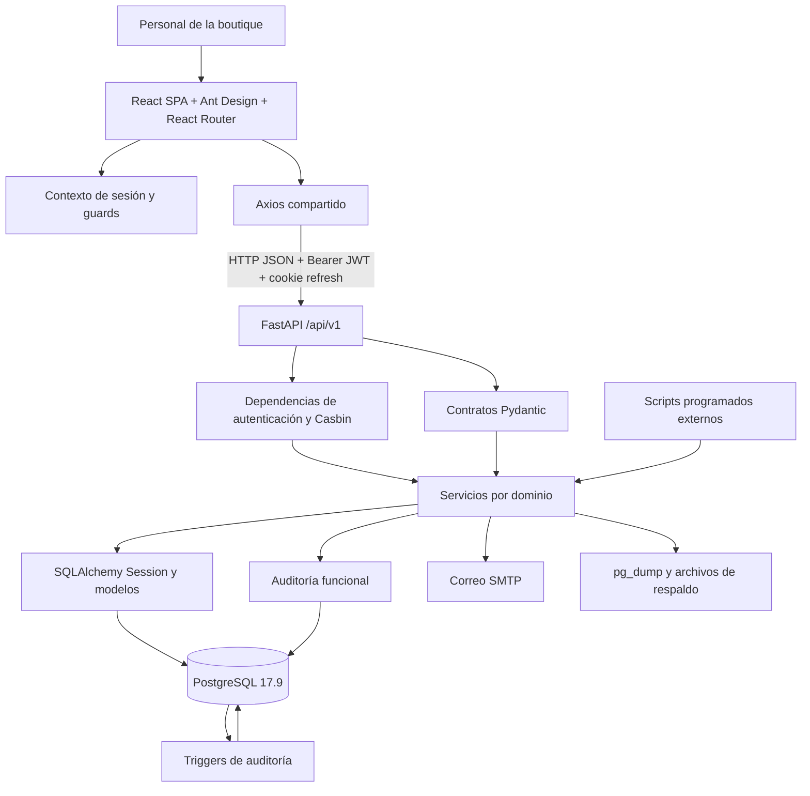
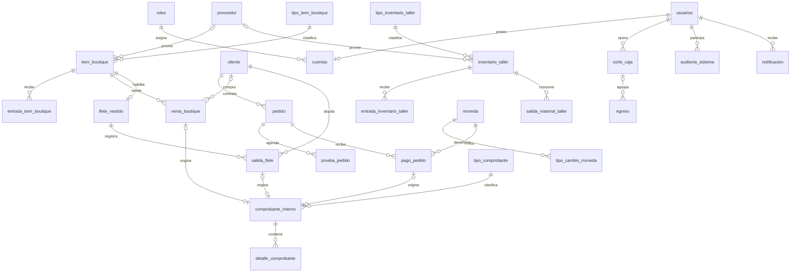

# Estado actual del sistema BellaArte Boutique

**Fecha de evaluación:** 17 de octubre de 2026.  
**Proyecto analizado:** `C:\laragon\www\bellaarte-program`.  
**Alcance:** documentación, código fuente, dependencias, modelos, migraciones, rutas, permisos, pruebas, estructura real de PostgreSQL y consultas de lectura a servicios.  
**Entregable:** diagnóstico técnico y funcional respecto de los 15 módulos solicitados. No se modificó el código ni se ejecutaron migraciones, seeds, operaciones comerciales, generación de nuevos backups o restauraciones.

## 1. Diagnóstico ejecutivo

BellaArte es un **ERP especializado para boutique y confección, con una implementación operativa amplia y pendiente de consolidación funcional y técnica**. Cuenta con frontend y backend separados, persistencia relacional, módulos comerciales integrados, control por roles, auditoría y respaldos reales.

El sistema supera una etapa de maqueta: la base local tiene operaciones registradas, las consultas evaluadas funcionan y el frontend compila. Sin embargo, **no corresponde declararlo terminado ni certificarlo para producción**: existen brechas respecto del alcance solicitado, una prueba automatizada fallida, defectos en flujos económicos y riesgos de concurrencia y seguridad identificados en el código.

### 1.1 Cifras verificadas

| Elemento | Resultado | Cómo se comprobó |
|---|---:|---|
| Áreas funcionales solicitadas | 15 | Lista proporcionada por el usuario |
| Áreas con implementación de alcance base | 11 | Código, servicios, rutas y pantallas |
| Áreas con implementación parcial respecto del alcance solicitado | 3 | Usuarios/permisos, historial integral de clientes y agenda general |
| Área ausente como módulo específico | 1 | Personal y remuneraciones; existe personal básico en Seguridad, pero no nómina |
| Grupos de rutas API registrados | 14 | `backend/app/api/router.py` |
| Operaciones HTTP bajo `/api/v1` | 172 | Conteo de métodos y rutas en routers |
| Operaciones HTTP de aplicación, incluyendo `/health` | 173 | Introspección de FastAPI; excluye endpoints automáticos de documentación |
| Rutas distintas en OpenAPI | 140 | Incluye `/health`; una ruta puede admitir varios métodos |
| Tablas propias de la aplicación | 38 | Metadatos ORM y PostgreSQL coinciden |
| Tablas físicas en esquema `public` | 39 | Las 38 anteriores más `alembic_version` |
| Columnas de aplicación | 469 | PostgreSQL y ORM; excluye la tabla técnica de Alembic |
| Claves foráneas | 57 | PostgreSQL y ORM |
| Restricciones `CHECK` de PostgreSQL | 94 | Consulta a `pg_constraint` |
| Restricciones `UNIQUE` de PostgreSQL | 28 | No incluye todas las unicidades implementadas mediante índices |
| Índices en `public` | 181 | Incluye índices de claves primarias y unicidades |
| Tipos enumerados PostgreSQL | 27 | Catálogo de tipos de la base |
| Migraciones Alembic | 13 | Cadena de revisiones del repositorio |
| Revisión aplicada | `20260620_0013` | Lectura de `alembic_version`; coincide con la última migración |
| Servicios de backend | 27 archivos | `backend/app/services/`, sin `__init__.py` |
| Archivos de esquemas Pydantic | 16 | `backend/app/schemas/`, sin `__init__.py` |
| Archivos de prueba de backend | 8 | `backend/tests/test_*.py` |
| Pruebas de backend ejecutadas | 72 | **71 aprobadas y 1 fallida** |
| Pruebas de frontend ejecutadas | 3 | **3 aprobadas**, en un archivo |
| Consultas funcionales de lectura evaluadas | 36 | **36 correctas**, contra la base local |
| Archivos de código/recursos bajo `frontend/src` | 90 | Inventario de archivos |
| Archivos JSX bajo `src/pages` | 48 | Incluyen formularios y componentes; no equivalen a 48 módulos |
| Declaraciones de rutas frontend con `path` | 45 | Incluyen ruta contenedora, redirección y comodín; existe además una ruta `index` |
| Backups existentes comprobados | 3 | Estado exitoso, archivo existente, tamaño y SHA-256 coincidentes |

Los 14 routers técnicos y las 15 áreas del ERP son formas distintas de agrupar el sistema. Por ejemplo, Pedidos, Pagos y Agenda comparten un router; Auditoría y Backups son dos routers para una sola área solicitada. Los números no deben interpretarse como un porcentaje de avance.

### 1.2 Estado general por dimensión

| Dimensión | Evaluación |
|---|---|
| Cobertura funcional | Amplia; faltan remuneraciones, agenda general e historial integral del cliente |
| Arquitectura | Separación clara entre SPA y API; backend modular organizado en capas |
| Base de datos | Migraciones al día en la base local, modelo relacional consistente en estructura revisada |
| Integración | Ventas, pagos, fletes, comprobantes, economía, notificaciones y auditoría están conectados |
| Calidad automatizada | Base de pruebas útil, centrada en contratos y helpers; falta cobertura integral de procesos |
| Frontend | Lint, pruebas y compilación correctos; carga inicial elevada |
| Seguridad | Controles existentes, con brechas concretas antes de un despliegue productivo |
| Operación | Backups reales verificables; automatizaciones externas y recuperación no certificadas |

## 2. Método y límites de la evaluación

Se contrastaron los tres README y los 27 documentos de `documentacion/` con las capas activas de `backend/app`, las 13 migraciones, los scripts operativos, el frontend, sus rutas y los manifiestos de dependencias.

También se importaron los modelos y se configuraron sus relaciones ORM; se generó OpenAPI; se consultó PostgreSQL en transacciones de **solo lectura**; se verificaron tablas, columnas, nulabilidad, enumeraciones, claves foráneas, índices, triggers y revisión aplicada; y se probaron consultas de servicios sobre datos existentes.

Para preservar el proyecto, las pruebas Python se ejecutaron sin caché de pytest ni escritura de bytecode, con temporales fuera del repositorio. La compilación frontend utilizó una carpeta temporal y no reemplazó `frontend/dist`. No se instalaron ni actualizaron dependencias.

Las verificaciones funcionales de lectura **no equivalen a pruebas HTTP completas con cada rol**, ni a pruebas de navegador o de escritura. No se crearon ventas, pagos, devoluciones, usuarios ni movimientos de inventario durante esta evaluación. Tampoco se probaron envíos SMTP, recuperación de respaldos, carga concurrente, infraestructura de producción o tareas programadas del sistema operativo.

En este informe:

- **Verificado en ejecución:** resultado observado en comandos, pruebas o consultas de lectura.
- **Implementado en código:** existen las piezas y reglas, pero no se ejecutó un flujo de escritura completo.
- **Hallazgo por inspección:** condición deducida directamente del código y sus restricciones; se indica cuando no hubo reproducción concurrente o funcional.
- **Pendiente de verificación:** depende de operación o infraestructura que no se evaluó.

## 3. Evaluación de los 15 módulos esperados

**Implementado base** significa que existe una solución operativa para la función principal. No significa ausencia de defectos ni cumplimiento de todos los escenarios posibles.

| N.º | Módulo esperado | Estado | Implementación y brecha principal |
|---:|---|---|---|
| 1 | Gestión de usuarios y roles | **Parcial** | Usuarios, cuentas, roles, autenticación y autorización presentes. La asignación de permisos está fijada en código; no existe administración dinámica de permisos para roles creados desde UI. |
| 2 | Gestión de clientes | **Parcial** | CRUD, datos de contacto, ubicación y reportes presentes. El historial existe repartido en módulos; falta una ficha única que integre compras, pedidos, pagos, fletes y comprobantes. |
| 3 | Gestión de ventas | **Implementado base** | Ventas de productos, cantidades, descuentos, métodos de pago, monedas, stock, comprobante y reversión económica. Cada venta referencia un solo producto. |
| 4 | Gestión de pedidos | **Implementado base** | Contratos de confección, detalles especializados, medidas, fechas, seguimiento, pruebas, pagos, cancelación y entrega. |
| 5 | Gestión de pagos | **Implementado base** | Pagos parciales/finales, conversión monetaria, historial, comprobantes y recálculo de saldo. Las devoluciones presentan las limitaciones descritas en hallazgos. |
| 6 | Inventario Boutique | **Implementado base** | Tipos, proveedores, productos, detalles, entradas, stock, ventas y habilitación a flete. No hay una salida genérica o ajuste especializado independiente. |
| 7 | Inventario Taller | **Implementado base** | Materiales, tipos, unidades, entradas, salidas y reversión. El consumo no se vincula por FK a pedidos ni calcula costos de producción por orden. |
| 8 | Gestión de fletes | **Implementado base** | Habilitación, reservas, entrega, garantía, devolución, revisión, contador, pase a venta y retiro. Requiere resolver el consumo de cupo por salidas anuladas. |
| 9 | Agenda operativa | **Parcial** | Agenda diaria/semanal/mensual de pruebas de pedidos con reprogramación. No hay agenda general de citas, entregas y otras actividades con control de disponibilidad. |
| 10 | Gestión financiera | **Implementado base** | Ingresos derivados, egresos, devoluciones, fondos y cortes de caja, reportes y CSV. Es gestión financiera operativa, con defectos pendientes en devoluciones e inmutabilidad histórica. |
| 11 | Gestión de personal y remuneraciones | **Ausente como módulo específico** | Seguridad contiene datos de colaboradores y Economía permite egreso `SUELDO`. No hay nómina, períodos salariales, bonificaciones laborales, comisiones o liquidaciones por trabajador. |
| 12 | Comprobantes internos | **Implementado base** | Emisión desde venta, pago y flete; historial, detalle, snapshot, impresión y anulación por origen. Existen 3 operaciones actuales sin comprobante asociado. |
| 13 | Reportes y BI | **Implementado base** | Reportes operativos, indicadores, series, rankings, gráficos y salidas imprimibles. BI descriptivo sobre la base transaccional; no hay motor predictivo o almacén analítico independiente. |
| 14 | Auditoría y copias de seguridad | **Implementado base** | Auditoría híbrida y backups con historial, hash, descarga y bloqueo temporal. Hay 3 archivos verificados; la recuperación y programación externa no se certificaron. |
| 15 | Notificaciones y alertas | **Implementado base** | Alertas por evento y scripts, campana, destinatarios, lectura, resolución y reintento de correo. Requiere programación externa para chequeos periódicos. |

**Resultado:** 11 áreas implementadas en su alcance base, 3 parciales y 1 ausente como módulo propio. Hay funcionalidades de personal básico, pero no deben contabilizarse como un módulo de remuneraciones terminado.

## 4. Detalle funcional y evidencias por módulo

### 4.1 Usuarios, roles y permisos

**Tablas:** `usuarios`, `cuentas`, `roles`.  
**Backend:** `app/api/routers/auth.py`, `users.py`, `roles.py`; `auth_service.py`, `user_service.py`; `app/core/permissions.py`; `app/security/`.  
**Frontend:** `/login`, `/app/cambiar-clave`, `/app/seguridad/usuarios`, `/app/seguridad/roles`.

Implementa login, renovación y cierre de sesión, contraseña cifrada mediante hash Bcrypt, access token JWT, refresh token en cookie HttpOnly, datos de personal, cuenta asociada, cambios de estado, reseteo de clave y correo de bienvenida.

Los roles base son `ADMIN`, `INV_TALLER`, `INV_BOUTIQUE`, `CAJA` y `MODISTA`. En la base consultada existen seis roles, incluido uno adicional denominado `DOC`. Crear un registro en `roles` no crea sus políticas Casbin: `build_policy_lines()` solo genera reglas para los cinco códigos base.

La interfaz aplica el cambio obligatorio de contraseña, pero las dependencias backend revisadas no impiden usar permisos operativos por tener `must_change_password = true`. Esta diferencia debe resolverse en el servidor.

### 4.2 Clientes

**Tabla:** `cliente`.  
**Backend:** `clients.py`, `client_service.py`, reportes compartidos y reportes de pedidos por cliente.  
**Frontend:** `/app/clientes` y sus reportes.

Incluye código único con autogeneración, identificación, nombres, contactos y referencia, correo, nacimiento, ubicación, observaciones y baja lógica. Los clientes se relacionan con ventas, pedidos, fletes y comprobantes. Hay reportes de pedidos, pagos y saldos por cliente.

La pantalla `ClientsPage.jsx` se concentra en el CRUD. No incorpora una ficha comercial única con todas las operaciones históricas. La información existe en otras áreas, pero su consulta requiere navegación separada.

### 4.3 Ventas

**Tabla principal:** `venta_boutique`.  
**Backend:** router Boutique y `boutique_sale_service.py`.  
**Frontend:** `/app/boutique/ventas`.

El precio se obtiene del inventario; se valida stock, cantidad, descuento y moneda; se congela el tipo de cambio; se descuenta existencia; y se emite comprobante en la transacción. La cancelación o anulación se canaliza por Economía.

El modelo tiene `itb_id` directamente en la venta, sin cabecera y tabla de renglones. Por ello registra un producto por venta, aunque admite varias unidades. No existe pago mixto desglosado: el enum actual admite efectivo, QR, transacción, tarjeta y ticket/vale.

### 4.4 Pedidos

**Tablas:** `pedido`, `pedido_vestido`, `pedido_velo`, `pedido_cola`, `pedido_manga`, `pedido_bouquet`, `pedido_otro`.  
**Backend:** `orders.py`, `order_service.py`.  
**Frontend:** `/app/pedidos`.

Administra pedido/contrato, cliente, responsable, precio, descuento, fechas, viaje y destino, observaciones y estados. Los detalles especializados incluyen medidas y características de confección. Cada pedido debe tener el detalle correspondiente a su tipo.

Los estados generales son `activo`, `inactivo`, `entregado` y `cancelado`. La entrega exige saldo cero. La confección detallada por etapas, asignación de tareas, consumo reservado por orden y cálculo de costo real no constituyen un módulo de producción integrado todavía.

### 4.5 Pagos

**Tabla:** `pago_pedido`.  
**Backend:** `order_payment_service.py`.  
**Frontend:** `/app/pedidos/pagos`.

Admite pagos parciales y finales, moneda, conversión congelada, métodos, historial y comprobantes. Los pagos registrados recalculan `ped_total_pagado` y `ped_saldo`; no se deben editar importes históricos.

La anulación pública directa responde conflicto para obligar a usar el flujo económico. El código actual permite anular con un reembolso parcial, pero luego rechaza el origen ya anulado para completar otra devolución. Tampoco permite una anulación económica con reembolso cero. Son límites reales frente a lo que declara la documentación.

### 4.6 Inventario Boutique

**Tablas propias:** `tipo_item_boutique`, `item_boutique`, cuatro detalles especializados y `entrada_item_boutique`. `venta_boutique` representa la salida comercial.  
**Frontend:** tipos, proveedores, inventario y entradas bajo `/app/boutique`.

Hay detalles para vestido, velo, bouquet y brassier; este último **sí existe en el código y la base actual**, aunque algunos documentos de Boutique lo omiten. El contrato de interfaz utiliza la denominación `BRASIER`, mientras la tabla se llama `detalle_brassier_boutique`.

Incluye entradas con proveedor y costo, mínimos, stock bajo, habilitación y reversión. La edición manual de stock solo se bloquea cuando el producto ya tiene ventas; no considera todas las demás clases de movimiento. Conviene cerrar esta brecha para mantener trazabilidad completa.

### 4.7 Inventario Taller

**Tablas:** `tipo_inventario_taller`, `inventario_taller`, `entrada_inventario_taller`, `salida_material_taller`.  
**Backend:** `workshop.py`, `workshop_service.py`.  
**Frontend:** `/app/taller/tipos`, `/inventario`, `/entradas`, `/salidas` y reportes.

Administra insumos, dimensiones, proveedor, costo de referencia, unidad, stock y mínimos. Las entradas suman, las salidas descuentan y el cambio de estado revierte cantidades. Se exige coincidencia de unidad entre movimiento y material.

No hay conversión entre unidades, reserva por pedido ni FK desde `salida_material_taller` hacia `pedido`: el destino se registra como texto. Los costos de materiales no se imputan automáticamente a un contrato de confección.

### 4.8 Fletes o alquileres

**Tablas:** `flete_vestido`, `salida_flete`.  
**Backend:** `fletes.py`, `flete_service.py`.  
**Frontend:** `/app/fletes`, `/app/fletes/salidas` y reportes.

Habilitar un vestido retira una unidad del stock comercial. La salida inicia reservada, puede entregarse, devolverse, pasar a revisión o anularse. Se controla garantía recibida/devuelta, observaciones, arreglos, máximo de salidas y pase a venta de usado.

Consideraciones relevantes:

- La elegibilidad exige un artículo de tipo vestido; no restringe expresamente el subtipo a vestido de 15 años.
- `flete_vestido.itb_id` es único: un SKU solo puede tener una configuración de flete. Para controlar varios ejemplares físicos por separado se requieren códigos distintos o un modelo futuro de unidades individuales.
- El contador de usos válidos se revierte al anular, pero la numeración nueva usa el máximo histórico de todas las salidas. Una reserva anulada puede consumir cupo de numeración.
- Las reservas bloquean el vestido mientras están activas; no hay un calendario de disponibilidad que permita varias reservas futuras no superpuestas.

### 4.9 Agenda operativa

**Tabla utilizada:** `prueba_pedido`; la entrega comprometida está en `pedido`.  
**Backend:** `order_test_service.py` y reportes de pedidos.  
**Frontend:** `/app/pedidos/pruebas`, `OrderTestsPage.jsx`.

Tiene calendario Ant Design, vista por día, semana y mes, agrupación por horas, estado, observaciones y reprogramación. Se valida secuencia y número de prueba, fecha actual y coherencia con entrega.

No se encontró una entidad de cita/actividad general, duración, recurso o sala; tampoco una agenda unificada que combine pruebas, entregas, citas comerciales y fletes. No se detecta control de colisiones por hora o capacidad. Por eso la agenda de pruebas no cubre completamente la agenda operativa solicitada.

### 4.10 Gestión financiera

**Tablas propias:** `egreso`, `corte_caja`. Los ingresos se derivan de ventas, pagos y salidas de flete.  
**Backend:** `economia.py` y servicios de ingresos, egresos, devoluciones, cortes y reportes.  
**Frontend:** `/app/economia`, `/egresos`, `/cortes-caja`, `/reportes`.

Implementa fondos de apertura, períodos por cajero, egresos clasificados, devoluciones con referencia al origen, reportes, CSV y restricciones de acceso. Solo ADMIN abre y cierra cortes. CAJA necesita corte abierto para registrar egresos; ADMIN puede registrar egresos sin corte.

La regla central mantiene los ingresos brutos históricos y representa la devolución como egreso. La garantía del flete no se suma como ingreso comercial del servicio.

Los cortes se calculan usando operaciones del cajero en un rango temporal. Los ingresos no tienen FK a `corte_caja`; los egresos sí. Los importes de cierre no se congelan en una liquidación independiente. El sistema no incorpora libro mayor, partidas dobles, plan de cuentas ni contabilidad integral: esos alcances no deben atribuirse al módulo financiero actual.

### 4.11 Personal y remuneraciones

El registro personal disponible en `usuarios` contiene identidad y contacto, y está orientado al acceso al sistema. No existen tablas, servicios, rutas o pantallas de remuneraciones.

La categoría `SUELDO` en `egreso` permite registrar una salida de dinero, pero no implementa:

- salario base y condiciones laborales por trabajador;
- períodos de nómina;
- bonificaciones laborales y comisiones;
- cálculo, aprobación y liquidación de remuneraciones;
- descuentos, anticipos y saldo por empleado;
- historial laboral de pagos y comprobantes de remuneración.

Las coincidencias de `BONIFICACION` en ventas, fletes y pedidos son motivos de descuento comercial. No son bonificaciones al personal.

### 4.12 Comprobantes internos

**Tablas:** `tipo_comprobante`, `comprobante_interno`, `detalle_comprobante`.  
**Backend:** `receipts.py`, `receipt_service.py`.  
**Frontend:** `/app/comprobantes` y `/app/comprobantes/tipos`.

Se emiten automáticamente para venta, pago y salida de flete, con snapshot del cliente, moneda, tipo de cambio, detalle y totales. Tienen un solo origen, unicidad por operación, impresión HTML y leyenda no fiscal. La anulación deriva del origen.

El código de comprobante usa un bloqueo transaccional PostgreSQL para su correlativo. Existen restricciones e índices únicos que impiden duplicados por origen.

La revisión de datos encontró **2 ventas y 1 pago sin comprobante**. La causa no está determinada: podrían ser operaciones anteriores a la integración u otra situación histórica. No se generaron comprobantes retroactivos durante esta evaluación.

### 4.13 Reportes y Business Intelligence

**Backend:** `module_report_service.py`, `order_report_service.py`, `economy_report_service.py`; contratos compartidos en `schemas/reporting.py`.  
**Frontend:** páginas de reportes de clientes, Boutique, Taller, Fletes, Monedas, Pedidos y Economía; componentes compartidos en `components/reports/`.

Hay indicadores de listados, filtros, series temporales, rankings, distribuciones, análisis por cliente/proveedor/material/producto/moneda, saldos, pagos, pruebas y entregas. Se imprimen vistas HTML y se exportan determinados reportes económicos y de auditoría a CSV.

La solución corresponde a **BI descriptivo y reportes operativos sobre datos transaccionales**. No se encontró un data warehouse, proceso ETL independiente, modelo semántico, motor OLAP o modelos predictivos entrenados. Las bibliotecas Pandas y NumPy están instaladas, pero no se observó su uso en la capa activa para implementar esas capacidades. Tampoco se encontró un módulo KMS/RAG activo.

### 4.14 Auditoría y copias de seguridad

**Tablas:** `auditoria_sistema`, `backup_bd`.  
**Backend:** `auditoria.py`, `backups.py`, `core/audit.py`, servicios y scripts de respaldo.  
**Frontend:** `/app/auditoria`, `/app/backups`, exclusivos para ADMIN.

La auditoría registra usuario, fecha, módulo, submódulo, tabla, registro, acción, contexto HTTP y cambios. Agrupa por UUID de evento. Combina resumen del backend con triggers PostgreSQL de refuerzo, presentes en **17 tablas**, para INSERT, UPDATE y DELETE. Excluye campos sensibles de la captura de valores.

Los respaldos usan `pg_dump -Fc`, historial, tamaño, SHA-256, descarga y lock de ejecución. Se comprobó que los **3 registros actuales son exitosos y sus archivos existen, coinciden en tamaño y mantienen el hash registrado**.

No se ejecutó una restauración, ni se verificó el Programador de tareas. El script semanal existe; su presencia no demuestra que se ejecute automáticamente. El respaldo manual es síncrono y bloquea temporalmente operaciones normales de la API.

### 4.15 Notificaciones y alertas

**Tabla:** `notificacion`.  
**Backend:** `notifications.py`, `notification_service.py`, `notification_job_service.py`, `scripts/run_notification_checks.py`.  
**Frontend:** campana en `AuthenticatedLayout.jsx` y `/app/notificaciones`.

Se generan alertas de stock bajo, pruebas, preparación de material, entregas, devoluciones de flete, máximo de salidas y fallos de correo. Existen destinatarios por rol, deduplicación lógica, referencias, prioridades, lectura, resolución y reintento administrativo.

La campana consulta cada **60 segundos** y al recuperar el foco. Es actualización por polling, sin WebSocket o canal push. Los chequeos diarios y reintentos dependen de scripts programados externamente.

## 5. Catálogos y capacidades de soporte

Además de los módulos enumerados, el sistema incluye piezas que no deben contarse como módulos ERP completos adicionales sin aclararlo:

| Capacidad | Implementación |
|---|---|
| Proveedores | Catálogo compartido por Boutique y Taller; datos, contactos, estado y referencias de inventario |
| Monedas | Catálogo, moneda base y habilitación |
| Tipos de cambio | Historial, un valor activo por moneda y congelación en operaciones |
| Tipos de comprobante | Catálogo con tipos base protegidos y tipos personalizados |
| Tipos de inventario | Clasificación separada para Boutique y Taller |
| Inicio/dashboard | Portada y accesos según permisos; no constituye un tablero ejecutivo consolidado con todos los KPI del negocio |
| Componentes de formularios | Configuración, normalización y tratamiento compartido de errores |

## 6. Stack tecnológico real

Se distingue entre lo declarado por los manifiestos, lo resuelto por el lockfile y lo comprobado en el entorno. No se tomaron como actuales las versiones descritas únicamente en el README.

### 6.1 Backend y datos

| Tecnología | Versión comprobada | Función |
|---|---|---|
| Python del entorno `backend/venv` | **3.10.6** | Runtime real de las pruebas; el README declara 3.14.2 |
| FastAPI | 0.115.6 | API HTTP y OpenAPI |
| Uvicorn | 0.32.1 | Servidor ASGI |
| SQLAlchemy | 2.0.46 | ORM y sesiones |
| Alembic | 1.16.5 | Migraciones |
| Pydantic | 2.12.5 | Contratos y validación |
| pydantic-settings | 2.10.1 | Configuración por entorno |
| PostgreSQL servidor local | **17.9** | Persistencia relacional |
| psycopg2-binary | 2.9.11 | Driver PostgreSQL síncrono |
| Casbin | 1.43.0 | Autorización con políticas |
| Bcrypt / Passlib | 4.2.0 / 1.7.4 | Hash y verificación de contraseñas |
| python-jose | 3.5.0 | Tokens JWT |
| Pytest | 8.4.2 | Pruebas backend |
| Pandas / NumPy | 2.3.3 / 2.2.6 | Dependencias presentes; sin motor analítico avanzado activo encontrado |
| `pg_dump` disponible | 17.9 | Respaldo lógico |
| SMTP | Implementación con biblioteca estándar `smtplib` | Correo de credenciales; envío real no probado |

`pip check` terminó correctamente. La documentación menciona `user-agents`, pero esa distribución no está instalada: el código de auditoría incluye un parser propio. Tampoco se encontró uso activo de FastAPI Users, aunque aparece mencionado en el contexto documental.

### 6.2 Frontend

| Tecnología | Versión / evidencia | Función |
|---|---|---|
| Node.js | **22.12.0**, ejecutado | Runtime de herramientas |
| pnpm | **10.33.0**, ejecutado | Gestor de dependencias |
| React / React DOM | 19.0.0, lockfile | SPA y renderizado |
| Vite | **6.4.1**, comprobado al compilar | Desarrollo y build |
| Ant Design | 5.29.3, lockfile | Formularios, tablas, calendarios, modales y layout |
| React Router DOM | 7.14.0, lockfile | Navegación y rutas |
| Axios | 1.14.0, manifiesto/lockfile | Cliente HTTP e interceptores |
| Recharts | 3.8.1, lockfile y paquete legible | Gráficos |
| Day.js | 1.11.20, lockfile | Fechas y agenda |
| ESLint | 9.39.4, lockfile; ejecución correcta | Análisis estático |
| Vitest | **3.2.4**, ejecución correcta | Pruebas frontend |

Los rangos como `^19.0.0` de `package.json` no son por sí solos la versión instalada. El lockfile permite precisar la resolución. El frontend está escrito principalmente en JavaScript/JSX; no se encontró una aplicación TypeScript.

## 7. Arquitectura y patrón de arquitectura

### 7.1 Clasificación

La clasificación más precisa del proyecto actual es:

> **Arquitectura cliente-servidor desacoplada, con SPA en el cliente y backend de monolito modular organizado en capas, sobre una base de datos relacional compartida.**

Hay tres niveles principales: presentación, aplicación/reglas de negocio y persistencia. Frontend y backend se ejecutan como aplicaciones separadas. Dentro del backend, los dominios comparten proceso, sesiones, modelos y base de datos.

No se observó un despliegue de microservicios ni servicios de dominio con bases independientes. La organización actual tampoco corresponde a una arquitectura hexagonal estricta: los servicios importan directamente SQLAlchemy y excepciones HTTP de FastAPI, sin puertos y adaptadores que aíslen completamente el dominio.

### 7.2 Diagrama de componentes



### 7.3 Capas y responsabilidades

| Capa | Ubicación | Responsabilidad |
|---|---|---|
| Arranque | `backend/main.py`, `app/main.py` | Crear FastAPI, middleware, CORS y router principal |
| Transporte HTTP | `app/api/routers/` | Rutas, parámetros, dependencias y respuestas |
| Contratos | `app/schemas/` | Validación de entrada y serialización |
| Aplicación / negocio | `app/services/` | Reglas, coordinación entre entidades, auditoría y commits |
| Persistencia | `app/models/`, `app/core/database.py` | Mapeo ORM, relaciones y sesiones |
| Seguridad transversal | `app/deps/auth.py`, `app/core/security.py`, `permissions.py`, `app/security/` | Autenticación y autorización |
| Evolución de esquema | `backend/alembic/` | Migraciones versionadas |
| UI | `frontend/src/pages/`, `components/` | Pantallas y componentes |
| Estado de sesión | `src/auth/`, `src/api/tokenStore.js` | Usuario, token en memoria y renovación |
| Navegación | `src/routes/`, `src/layout/` | Rutas protegidas y menú |

Los servicios usan directamente `Session` y controlan transacciones. No existe una capa Repository independiente ni una implementación explícita de Unit of Work separada de SQLAlchemy. El ORM funciona como Data Mapper y la capa de servicios concentra el flujo de aplicación.

Aunque FastAPI es ASGI y hay middleware asíncrono, las consultas de datos utilizan **`create_engine`, `Session` y psycopg2 síncronos**. No se debe describir la persistencia actual como un backend de base de datos completamente asíncrono.

### 7.4 Estructura resumida

```text
bellaarte-program/
├── README.md
├── documentacion/                 27 documentos
├── backend/
│   ├── main.py                    entrada compatible con uvicorn main:app
│   ├── app/
│   │   ├── main.py
│   │   ├── api/router.py
│   │   ├── api/routers/           14 routers funcionales
│   │   ├── core/                 configuración, DB, permisos, auditoría, backups
│   │   ├── deps/                 dependencias de autenticación/autorización
│   │   ├── models/               38 entidades persistentes
│   │   ├── schemas/              contratos Pydantic
│   │   ├── security/             modelo y política Casbin
│   │   └── services/             27 servicios
│   ├── alembic/versions/         13 migraciones
│   ├── scripts/                  seeds, chequeos y backups
│   ├── tests/                    8 archivos de pruebas
│   ├── core/database.py          reexportación de compatibilidad
│   ├── models/models.py          reexportaciones de compatibilidad
│   ├── storage/                  almacenamiento operativo
│   └── requirements.txt
└── frontend/
    ├── src/
    │   ├── api/
    │   ├── auth/
    │   ├── components/forms/
    │   ├── components/reports/
    │   ├── config/
    │   ├── layout/
    │   ├── pages/
    │   └── routes/
    ├── public/
    ├── package.json
    ├── pnpm-lock.yaml
    └── vite.config.js
```

Los directorios `backend/core` y `backend/models` revisados son envoltorios de compatibilidad; no representan otra implementación completa paralela. No se encontraron archivos de contenedores Docker, orquestación o pipelines CI/CD dentro del código revisado. La documentación de futura contenerización no constituye un despliegue implementado.

## 8. Base de datos: tablas, relaciones e integridad

### 8.1 Distribución de las 38 tablas

| Bloque | Tablas | Cantidad |
|---|---|---:|
| Seguridad | `roles`, `usuarios`, `cuentas` | 3 |
| Clientes y proveedores | `cliente`, `proveedor` | 2 |
| Multimoneda | `moneda`, `tipo_cambio_moneda` | 2 |
| Boutique, movimientos y ventas | `tipo_item_boutique`, `item_boutique`, cuatro detalles, `entrada_item_boutique`, `venta_boutique` | 8 |
| Taller | Tipo, inventario, entrada y salida | 4 |
| Fletes | `flete_vestido`, `salida_flete` | 2 |
| Pedidos, detalles, pagos y pruebas | `pedido`, seis detalles, `pago_pedido`, `prueba_pedido` | 9 |
| Comprobantes | Tipo, cabecera y detalle | 3 |
| Economía | `corte_caja`, `egreso` | 2 |
| Auditoría | `auditoria_sistema` | 1 |
| Notificaciones | `notificacion` | 1 |
| Backups | `backup_bd` | 1 |
| **Total de aplicación** | | **38** |
| Control técnico adicional | `alembic_version` | **1** |

### 8.2 Inventario completo y volumen observado

Las cantidades son una fotografía de la base local durante la evaluación. No demuestran que los registros sean datos de producción ni que todos los escenarios estén cubiertos.

| N.º | Tabla | Clave primaria | Filas | Función |
|---:|---|---|---:|---|
| 1 | `roles` | `id` | 6 | Clasificación de acceso |
| 2 | `usuarios` | `id` | 3 | Colaboradores |
| 3 | `cuentas` | `id` | 3 | Credenciales y rol |
| 4 | `cliente` | `cli_id` | 8 | Clientes |
| 5 | `proveedor` | `pro_id` | 4 | Proveedores |
| 6 | `moneda` | `mon_id` | 3 | Monedas |
| 7 | `tipo_cambio_moneda` | `tcm_id` | 3 | Tipos de cambio |
| 8 | `tipo_item_boutique` | `tib_id` | 11 | Tipos de producto |
| 9 | `item_boutique` | `itb_id` | 15 | Inventario comercial |
| 10 | `detalle_vestido_boutique` | `dvb_id` | 8 | Especificación de vestido |
| 11 | `detalle_velo_boutique` | `dve_id` | 0 | Especificación de velo |
| 12 | `detalle_bouquet_boutique` | `dbo_id` | 3 | Especificación de bouquet |
| 13 | `detalle_brassier_boutique` | `dbb_id` | 0 | Especificación de brassier |
| 14 | `entrada_item_boutique` | `eib_id` | 8 | Entrada de producto |
| 15 | `venta_boutique` | `veb_id` | 17 | Venta directa |
| 16 | `tipo_inventario_taller` | `tit_id` | 1 | Clasificación de material |
| 17 | `inventario_taller` | `int_id` | 3 | Materiales e insumos |
| 18 | `entrada_inventario_taller` | `emt_id` | 2 | Entrada de material |
| 19 | `salida_material_taller` | `smt_id` | 1 | Consumo o salida |
| 20 | `flete_vestido` | `fle_id` | 4 | Configuración de alquiler |
| 21 | `salida_flete` | `sfl_id` | 4 | Operación de alquiler |
| 22 | `pedido` | `ped_id` | 11 | Contrato/pedido |
| 23 | `pedido_vestido` | `pdv_id` | 7 | Detalle de vestido |
| 24 | `pedido_velo` | `pdve_id` | 1 | Detalle de velo |
| 25 | `pedido_cola` | `pdco_id` | 1 | Detalle de cola |
| 26 | `pedido_manga` | `pdma_id` | 0 | Detalle de manga |
| 27 | `pedido_bouquet` | `pdb_id` | 1 | Detalle de bouquet |
| 28 | `pedido_otro` | `pdot_id` | 1 | Otro detalle |
| 29 | `prueba_pedido` | `prp_id` | 7 | Programación de pruebas |
| 30 | `pago_pedido` | `ppd_id` | 7 | Abonos al contrato |
| 31 | `tipo_comprobante` | `tco_id` | 3 | Catálogo documental |
| 32 | `comprobante_interno` | `coi_id` | 25 | Cabecera documental |
| 33 | `detalle_comprobante` | `dco_id` | 25 | Conceptos del comprobante |
| 34 | `corte_caja` | `cco_id` | 1 | Período por cajero |
| 35 | `egreso` | `egr_id` | 9 | Salida de dinero |
| 36 | `auditoria_sistema` | `aud_id` | 428 | Trazabilidad |
| 37 | `notificacion` | `not_id` | 16 | Avisos internos |
| 38 | `backup_bd` | `bkp_id` | 3 | Historial de respaldos |

`alembic_version` contiene la revisión aplicada y queda fuera del conteo de entidades de negocio. Las vistas de ingresos, los reportes y la agenda no requieren una tabla independiente llamada `ingreso`, `reporte` o `agenda` para existir funcionalmente.

### 8.3 Relaciones físicas

La siguiente tabla agrupa las **57 claves foráneas**. Las flechas indican la tabla hija y su columna hacia la tabla referenciada.

| Tabla hija | Referencias físicas |
|---|---|
| `cuentas` | `usuario_id → usuarios.id`; `rol_id → roles.id` |
| `tipo_cambio_moneda` | `mon_id → moneda.mon_id`; `usu_id → usuarios.id` |
| `item_boutique` | `tib_id → tipo_item_boutique.tib_id`; `pro_id → proveedor.pro_id` |
| `detalle_vestido_boutique` | `itb_id → item_boutique.itb_id` |
| `detalle_velo_boutique` | `itb_id → item_boutique.itb_id` |
| `detalle_bouquet_boutique` | `itb_id → item_boutique.itb_id` |
| `detalle_brassier_boutique` | `itb_id → item_boutique.itb_id` |
| `entrada_item_boutique` | `itb_id → item_boutique.itb_id`; `usu_id → usuarios.id`; `pro_id → proveedor.pro_id` |
| `venta_boutique` | `itb_id → item_boutique.itb_id`; `usu_id → usuarios.id`; `cli_id → cliente.cli_id`; `mon_id → moneda.mon_id` |
| `inventario_taller` | `tit_id → tipo_inventario_taller.tit_id`; `pro_id → proveedor.pro_id` |
| `entrada_inventario_taller` | `int_id → inventario_taller.int_id`; `usu_id → usuarios.id`; `pro_id → proveedor.pro_id` |
| `salida_material_taller` | `int_id → inventario_taller.int_id`; `usu_id → usuarios.id` |
| `flete_vestido` | `itb_id → item_boutique.itb_id`; `usu_id → usuarios.id` |
| `salida_flete` | `fle_id → flete_vestido.fle_id`; `cli_id → cliente.cli_id`; `usu_id → usuarios.id`; `mon_id → moneda.mon_id` |
| `pedido` | `cli_id → cliente.cli_id`; `ped_usu_encargado → usuarios.id` |
| Cada detalle `pedido_*` | `ped_id → pedido.ped_id`; seis FK, una por tabla especializada |
| `prueba_pedido` | `ped_id → pedido.ped_id` |
| `pago_pedido` | `ped_id → pedido.ped_id`; `usu_id → usuarios.id`; `mon_id → moneda.mon_id` |
| `comprobante_interno` | `tco_id → tipo_comprobante.tco_id`; `cli_id → cliente.cli_id`; `usu_id → usuarios.id`; `mon_id → moneda.mon_id`; `veb_id → venta_boutique.veb_id`; `ppd_id → pago_pedido.ppd_id`; `sfl_id → salida_flete.sfl_id` |
| `detalle_comprobante` | `coi_id → comprobante_interno.coi_id` |
| `corte_caja` | `usu_id_cajero → usuarios.id`; `usu_id_admin → usuarios.id` |
| `egreso` | `usu_id → usuarios.id`; `cco_id → corte_caja.cco_id` |
| `auditoria_sistema` | `usu_id → usuarios.id` |
| `notificacion` | `usu_id → usuarios.id` |
| `backup_bd` | `usu_id → usuarios.id` |

Las FK revisadas usan `ON DELETE RESTRICT`, coherente con conservar referencias históricas. Varias relaciones son opcionales: proveedor, cliente en venta, orígenes alternativos del comprobante y usuario en algunos registros técnicos.

### 8.4 Cardinalidades y relaciones lógicas

- **Rol 1:N cuentas.** Cada cuenta tiene un rol, sin tabla de asignación de varios roles por cuenta.
- **Usuario 1:0..1 cuenta.** `cuentas.usuario_id` es único. No es 1:N como indica un documento histórico.
- **Cliente 1:N pedidos, ventas, fletes y comprobantes.** En ventas el cliente puede ser nulo, complementándose con snapshot documental.
- **Tipo Boutique 1:N productos** y **Proveedor 1:N productos/materiales/entradas**.
- **Producto 1:0..1 por cada detalle especializado.** La pertenencia al tipo correcto se controla desde servicios y esquemas; no existe una única FK que garantice exclusividad entre las cuatro tablas de detalle.
- **Producto 1:0..1 configuración de flete**, por unicidad de `itb_id`.
- **Flete 1:N salidas**, con numeración única por vestido.
- **Pedido 1:0..1 por cada detalle especializado**, y **1:N pagos y pruebas**. La regla de un solo detalle del tipo correcto es lógica de aplicación.
- **Venta/pago/salida 1:0..1 comprobante**, con un origen único obligatorio en la cabecera. En la base existen excepciones históricas a la emisión, descritas antes.
- **Comprobante 1:N líneas de detalle**.
- **Usuario cajero 1:N cortes**; un índice único parcial impide dos cortes abiertos para el mismo cajero.
- **Corte 1:N egresos**. Los ingresos se asignan por usuario y ventana temporal, sin FK al corte.
- **Moneda 1:N tipos de cambio y operaciones**. Las operaciones guardan el valor usado, no una FK obligatoria al registro histórico de tipo de cambio.

Hay referencias polimórficas que **no son FK físicas**:

- `egreso.egr_tabla_ref + egr_id_ref` identifica la venta, pago o salida reembolsada.
- `notificacion.not_tabla_ref + not_id_ref` permite navegar al origen de una alerta.
- `auditoria_sistema.aud_tabla + aud_id_registro` identifica el registro auditado.

Estas referencias requieren validación del servicio; PostgreSQL no puede garantizar mediante una FK común que el identificador pertenezca a la tabla indicada por el texto.

### 8.5 Diagrama relacional principal

El diagrama muestra el núcleo y no reemplaza el inventario completo de FK anterior.



En el caso del comprobante, cada una de las tres FK de origen puede ser nula, pero **exactamente una debe estar presente**. Esa exclusividad es parte del `CHECK` de cabecera, no de las líneas separadas del diagrama.

### 8.6 Integridad y cálculos

Se utilizan restricciones de importes, stock, estados, fechas, motivos, referencia y unicidad. Existen índices únicos parciales para moneda base, tipo de cambio activo, corte abierto y comprobante por origen.

Hay cinco columnas generadas principales:

| Columna | Cálculo |
|---|---|
| `venta_boutique.veb_tot` | Cantidad × precio unitario − descuento |
| `salida_flete.sfl_total_flete` | Precio del servicio − descuento |
| `pedido.ped_pre_tot` | Precio − descuento |
| `pago_pedido.ppd_monto_bob` | Monto original × tipo de cambio |
| `egreso.egr_monto` | Cantidad × precio unitario |

Stock, saldo acumulado y contador de fletes se mantienen desde servicios porque dependen de otros registros. Los importes se almacenan con tipos `NUMERIC`; varios contratos de API y agregados usan `float`, por lo que debe mantenerse una política explícita de redondeo.

### 8.7 Resultados de consistencia de datos

| Verificación de solo lectura | Resultado |
|---|---|
| Tablas ORM ausentes en PostgreSQL | 0 |
| Tablas adicionales en `public` | Solo `alembic_version` |
| Diferencias en nombres de columnas o nulabilidad respecto del ORM | 0 |
| Diferencias entre enumeraciones ORM y PostgreSQL | 0 |
| Pedidos cuyo total pagado/saldo difiere de pagos registrados | 0 |
| Pedidos con cantidad de detalles especializados distinta de uno | 0 |
| Fletes cuyo contador difiere de devoluciones válidas | 0 |
| Comprobantes con cantidad de orígenes distinta de uno | 0 |
| Ventas sin comprobante | **2** |
| Pagos sin comprobante | **1** |
| Salidas de flete sin comprobante | 0 |
| Archivos de backup existentes con tamaño y hash correctos | **3 de 3** |

La comparación estructural no sustituye una comparación completa de todas las expresiones SQL, defaults, permisos de base o rendimiento de índices. Las validaciones de consistencia son las consultas indicadas, no una certificación de todos los datos.

## 9. Integración entre módulos

### 9.1 Venta directa

1. Se valida cuenta, permiso, producto, cliente opcional, moneda y stock.
2. Se obtiene el precio desde inventario y se calcula la conversión.
3. Se crea la venta y se descuenta stock.
4. Se emite comprobante con snapshot.
5. Se registra auditoría y se sincroniza stock bajo.
6. Se confirma la transacción.

### 9.2 Pedido de confección

1. Se registra cliente, contrato y detalle especializado.
2. Se programan pruebas y alertas.
3. Cada pago agrega su conversión, comprobante y actualización de saldo.
4. La entrega exige que el saldo sea cero.
5. Los reportes consolidan pedidos, abonos, pruebas y deuda.

Falta la integración de consumo de materiales y remuneraciones con el costo real de cada pedido.

### 9.3 Flete

1. Se habilita un vestido retirando una unidad del stock comercial.
2. Se registra reserva/salida, cobro y garantía separada.
3. Se emite comprobante.
4. Se entrega y devuelve; la devolución válida actualiza contador y estado.
5. El vestido puede revisarse, retirarse o convertirse en un producto usado para venta.

### 9.4 Reversión económica

1. Desde venta, pago o flete se inicia la cancelación/anulación.
2. La UI dirige al flujo de Economía.
3. Economía valida el monto y crea un egreso de devolución.
4. En la misma transacción se revierte el origen, stock o saldo y comprobante.
5. El ingreso histórico permanece y el egreso representa el dinero devuelto.

La intención arquitectónica es consistente. La implementación debe completarse para reembolsos posteriores, devoluciones parciales sucesivas y correcciones sin devolución monetaria.

## 10. Seguridad y modelo de autorización

### 10.1 Controles presentes

- Hash Bcrypt y validación de complejidad de contraseña.
- JWT de acceso y renovación, con tipos diferenciados.
- Refresh token en cookie HttpOnly.
- Access token almacenado en memoria del frontend, sin persistencia en localStorage.
- Revisión de cuenta, usuario y rol habilitados en backend.
- Permisos de formato `dominio:acción` y evaluación Casbin.
- Guards de rutas y menú en frontend.
- CORS con origen configurado y credenciales.
- Auditoría de eventos sensibles y denegaciones relevantes.
- Restricciones específicas por usuario/corte para determinadas operaciones financieras.

### 10.2 Matriz resumida de roles base

| Rol | Permisos distintos calculados | Alcance principal |
|---|---:|---|
| `ADMIN` | 150 | Administración y operación global |
| `INV_BOUTIQUE` | 38 | Catálogos, inventario y entradas Boutique; lecturas y reportes autorizados |
| `INV_TALLER` | 28 | Tipos, materiales y movimientos del Taller |
| `CAJA` | 68 | Ventas, fletes, pagos, comprobantes y economía operativa; varias lecturas de apoyo |
| `MODISTA` | 35 | Clientes, pedidos, pruebas y salidas de Taller; consulta de pagos/reportes permitidos |

Los conteos incluyen permisos comunes de autenticación y dashboard. Son permisos lógicos, no número de endpoints ni pantallas.

Para un código nuevo como `DOC`, el helper devuelve cuatro permisos comunes, pero el archivo de políticas generado no crea reglas ni agrupación Casbin para ese código. Hay una diferencia entre lo que puede comunicar el resumen de usuario y lo que autoriza el enforcer. Se requiere una política coherente de roles personalizados.

### 10.3 Brechas principales

1. **Cambio obligatorio de contraseña controlado solo en navegación.** La dependencia de autorización no comprueba la bandera antes de permitir operaciones.
2. **Cookie refresh con `secure=False` fijo.** No se adapta a un entorno HTTPS de producción.
3. **Secretos JWT de desarrollo como valores predeterminados.** No existe validación de arranque que prohíba utilizarlos en producción. No se exponen en este informe los valores del `.env` real.
4. **Sin revocación persistente de tokens.** Logout borra cookie y registra auditoría; un token ya emitido no se invalida mediante una sesión revocada o versión de credenciales. No se encontró limitación de intentos de login en la aplicación.
5. **Correo simulado con credenciales en consola.** Si falta configuración SMTP, `send_welcome_email` imprime usuario y contraseña temporal y devuelve éxito, sin limitar ese comportamiento al entorno de desarrollo.
6. **Seed administrativo que resetea credenciales existentes.** Reejecutar `seed_security.py` puede reemplazar el hash del administrador por el valor bootstrap, reactivar la cuenta y exigir nuevo cambio de clave.

Estas observaciones proceden del código. No implican que se haya comprobado una intrusión ni que el `.env` productivo utilice valores predeterminados.

## 11. Pruebas y verificación ejecutadas

### 11.1 Backend

Se ejecutó la suite `backend/tests` con pytest, usando el entorno virtual existente y evitando cambios en cachés del repositorio.

**Resultado: 71 passed, 1 failed.**

Falla:

```text
tests/test_security_and_client_contracts.py
test_order_base_payload_requires_discount_reason
```

El caso utiliza `fecha_entrega = 2026-06-20`. Al evaluarlo el 17 de octubre de 2026, el validador rechaza la fecha pasada antes de alcanzar la regla de motivo de descuento. La aserción esperaba un mensaje que contuviera `motivo`.

Es un defecto de estabilidad del test por dependencia del calendario. No demuestra por sí solo que la regla comercial de descuento esté rota, pero la suite actual **no está completamente aprobada**. No se modificó el caso.

Las pruebas existentes cubren principalmente permisos, normalización, esquemas, helpers, snapshot, bloqueo de anulaciones directas, auditoría y contratos de backup. Varias utilizan objetos simulados o monkeypatch. No hay evidencia de una suite exhaustiva de procesos comerciales contra PostgreSQL aislado.

También se ejecutó `pip check`: **sin dependencias rotas detectadas**.

### 11.2 Frontend

| Verificación | Resultado |
|---|---|
| ESLint sobre frontend | Correcto |
| Vitest, sin caché | **3 pruebas aprobadas** |
| Vite build con salida temporal | Correcto |
| Build en `frontend/dist` | No se sobrescribió |

Las pruebas frontend corresponden a `src/components/forms/formErrorUtils.test.js`, sobre tratamiento y asignación de errores. No equivalen a pruebas de todas las pantallas, autenticación o flujos de venta.

La compilación produjo un JavaScript principal de aproximadamente **2.261,85 kB**, **670,86 kB gzip**, y una advertencia por chunk mayor a 500 kB. Las rutas importan las páginas directamente; no se encontró división de carga por rutas con `React.lazy` o imports dinámicos.

En este entorno, PowerShell bloqueó inicialmente el wrapper `pnpm.ps1`, y el sandbox restringió accesos a dependencias. Las verificaciones finalmente se completaron con Node y los ejecutables locales, fuera de esa restricción y fijando explícitamente la carpeta del frontend. Esas incidencias de ejecución no se contabilizan como fallos del código.

### 11.3 Consultas funcionales de lectura

**36 de 36 correctas**, usando servicios existentes y transacciones de solo lectura:

- Clientes y proveedores.
- Tipos, inventario, entradas y ventas Boutique.
- Tipos, inventario, entradas y salidas Taller.
- Monedas y tipos de cambio.
- Fletes y sus salidas.
- Pedidos, pagos y pruebas.
- Reportes de saldos, pagos, pruebas y entregas.
- Comprobantes y tipos de comprobante.
- Notificaciones, auditoría y listado de backups.
- Cinco paneles analíticos: clientes, Boutique, Taller, Fletes y Monedas.
- Ingresos, egresos, cortes, estado de resultados y flujo de efectivo.

Esto confirma que esos servicios pueden consultar y transformar los datos existentes. No se probaron todas las combinaciones de filtros ni los permisos HTTP para cada rol.

## 12. Hallazgos técnicos y funcionales priorizados

Las prioridades expresan impacto esperado en este proyecto. Los riesgos de concurrencia se deducen del código y del aislamiento `READ COMMITTED` observado; no se ejecutaron ventas o pagos simultáneos.

### 12.1 Prioridad alta

| ID | Hallazgo | Evidencia | Consecuencia / acción necesaria |
|---|---|---|---|
| A1 | Concurrencia insuficientemente protegida en stock y pagos | `boutique_sale_service.py`, `workshop_service.py` y `order_payment_service.py` leen valores y luego actualizan entidades sin bloqueo de fila o versión. La base usa `READ COMMITTED`. | Dos operaciones pueden validar sobre el mismo stock/saldo y perder actualizaciones o admitir cobros excesivos. Aplicar control transaccional específico y pruebas concurrentes. El lock del correlativo de comprobantes ocurre después de decisiones de negocio y no sustituye ese control. |
| A2 | Devolución parcial sin continuación posterior | `income_service.py`, funciones de contexto; `refund_flow_service.py`. | Una devolución parcial anula el origen y el siguiente intento se rechaza por su estado. Separar reversión operativa única de reembolsos económicos posteriores. |
| A3 | Cambio obligatorio de contraseña sin bloqueo backend | `app/deps/auth.py`, `auth_service.py` frente a `RouteGuards.jsx`. | La regla puede omitirse al acceder directamente a la API con un token válido. Debe exigirse en servidor, exceptuando las operaciones necesarias para cambiar clave y salir. |
| A4 | Credenciales temporales expuestas por fallback SMTP | `email_service.py:11` y rama sin credenciales SMTP. | Se imprimen claves en consola y se informa éxito pese a no enviar correo. Eliminar exposición y distinguir envío real, simulación y fallo. |
| A5 | Preparación de seguridad productiva incompleta | `auth.py:28`, `core/config.py`, `core/security.py`. | Cookie no Secure, valores de desarrollo aceptables como fallback y ausencia de revocación persistente. Definir configuración y ciclo de sesión de producción. |
| A6 | Remuneraciones no implementadas | Sin modelos, migraciones, servicios o páginas específicos; solo `SUELDO` en egresos. | No se cumple el módulo 11. Diseñar datos y proceso laboral antes de contabilizarlo como terminado. |

### 12.2 Prioridad media

| ID | Hallazgo | Evidencia | Consecuencia / acción necesaria |
|---|---|---|---|
| M1 | Roles creados en UI no tienen permisos administrables | `permissions.py:323` y `:338`; CRUD de roles. | Dar de alta un rol no configura su autorización. Implementar asignación coherente o limitar explícitamente el catálogo a roles soportados. |
| M2 | Operaciones sin comprobante | Consulta de FK: 2 ventas y 1 pago sin cabecera. | Investigar origen y decidir regularización documental con trazabilidad; no asumir que todas las operaciones históricas están documentadas. |
| M3 | Salidas anuladas consumen numeración/cupo de flete | `flete_service.py:705`: `max(numero_salida) + 1`, incluyendo anuladas. | Puede bloquearse el vestido aunque el contador de devoluciones válidas esté por debajo del máximo. Distinguir identificador histórico de número de uso comercial. |
| M4 | Stock Boutique editable pese a ciertos movimientos | `boutique_service.py:487`: el bloqueo comprueba ventas, sin considerar todas las entradas o asignaciones a flete. | Se puede alterar el stock fuera del historial de movimientos. Centralizar ajustes y definir regla para cualquier movimiento previo. |
| M5 | Corte cerrado sin importes congelados | `cash_cut_service.py:145` recalcula métricas; `expense_service.py:249` permite a ADMIN anular egresos sin prohibir cortes cerrados. | El resultado histórico puede variar aunque el corte no se edite. Definir cierre consolidado e inmutable o un procedimiento de ajuste posterior. |
| M6 | No existe anulación económica con devolución cero | `schemas/economy.py:76` exige `refund_amount > 0`; las anulaciones directas están bloqueadas. | No hay flujo para corregir un registro erróneo sin movimiento real de dinero. Debe distinguirse corrección administrativa de reembolso. |
| M7 | Seed de seguridad altera una cuenta administrativa existente | `seed_service.py:103`. | Un mantenimiento rutinario puede resetear clave y reactivar cuenta. Separar bootstrap inicial, actualización de catálogos y rescate explícito. |
| M8 | Paginación principalmente en cliente | Listados retornan `.all()`; tablas Ant Design paginan datos ya descargados. | El crecimiento de auditoría, movimientos y reportes aumenta memoria, tiempo y transferencia. Incorporar paginación y agregación del lado servidor. |
| M9 | Prueba dependiente de una fecha fija vencida | `test_security_and_client_contracts.py:93`. | La suite falla con el paso del tiempo. Usar fechas relativas o reloj controlado sin cambiar el propósito de la prueba. |
| M10 | Agenda e historial del cliente incompletos | `OrderTestsPage.jsx`, `ClientsPage.jsx`. | Se requiere consulta separada entre áreas; falta agenda integral y vista comercial de cliente. |
| M11 | Bundle inicial grande | Build Vite: 2.261,85 kB, sin división de páginas por rutas. | Aumenta el costo de carga inicial. Dividir carga de dominios y revisar dependencias de gráficos/UI. |
| M12 | Recuperación de backups no validada | Archivos y hash correctos, sin restauración de prueba durante el análisis. | Un archivo íntegro no certifica recuperación funcional. Documentar y ensayar restauración en una base aislada. |

### 12.3 Otras observaciones de mantenimiento

- **Vinculación Taller–Pedidos:** falta una relación estructurada para costo y consumo por orden; el campo destino libre no permite imputación confiable automática.
- **Unidades de Taller:** se valida la unidad del movimiento, pero la edición del material debe restringir cambios de unidad cuando ya existe historial para no reinterpretar stock previo.
- **Códigos autogenerados:** varios correlativos se calculan consultando registros existentes; necesitan tratamiento de colisiones y errores de unicidad bajo concurrencia. El comprobante sí incorpora un lock específico.
- **Zona horaria:** el proyecto mezcla fechas mediante `date.today()`, timestamps UTC y zona explícita para backups. Conviene centralizar el día operativo de Bolivia para despliegues en servidores con otro huso.
- **Rendimiento analítico:** varios reportes cargan filas y agregan en Python. Algunos filtros financieros usan funciones sobre columnas de fecha. Requieren evaluación con volumen real, además de índices.
- **Portabilidad de correo:** el logo del correo usa una ruta absoluta `c:/laragon/...` dentro de `email_service.py`. Debe resolverse desde configuración o recursos del backend.
- **Continuidad de backups:** el generador usa un subproceso síncrono sin timeout explícito; un proceso colgado o un registro persistente `EN_PROCESO` necesita un procedimiento de recuperación verificable.
- **Métricas y alertas:** los scripts periódicos existen, pero no hay un scheduler integrado ni evidencia revisada de su programación externa.
- **Automatización de calidad:** no se encontraron pipelines versionados de CI/CD ni pruebas E2E de navegador. No se midió porcentaje de cobertura.

## 13. Estado de la documentación frente al código

La documentación explica bien los dominios, pero contiene versiones históricas mezcladas con descripciones actuales. El código y la base local son una referencia más precisa para el inventario real.

| Diferencia | Situación encontrada |
|---|---|
| Versión Python | README indica 3.14.2; el venv evaluado utiliza 3.10.6 |
| Versión Vite | README presenta 6.0; build y lockfile resuelven 6.4.1 |
| Documentos de seguridad referenciados | `GUIA_DESARROLLO.md` apunta a `MODULO_SEGURIDAD_V1.md` y `V2.md`, inexistentes |
| Modelo de datos | Documentos conservan nombres históricos; el código actual usa `roles`, `usuarios`, `cuentas` y nombres comerciales en minúscula |
| Brassier | Existe modelo, migración, esquema y soporte de formulario; algunos documentos de Boutique no lo incluyen |
| Comprobantes de pedidos | El documento de Pedidos dice que no integra comprobantes; el código sí los emite |
| Fletes y notificaciones | El documento de Fletes mantiene pendientes que ya cuentan con implementación transversal |
| Tratamiento de anulados | Documentos antiguos excluyen ingresos; Economía mantiene ingreso bruto y registra devolución como egreso |
| Devoluciones diferidas o sucesivas | La documentación afirma soporte más amplio que el flujo actual que bloquea orígenes anulados |
| Errores de formulario | Regla CRUD antigua prescribe toast; la implementación compartida actual preserva errores y los asigna a campos o alerta de proceso |
| Número de pruebas | Arquitectura menciona cinco fases y cuatro obligatorias; el modelo actual permite secuencia flexible |
| Inteligencia predictiva y KMS/RAG | Aparecen como visión o ejemplos, sin módulo activo identificado |
| Inventarios de rutas | Algunos README omiten rutas de Pedidos, Notificaciones y Backups presentes en código |
| Validaciones históricas | Las frases de pruebas aprobadas corresponden a entregas anteriores; el resultado actual es el de este reporte |

Se necesita un índice documental con estado, fecha, alcance y precedencia por documento. Las versiones anteriores deberían señalarse como históricas, especialmente en contabilidad operativa, autenticación y contratos de formulario.

## 14. Plan de consolidación propuesto

Este plan describe trabajo pendiente; no se implementaron cambios durante la evaluación.

### Etapa 1. Corregir integridad y seguridad

1. Proteger stock, cobros y devoluciones frente a concurrencia.
2. Resolver devoluciones sucesivas, correcciones con devolución cero y reglas de estado del origen.
3. Exigir cambio de contraseña desde backend.
4. Eliminar impresión de credenciales y separar simulación de correo de envío real.
5. Ajustar cookie, validación de configuración productiva y política de revocación de sesiones.
6. Separar seed inicial de reseteo administrativo.
7. Investigar las tres operaciones sin comprobante y el consumo de cupo de flete por anulaciones.

### Etapa 2. Completar el alcance funcional solicitado

1. Implementar personal y remuneraciones con períodos, conceptos, cálculo, aprobación, liquidación e historial por empleado.
2. Extender agenda a citas, pruebas, entregas y actividades, con recursos y disponibilidad.
3. Construir ficha integral de cliente con navegación a todas sus operaciones.
4. Resolver administración de permisos de roles personalizados.
5. Relacionar consumo de Taller con pedidos y costos reales cuando ese alcance se apruebe para producción.

### Etapa 3. Fortalecer operación y calidad

1. Estabilizar la suite de pruebas y agregar pruebas de integración y concurrencia sobre base aislada.
2. Cubrir flujos E2E de venta, pedido, pago, flete, devolución y caja por rol.
3. Congelar o formalizar ajustes de cierres económicos.
4. Incorporar paginación de servidor y división de carga frontend.
5. Ensayar restauración de los respaldos y definir objetivos de recuperación.
6. Verificar y registrar tareas programadas, alertas de fallos y retención de backups.
7. Consolidar documentación, runtime reproducible y automatización de verificaciones.

## 15. Referencias principales de código

Los enlaces son relativos a la raíz para que el informe pueda consultarse dentro del repositorio.

| Tema | Fuentes |
|---|---|
| Entrada y composición API | [app/main.py](backend/app/main.py), [router.py](backend/app/api/router.py) |
| Modelos y relaciones | [models](backend/app/models/), [registro de modelos](backend/app/models/__init__.py) |
| Migraciones | [alembic/versions](backend/alembic/versions/) |
| Stack | [requirements.txt](backend/requirements.txt), [package.json](frontend/package.json), [pnpm-lock.yaml](frontend/pnpm-lock.yaml) |
| Configuración y persistencia | [config.py](backend/app/core/config.py), [database.py](backend/app/core/database.py) |
| Autorización | [deps/auth.py](backend/app/deps/auth.py), [permissions.py](backend/app/core/permissions.py), [Casbin](backend/app/security/) |
| Navegación y sesión | [AppRoutes.jsx](frontend/src/routes/AppRoutes.jsx), [RouteGuards.jsx](frontend/src/routes/RouteGuards.jsx), [AuthProvider.jsx](frontend/src/auth/AuthProvider.jsx), [client.js](frontend/src/api/client.js) |
| Venta y stock | [boutique_sale_service.py](backend/app/services/boutique_sale_service.py), [boutique_service.py](backend/app/services/boutique_service.py), [workshop_service.py](backend/app/services/workshop_service.py) |
| Pedidos, pagos y agenda | [order_service.py](backend/app/services/order_service.py), [order_payment_service.py](backend/app/services/order_payment_service.py), [order_test_service.py](backend/app/services/order_test_service.py), [OrderTestsPage.jsx](frontend/src/pages/pedidos/OrderTestsPage.jsx) |
| Fletes | [flete_service.py](backend/app/services/flete_service.py) |
| Economía | [income_service.py](backend/app/services/income_service.py), [refund_flow_service.py](backend/app/services/refund_flow_service.py), [expense_service.py](backend/app/services/expense_service.py), [cash_cut_service.py](backend/app/services/cash_cut_service.py) |
| Comprobantes | [receipt_service.py](backend/app/services/receipt_service.py) |
| Reportes | [module_report_service.py](backend/app/services/module_report_service.py), [economy_report_service.py](backend/app/services/economy_report_service.py), [order_report_service.py](backend/app/services/order_report_service.py) |
| Auditoría | [audit.py](backend/app/core/audit.py), [audit_service.py](backend/app/services/audit_service.py) |
| Backups | [backup_service.py](backend/app/services/backup_service.py), [backup_runtime.py](backend/app/core/backup_runtime.py), [backup_manager.py](backend/scripts/backup_manager.py) |
| Notificaciones | [notification_service.py](backend/app/services/notification_service.py), [notification_job_service.py](backend/app/services/notification_job_service.py) |
| Correo y bootstrap | [email_service.py](backend/app/services/email_service.py), [seed_service.py](backend/app/services/seed_service.py) |
| Pruebas | [backend/tests](backend/tests/), [pruebas de formularios](frontend/src/components/forms/formErrorUtils.test.js) |

## 16. Dictamen de estado

**El sistema tiene una base funcional sustancial, conectada y verificable, y se encuentra en una etapa de consolidación previa al cierre del alcance ERP.** Dispone de 38 tablas de aplicación, 14 routers API y componentes para 14 de las 15 áreas solicitadas, contando las implementaciones parciales. No dispone de un módulo específico de remuneraciones.

La base local está en la última revisión de Alembic, los servicios de lectura evaluados funcionan, el frontend supera sus verificaciones y los tres respaldos existentes mantienen integridad física. Los principales pendientes para considerar cerrado el sistema son seguridad del servidor, consistencia bajo concurrencia, flujos de devolución, alcance de personal y remuneraciones, agenda integral, historial del cliente y pruebas completas de operación y recuperación.

Este diagnóstico distingue capacidades presentes, límites de diseño, fallos comprobados y verificaciones aún pendientes. No atribuye al sistema módulos de IA, contabilidad integral o despliegue productivo que el código y las comprobaciones realizadas no acreditan.
