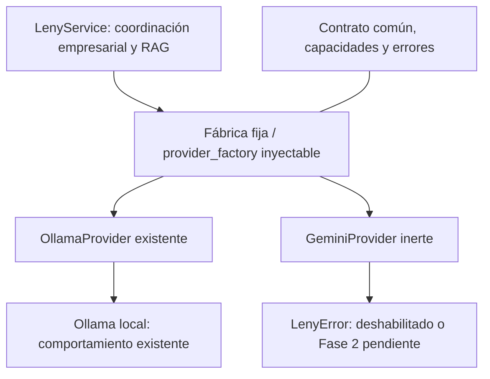

# LENY Gemini — Fase 01: preparación técnica

Fecha: 05/11/2026. Proyecto original: `C:\laragon\www\bellaarte-program`.

## 1. Introducción y objetivo

Se preparó una frontera multiproveedor para LENY sin habilitar inferencia externa. Ollama conserva su adaptador, parámetros y selección predeterminada. Gemini dispone de un adaptador inerte que rechaza todas las operaciones antes de leer una credencial, importar el SDK o construir un cliente. No hubo llamadas a la Gemini API, inferencias locales, transmisiones documentales ni activación para usuarios.

Esta entrega no certifica conexión, disponibilidad autenticada del modelo, cuotas de cuenta ni calidad de Gemini. Los metadatos documentales no se modificaron.

## 2. Estado inicial comprobado

- Python del venv original:3.10.6; FastAPI0.115.6; Pydantic2.12.5; HTTPX0.28.1; AnyIO4.13.0; pip22.2.1. `pip check` inicial correcto.
- Dependencias fijadas en `backend/requirements.txt`, codificado UTF-16. Se conservaron sus bytes anteriores y se añadieron únicamente nuevos pins en la misma codificación.
- Existían cambios locales amplios de LENY, usuarios/sesiones, monedas y otros módulos. No se restauraron desde HEAD ni se crearon ramas, copias de ERP o worktrees.
- `LenyService` ya permitía inyectar `provider_factory`. El protocolo `ChatProvider` anterior declaraba solo disponibilidad y streaming; el código consumía también clasificación, generación estructurada y medición de contexto.
- El adaptador HTTP Ollama, coordinador PostgreSQL, métricas acumuladas y recuperación documental permanecen vigentes. La referencia documental sigue siendo FastAPI/React/PostgreSQL/pgvector; no se sustituyó infraestructura.
- Proceso original Uvicorn detectado sin `--reload`: lanzadorPID28856 e intérprete hijoPID26664. No se reiniciaron. Backend `/health` y Ollama `/api/tags` respondieron200 al comprobar el cierre.
- SDK Google ausente al inicio. No se encontraron claves `GEMINI_API_KEY` ni `GOOGLE_API_KEY` en el `.env` inspeccionado. Solo se comprobó presencia, sin imprimir valores.

## 3. Arquitectura preparada



El contrato común declara `available`, `stream`, `classify`, `structured` y `measure_prompt`, y los estados/contadores que ya consume LENY. Se mantuvieron las firmas y resultados existentes; no se tradujeron prompts ni formatos.

Las capacidades describen lo que ofrece el **adaptador**, no todas las posibilidades del modelo. Se distinguen `supported`, `unsupported` y `prepared_disabled`. Ollama declara texto, streaming, salida estructurada, uso de tokens y medición de contexto. El control de razonamiento no se expone en este contrato como capacidad operativa de Ollama. Gemini declara todas las capacidades deshabilitadas.

La fábrica acepta únicamente nombres conocidos; no ejecuta imports derivados de entradas ni realiza fallback. Ollama sigue siendo el default. Gemini es seleccionable solo como placeholder: todas sus operaciones fallan con503 y código `LENY_GEMINI_DISABLED` cuando el flag esfalse, o `LENY_GEMINI_PHASE_NOT_IMPLEMENTED` cuando estrue. Tampoco `available()` comprueba la clave o consulta modelos. Incluso con clave y flagtrue no hay ruta operativa.

`LenyError` y `ChatProvider` se reexportan desde `leny_ollama` para conservar importaciones anteriores e identidad de excepciones. La inyección de dobles existente sigue funcionando. No se añadieron endpoints, tipos NDJSON ni controles frontend.

## 4. Cambios implementados

| Archivo | Propósito |
|---|---|
| `backend/app/services/leny_llm_contracts.py` | Nuevo contrato, capacidades inmutables y error común |
| `backend/app/services/leny_llm_providers.py` | Nueva fábrica controlada; sin fallback |
| `backend/app/services/leny_gemini.py` | Adaptador preparado, íntegramente inerte y sin imports Google |
| `backend/app/services/leny_ollama.py` | Reexportar contrato/error y declarar capacidades; conservar transporte y parámetros |
| `backend/app/services/leny_service.py` | Delegar la fábrica predeterminada al selector; preservar inyección y resto del pipeline |
| `backend/app/core/config.py` | Campos nuevos, secreto excluido de representación/serialización y ocultación de entradas en mensajes de validación de Settings |
| `backend/.env.example` | Ejemplo sin clave y valores deshabilitados |
| `backend/requirements.txt` | Pins del SDK y dependencias nuevas, conservando UTF-16 |
| `backend/tests/test_leny_gemini_preparation.py` | Pruebas sin tráfico externo ni claves reales |
| `documentacion/evidencias/leny_gemini_fase01_*` | Resultados reproducibles y manifiesto técnico sin secretos |

No se modificaron reglas de política, prompts, síntesis/validador, ranking, embeddings, índices, cantidades20/5, presupuesto4096/768, generación, razonamiento, ACL o contratos de fuentes. No hubo migraciones ni conexiones de prueba a tablas comerciales. Las clases y códigos de rol no cambiaron.

## 5. Dependencias

Se instaló el SDK oficial `google-genai==2.33.0` en el venv existente. La resolución previa con restricciones de las61distribuciones instaladas no exigió reemplazos. Inventario posterior:71distribuciones; las61versiones iniciales permanecieron iguales. `pip check` final correcto.

| Paquete añadido | Versión |
|---|---|
| google-genai |2.33.0|
| google-auth |2.62.1|
| requests |2.34.2|
| charset-normalizer |3.5.2|
| urllib3 |2.8.0|
| pyasn1_modules |0.4.2|
| tenacity |9.1.4|
| websockets |16.1.1|
| distro |1.9.0|
| sniffio |1.3.1|

Se conservaron FastAPI, Pydantic, HTTPX, AnyIO, cryptography y demás paquetes anteriores. No se actualizaron pip/Python, ni se instalaron extras, tokenizadores, frameworks de orquestación o modelos.

La versión2.33.0 declara Python>=3.10, HTTPX>=0.28.1,<1 y Pydantic>=2.12.5,<3. La versión más reciente consultada,2.34.0, requiere Python>=3.11; por ello no se usó una instalación sin pin. Referencias: [metadatos oficiales2.33.0](https://pypi.org/pypi/google-genai/2.33.0/json), [dependencias del tag](https://github.com/googleapis/python-genai/blob/v2.33.0/pyproject.toml).

## 6. Configuración

```dotenv
LENY_LLM_PROVIDER=ollama
LENY_GEMINI_ENABLED=false
LENY_GEMINI_MODEL=gemini-3.8-flash
GEMINI_API_KEY=
LENY_GEMINI_TIMEOUT_SECONDS=60
```

El `.env` real no se editó. Estos valores predeterminados bastan para mantener el comportamiento al próximo arranque. El proceso habitual continúa con su código ya cargado: no se presenta una preparación en disco como recarga de producción ejecutada.

Proveedor:enumeración `ollama/gemini`. Modelo:no vacío ni espacios. Timeout:positivo y finito; es configuración preparada, no timeout externo aplicado. Clave: `SecretStr | None`, `exclude=True`, `repr=False`. `Settings` oculta valores de entrada en sus mensajes de error. `model_dump`, JSON de configuración y listado ADMIN no exponen la clave.

En Fase1 la ausencia de clave nunca impide iniciar y habilitar un flag no crea un cliente. La validación autenticada y el requisito de clave para operar se implementarán con la activación de Fase2. No existen parámetros Gemini efectivos de tokens, contexto o razonamiento.

## 7. Configuración privada de API Key en Windows/Laragon

1. Abrir localmente `C:\laragon\www\bellaarte-program\backend\.env` en el editor habitual. No copiar este archivo a informes o servicios externos.
2. Conservar todas sus líneas existentes. Añadir `GEMINI_API_KEY=` únicamente si no existe y pegar allí la clave desde AI Studio. Si ya existe una clave, no sustituirla como parte de esta preparación.
3. Conservar `LENY_LLM_PROVIDER=ollama` y `LENY_GEMINI_ENABLED=false`; si esas variables no existen, se aplican sus defaults. Guardar sin cambiar la codificación del archivo.
4. Mantener el archivo con acceso NTFS limitado a las identidades que administran/ejecutan el backend; no ampliar permisos globales ni convertirlo en archivo compartido.
5. Comprobar que está ignorado con `git check-ignore backend/.env`. No usar `Get-Content`, comandos con la clave literal, capturas, `VITE_*`, almacenamiento del navegador ni verificaciones online para probarla.
6. No recargar servicios solo para introducir una clave inactiva. Su uso y recarga operacional se decidirán en Fase2.

La clave no fue solicitada ni introducida durante esta fase. La comprobación de presencia no demuestra validez. El SDK soporta también `GOOGLE_API_KEY` con precedencia propia: la futura integración deberá pasar explícitamente la clave prevista y no recurrir a autodetección de otra cuenta. No se implementó esa conexión ahora.

## 8. Seguridad

El adaptador Gemini no importa SDK, no construye cliente, no lee el secreto y no abre red. Las pruebas importan el SDK instalado solo para bloquear su constructor y comprobar que nunca se llama. No se añadieron clientes de Google al arranque ni endpoints configurables por usuario.

JWT, Casbin, conversaciones por propietario, cuota/coordinación y publicación/versiones permanecen bajo sus controles actuales. Una ACL local **no autoriza enviar** preguntas, historial o pasajes a Google. Fase2 necesita una decisión explícita de transmisión externa antes de la llamada, además de recuperar con ACL y revalidar fuentes. No se inventó una autorización externa automática derivada de publicación/rol.

Google publica Free Tier de `gemini-3.8-flash`, pero la clave no permite certificar localmente el nivel de facturación ni las cuotas de la cuenta. No se activaron pagos, proyectos, Vertex/Agent Platform, herramientas, grounding, archivos externos o almacenamiento en Google. La documentación de [precios](https://aistudio.google.com/docs/pricing#gemini-3.8-flash) indica uso de contenido gratuito para mejorar productos; esto debe considerarse en la decisión de transmisión futura.

## 9. Pruebas y comandos ejecutados

Desde la raíz, con `backend\venv\Scripts\python.exe -B`:

- `-m pip check`: correcto antes y después.
- `-m pip install --dry-run --only-binary=:all: --disable-pip-version-check --constraint <constraints-before.txt> --report <sdk-resolution.json> google-genai==2.33.0`: resolución sin reemplazos.
- Instalación con `--only-binary=:all: -c <constraints-before.txt> -r <packages-added.txt>`: diez paquetes nuevos,61versiones anteriores intactas. Archivos de resolución/inventario en respaldo privado.
- Pytest seleccionado de Gemini, LENY, Ollama/transporte, seguridad, RAG, selección, síntesis, fuentes y seguimiento: **506passed**, sin acceso a base empresarial. Evidencia `evidencias/leny_gemini_fase01_tests.xml`.
- Runtime/lifecycle con procesos/HTTP simulados: **16passed**; `evidencias/leny_gemini_fase01_runtime.xml`. No arranca Ollama, workers ni backend reales.
- GET de solo lectura al backend `/health` y Ollama `/api/tags`:200. Sin generación, catálogo Gemini ni autenticación Google.

Las pruebas usan `ENVIRONMENT=test`, `DATABASE_URL=postgresql+psycopg2://unit_only@127.0.0.1:1/unit_only`, `LENY_RUNTIME_AUTOSTART=false`, `-p no:cacheprovider` y `--basetemp` nuevo. Las16pruebas de runtime se ejecutan aparte con autostarttrue sobre sus dobles. El smoke test en subproceso carga Settings y LenyService sin clave, bloquea imports Google y red, y construye únicamente Ollama.

Las15pruebas nuevas cubren defaults, errores de configuración, secreto oculto, importaciones compatibles, fábrica/inyección, desconocidos sin fallback y lascincooperaciones Gemini con/sin clave y flag. No prueban generación/streaming de Gemini. La prueba de socket permite solo el loopback numérico que necesita asyncio en Windows; DNS y conexiones externas quedan prohibidos.

Incidencias corregidas: primer procesamiento del reporte pip asumió CP1252 y terminó antes de instalar; se leyó explícitamente UTF-8. El editor de parches rechazó requirementsUTF-16 antes de aplicar cambios; se añadió el bloque preservando bytes/codificación. Primera tanda76tuvo4fallos por bloquear el socketpair interno de asyncio; se corrigió el arnés, luego76/76 y506/506pasaron. Ninguno requirió debilitar controles del ERP.

No se ejecutó un nuevo lifespan completo contra la base habitual: revisa locks y mantenimiento. La salud del proceso activo, el smoke de importación/construcción y las pruebas simuladas se informan por separado, sin afirmar una recarga o inferencia real que no ocurrió. No se repitieron pruebas frontend porque no se modificó frontend/API pública.

## 10. Compatibilidad

El default construye `OllamaProvider` con el mismo objetoSettings. El código de su transporte no cambió. La excepción anterior conserva identidad; continúa el control de errores existente. No se alteraron `rag4_v1`, política `rag4-v4`, modos extractivo/síntesis, guardas, fuentes, historial, selección o embeddings. Las limitaciones semánticas anteriores de LENY siguen existiendo; esta fase no las corrige ni reevalúa.

El backend habitual y Ollama permanecieron activos y no se emitieron solicitudes de inferencia. La preparación está integrada en disco y será compatible con el próximo arranque normal en modoOllama; no se cambió el proveedor efectivo de usuarios actuales.

## 11. Reversión

Respaldo privado: `%LOCALAPPDATA%\BAB_VDOS\leny-gemini-phase1\20261105-034026`. Conserva cinco archivos iniciales, hashes, inventarios antes/después, resolución, pins añadidos y parche propio. La raíz privada limita acceso al propietario/SYSTEM/Administrators. HEAD no representa esos cambios iniciales del propietario.

1. Asegurar ausencia de edición concurrente y que no se activó Fase2. El backend actual no requiere reinicio para retirar esta preparación no cargada.
2. Comprobar desde raíz `git apply --reverse --check --ignore-space-change <respaldo>\phase1.patch`. Solo si pasa, aplicar con `--reverse --ignore-space-change`. Revierte los cuatro archivosUTF-8 existentes; no usa reset/clean ni sustituye el árbol por HEAD.
3. RequirementsesUTF-16: el respaldo incluye `requirements-added.bin`. Comprobar que el archivo actual termina exactamente en ese sufijo y que el prefijo coincide byte a byte con el original respaldado; retirar solo el sufijo. Si difiere, detenerse y reconciliar ediciones posteriores. No sobrescribirlo completo a ciegas.
4. Retirar únicamente los tres módulos nuevos y la prueba nueva si sus SHA siguen coincidiendo con el manifiesto final y no hay consumidores nuevos. Conservar documentación/evidencias salvo decisión explícita de retirarlas.
5. Antes de desinstalar, comparar inventario actual con `packages-after.json` y comprobar que ningún consumidor posterior depende de los diez paquetes añadidos. Si se mantiene ese estado, usar el venv con `-m pip uninstall -r <respaldo>\packages-added.txt`, y después `-m pip check`. No quitar paquetes preexistentes ni actualizar dependencias para revertir.
6. Si el backend ya fue reiniciado o desplegado posteriormente, programar su recarga controlada tras la reversión. No detener servicios ajenos ni modificar DB, publicaciones o ACL. El `.env` no tiene cambios de esta fase que revertir.

La reversión se comprobó en seco; no se ejecutó. El manifiesto público identifica solo archivos, hashes, versiones y resultados técnicos.

## 12. Preparación para Fase2 y aceptación

La [ficha oficial del modelo](https://aistudio.google.com/docs/models/gemini-3.8-flash) describe entrada1.048.576tokens/salida65.536, texto y salida estructurada, razonamiento `low/medium/high` y rechazo de `minimal`. No se trasladaron esos límites a Qwen ni se adoptaron parámetros de Gemini. La documentación del SDK distingue [creación del cliente y servicios](https://googleapis.github.io/python-genai/); no se instanció ninguno.

Pendientes para otra instrucción: verificar acceso/modelo/cuotas FreeTier de la cuenta; autorización de transmisión; cliente y cierre; timeout/cancelación; traducción de mensajes/schemas; clasificación, síntesis y streaming reales; errores del proveedor; métricas/tokens/modelo efectivo; coordinación que hoy presupone modelo local y pruebas de memoria; presupuestos/razonamiento; RAG y fuentes mediante Gemini; auditoría de proveedor externo; comparación real de calidad y latencia. No habilitar simplemente el flag para saltarse esos trabajos.

**Aceptación Fase1:** arquitectura inspeccionada y preparada; SDK instalado compatible; configuración segura; procedimiento privado de clave; defaultsOllama/Geminifalse; adaptador sin operación incluso conflagtrue; pruebas locales aprobadas; servicios habituales disponibles; sin llamadas Gemini, migraciones, datos comerciales, publicaciones o ACL modificados; documentación y reversión preparadas. La clave sigue ausente y la conexión externa no está probada, conforme al alcance. El arranque productivo con el código nuevo no se ha ejecutado; se comprobó su preparación offline, no una activación funcional.
