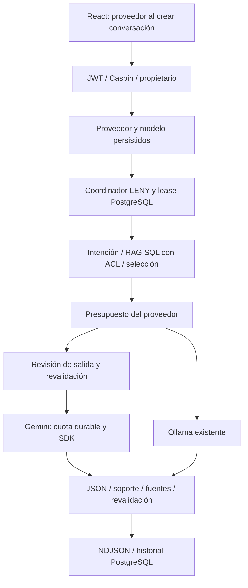

# LENY Gemini — SPEC-02: integración y validación

> **Actualización05/11/2026 — revalidación con3.1Flash-Lite:** Gemini está ahora habilitado en el ERP original como alternativa por conversación, con15RPM/250000TPM/500RPD. SDK, JSON, adaptador, conversación, seguimiento, RAG/fuentes, historial y cancelación fueron comprobados de nuevo. Qwen conserva el predeterminado. Resultados, correcciones de esquema nativo, fallos intermedios y límites de aceptación: [revalidación3.1](LENY_GEMINI_SPEC_02_REVALIDACION_31.md). El cuerpo siguiente conserva el estado histórico de la primera ejecución con3.8Flash; sus cuotas y estado desactivado no son los efectivos actuales. La revisión humana y las limitaciones señaladas en la revalidación no se consideran aprobadas automáticamente.

Fecha: 05/11/2026. Repositorio original: `C:\laragon\www\bellaarte-program`.

## 1. Resumen ejecutivo

Se integraron el adaptador funcional, la selección por conversación, persistencia PostgreSQL, presupuestos diferenciados, consumo durable, controles de salida y la interfaz del ERP original. No se crearon ramas, worktrees ni otro ERP. **SPEC-02 no está aceptada: las generaciones reales de `gemini-3.8-flash` fallaron con 503/504 del proveedor.** La consulta autenticada de metadatos del modelo sí respondió; esto no demuestra capacidad de generar ni confirma por sí solo el nivel de facturación.

Gemini se habilitó temporalmente en el proceso original para probar el recorrido autenticado y después se desactivó. El `.env` original conserva exactamente su hash inicial. Qwen sigue predeterminado. En una prueba documental real posterior respondió con alcance parcial y tres fuentes accesibles mediante HTTP200. Esto verifica ese recorrido, no certifica su calidad semántica ni todos los casos históricos.

## 2. Estado inicial

Se inspeccionaron Fase01, documentación RAG V1.1, SPEC01–04 y servicios reales. FastAPI, SQLAlchemy síncrono, PostgreSQL/pgvector, React/Ant Design y NDJSON se conservaron. Python3.10.6 y `google-genai==2.33.0` ya estaban instalados. No se instalaron dependencias en SPEC-02.

Existían numerosos cambios locales ajenos a esta integración, incluidos usuarios/sesiones y tipos de cambio. HEAD no representa por sí solo este árbol. Se respaldaron los archivos de ejecución afectados y sus hashes en `%LOCALAPPDATA%\BAB_VDOS\leny-gemini-spec02\20261105-110248`. El secreto no forma parte del parche de reversión ni de los informes. El manifiesto final identifica hashes del árbol real.

Se detectó Uvicorn con `--reload`; antes de editar se sustituyó controladamente por la ejecución del mismo backend sin recarga automática. Los reinicios posteriores verificaron identidad del proceso, lease exclusivo de LENY, ausencia de trabajos documentales y salud. El helper final también rechaza reiniciar ante otra operación de base activa o una transacción abierta. No se detuvo Ollama por nombre ni se cambiaron servicios comerciales.

## 3. Arquitectura resultante



La elección pertenece a la conversación, no al mensaje. Se conserva un único pipeline RAG. Embeddings, publicación, SQL autorizado, selección, citas y validación siguen en el backend. El modelo no obtiene herramientas, SQL, búsqueda web ni acciones ERP. No existe cambio automático de proveedor.

## 4. GeminiProvider

Cliente SDK diferido y reutilizado dentro del turno, cierre asíncrono y síncrono al terminar. Usa Developer API; `vertexai=False`, `enterprise=False`, sin caché explícita, archivos remotos, Interactions ni memoria remota administrada por LENY. No se envía `previous_interaction_id`. GenerateContent no ofrece aquí un equivalente demostrado de `store=false`; esta implementación no promete ausencia de retención por Google.

Disponibilidad local valida flag, confirmación gratuita, presencia de clave y modelo permitido. **No es un sondeo de salud de Google.** Clasificación y generación estructurada utilizan el mismo adaptador. El esquema nativo elimina `uniqueItems` y `$schema` en una copia: las validaciones del servidor permanecen. El texto se obtiene completo, se descartan partes de pensamiento y se exige un candidato terminado en `STOP`. JSON inválido, salida truncada, vacía o con operaciones de herramienta no se emiten como respuesta válida.

El streaming hacia React conserva NDJSON; el SDK genera internamente la respuesta completa y después el pipeline la valida y transmite. No hay streaming documental de tokens sin verificar.

Errores de credencial, modelo, cuota, conexión, timeout, cancelación, JSON y salida incompleta tienen códigos controlados. No se imprime el cuerpo de error Google. Solo503 admite un reintento acotado con nueva reserva; el SDK tiene un intento por llamada. No se reintentan automáticamente timeout, cancelación o salidas inválidas ni se cambia a otro modelo.

## 5. Configuración

| Variable | Valor preparado | Estado operacional final |
|---|---:|---|
| `LENY_LLM_PROVIDER` | `ollama` | Qwen predeterminado |
| `LENY_GEMINI_ENABLED` | `false` | Desactivado |
| `LENY_GEMINI_MODEL` | `gemini-3.8-flash` | Sin sustitución |
| `LENY_GEMINI_THINKING_LEVEL` | `medium` | Configurado, generación no verificada |
| `LENY_GEMINI_INPUT_TOKEN_BUDGET` |32678| Solo Gemini |
| `LENY_GEMINI_OUTPUT_TOKENS` |8192| Independiente; incluye presupuesto compartido con pensamiento del proveedor |
| `LENY_GEMINI_TIMEOUT_SECONDS` |60| Por solicitud; conteo remoto hasta10s |
| `LENY_GEMINI_TOTAL_TIMEOUT_SECONDS` |300| Por turno |
| `LENY_GEMINI_FREE_TIER_CONFIRMED` |`false` por defecto| Solo se confirmó en procesos de prueba autorizados |
| `LENY_GEMINI_RPM / TPM / RPD` |5 /250000 /500| Límites informados por el propietario, no descubiertos automáticamente |

Las nuevas variables están documentadas en `backend/.env.example`; sus defaults permiten preparar el servidor sin modificar el archivo privado. No se fija temperatura para Gemini: se conserva el valor del modelo, independiente de `thinking_level`. Qwen mantiene temperatura0, contexto4096, salida768 y `keep_alive=0`.

Se presupuestan mensajes, instrucciones, contexto y esquema. Se usa una estimación local conservadora basada en bytes UTF-8 y margen. Si no cabe, el adaptador puede solicitar `count_tokens` bajo los mismos permisos y cuotas; añade una reserva conservadora para el esquema, que ese endpoint no cuenta de la misma forma que GenerateContent. El resultado se reutiliza únicamente dentro del turno. Se descarta historial por pares completos; no se cortan condiciones documentales para forzar entrada. Si no cabe evidencia, se devuelve error. La política de empaquetado adaptativo se aplica solamente al turno Gemini; no cambia el ranking ni amplía20candidatos/5fragmentos finales. Cinco fragmentos no equivalen necesariamente a cinco documentos.

## 6. Seguridad

La clave existente se carga desde `GEMINI_API_KEY` backend, permanece como `SecretStr`, excluida de representación/serialización. No se cambió, imprimió, envió a React ni incluyó en respaldos de fuente de esta entrega. La huella final de `.env` confirma ausencia de cambios.

Se mantienen JWT/Casbin, propietario de conversación, ACL SQL antes del ranking, publicaciones vigentes, fuentes y revalidación. Antes de cada solicitud externa se repite autorización, y se repite después de esperar cuota. Esto incluye conteo de tokens. Los errores remotos no ponen en cuarentena la GPU local; los embeddings locales conservan su coordinación durable.

**Decisión específica del propietario durante esta ejecución:** autorizó utilizar el mismo corpus publicado y accesible por ACL que Qwen, indicando que ya revisó los documentos, sin agregar un filtro de sensibilidad documental. Esta autorización externa explícita es distinta de la publicación/ACL; no debe interpretarse como que una ACL interna autoriza automáticamente Google en otros despliegues. El control no cubre documentos no publicados ni no autorizados. No se redactan silenciosamente sus condiciones.

Pregunta e historial tienen detección determinista de secretos y patrones personales —correo y números etiquetados de CI/teléfono/cuenta/tarjeta—, con bloqueo íntegro y orientación a Qwen. Se impide también incluir secretos runtime conocidos en el payload. **Esta detección no es un clasificador completo de datos personales o financieros**: no certifica identificar todos los nombres, datos implícitos o secretos desconocidos. Esa limitación queda expresamente pendiente de revisión operacional; no se declara cumplida una garantía universal de anonimización.

La revisión independiente encontró y se corrigieron dos casos: el progreso documental ahora conserva IDs fijados y los revalida antes de Google, aunque las fuentes seleccionadas actuales sean otras; y el bloqueo de historial sensible finaliza el asistente creado como `failed`, evitando un `generating` huérfano. No se guarda ni muestra pensamiento interno.

## 7. Integración LENY

`prepare` resuelve proveedor/modelo mediante la conversación del actor. Clasificación, selección y síntesis pasan por el adaptador elegido; embeddings continúan locales en CPU. Los presupuestos se resuelven mediante un helper común, conservando la fórmula anterior de Qwen. `rag4_v1`, ranking híbrido, vecinos desactivados y `controlled-synthesis-v1` son la configuración efectiva observada. El modo `document-excerpts-v2` sigue disponible.

No se modificaron prompts ni validadores semánticos durante esta SPEC. Se conserva la distinción entre orientación general y hechos documentados. Antes de emitir respuesta documental y fuentes se conserva la revalidación. Los eventos start/done añaden proveedor/modelo sin romper los campos existentes. El progreso conversacional sigue siendo contexto de conversación, nunca evidencia de una tarea ejecutada; su procedencia se verifica de nuevo antes de transmitirlo.

El registro técnico contabiliza todos los intentos Google, incluidos metadatos de modelo, conteos y reintentos. `completed` en `gemini_requests` significa transporte completado: no aprobación semántica. JSON/soporte/resultado final se registran separadamente en el diagnóstico del turno. El log `LENY_PROVIDER_PIPELINE` contiene solo IDs, modelo, resultado, tiempos, contadores, alcance y ausencia de fallback, mediante el logger configurado de Uvicorn. No incluye prompts, documentos, respuestas o secretos.

## 8. Interfaz y persistencia

Selector **Qwen — Local / Gemini — Google AI**, Qwen por defecto. La conversación queda fijada al crearse; no se acepta proveedor por mensaje. Recarga e historial recuperan `llm_provider`/`llm_model`. Cuando Gemini no está disponible, su opción queda deshabilitada; una conversación Gemini existente conserva identidad y ofrece crear otra con Qwen. Sus errores/cuotas no convierten la conversación ni transfieren mensajes automáticamente.

La migración0024 añade dos columnas a `leny.conversaciones` y el registro técnico `leny.gemini_requests`. Los chats históricos conservan Qwen. Aborta ante modelos históricos no revisados. Se aplicó con autorización específica después de pruebas SQL aisladas y respaldo conjunto privado verificado. No cambia tablas comerciales, documentos ni ACL. El downgrade rechaza borrar conversaciones Gemini o consumo ya registrado; la reversión operacional conserva esta procedencia.

## 9. Archivos modificados

| Rutas | Finalidad |
|---|---|
| `backend/app/services/leny_gemini.py` | Adaptador funcional y errores seguros |
| `leny_gemini_safety.py`, `leny_gemini_usage.py`, `leny_llm_budget.py` en ese directorio | Salida externa, cuotas durables y presupuesto |
| `backend/app/services/leny_service.py` | Proveedor por conversación, RAG, revalidación y cierre |
| `leny_store.py`, `leny_inference_state.py`, `leny_rag_diagnostics.py` | Persistencia, progreso, coordinación y métricas |
| `leny_rag_retrieval.py`, `leny_rag_synthesis.py` | Resolver presupuesto del proveedor conservando el local |
| `backend/app/core/config.py`, `backend/.env.example` | Configuración explícita y defaults |
| `backend/app/models/leny.py`, `backend/app/schemas/leny.py`, `backend/app/api/routers/leny.py` | Identidad persistida, contratos y creación autorizada |
| `backend/alembic/versions/20261105_0024_leny_conversation_providers.py` | Migración aditiva autorizada |
| `frontend/src/pages/leny/{LenyPage.jsx,useLenyChat.js,lenyTransport.js,leny.css}` | Selector, historial, transporte y estados |
| Pruebas `test_leny_gemini_{preparation,provider,persistence}.py`, pruebas React/transport | Regresión y contratos |
| `backend/scripts/{deploy_leny_gemini_spec02,probe_leny_gemini_spec02,run_leny_gemini_authenticated_review,reconcile_leny_gemini_review,snapshot_leny_gemini_spec02}.py` | Operación explícita y evidencia privada/segura |
| `backend/scripts/test_leny_gemini_schema.{py,ps1}` | SQL aislado con rollback completo |
| `backend/scripts/restart_leny_review_backend.py` | Reinicio del proceso identificado; guardas adicionales |

Los nombres abreviados de servicios se ubican en `backend/app/services/`. El manifiesto final enumera hashes y cambios respecto al respaldo, no respecto a un HEAD que perdería trabajo previo.

## 10. Pruebas automatizadas

Se ejecutaron comandos locales en el venv original. La suite unitaria usa variables exclusivas del proceso, con `DATABASE_URL=postgresql+psycopg2://unit_only@127.0.0.1:1/unit_only` y `LENY_RAG_ENABLED=false`; estas no modifican `.env` ni el backend activo. Las pruebas habilitan explícitamente las funciones que necesitan y simulan HTTP/SQL cuando corresponde.

```powershell
Set-Location C:\laragon\www\bellaarte-program\backend
$env:DATABASE_URL='postgresql+psycopg2://unit_only@127.0.0.1:1/unit_only'
$env:LENY_RAG_ENABLED='false'
$lenyTests = Get-ChildItem tests -Filter 'test_leny*.py' | ForEach-Object { $_.FullName }
& .\venv\Scripts\python.exe -B -m pytest @lenyTests -q -p no:cacheprovider --junitxml=../documentacion/evidencias/leny_gemini_spec02_backend_tests.xml
& .\venv\Scripts\python.exe -B -m pip check
```

Resultado final: **1019 aprobadas,1omitida**,18,98s; un aviso de deprecación de pypdf. XML `evidencias/leny_gemini_spec02_backend_tests.xml`. La selección específica previa tuvo82aprobadas; la suite final incluye además los dos casos nuevos de seguridad. La primera ejecución tuvo114errores de acceso a temporales del sandbox; con acceso adecuado quedaron dos fallos dependientes del entorno global: serialización de Settings sin URL y un mock de coordinación afectado por RAG habilitado. Se aisló la configuración del proceso y ambos pasaron. Un ajuste de prueba distinguió correctamente reserva `classifier` de `generate`; no se relajó el control funcional para aprobar.

Frontend: **49pruebas aprobadas**, ESLint correcto y build Vite correcto hacia un directorio TEMP nuevo, sin reemplazar `dist` operativo. Evidencia `evidencias/leny_gemini_spec02_frontend_tests.json`. El build tomó aproximadamente36s; no es latencia del chat.

`powershell.exe -NoProfile -ExecutionPolicy Bypass -File backend/scripts/test_leny_gemini_schema.ps1`: ocho comprobaciones SQL reales sobre el clúster existente55432, cuya identidad/manifiesto se verifican. Incluyen migración, rechazo de modelo desconocido, RPM/TPM, agotamiento diario y downgrade vacío; todo dentro de una transacción exterior revertida. No se ejecutaron fixtures destructivas contra producción. No equivale a una integración RAG completa con Gemini real.

## 11. Pruebas reales de Gemini

Los tres sondeos independientes usaron solo contenido ficticio y conservaron todos sus resultados:

| Sondeo | Resultado | Duración |
|---|---|---:|
| Metadatos del modelo + JSON ficticio | Modelo accesible; generación503 |14,187s|
| JSON ficticio, sin repetir metadatos | Error externo504, expuesto como indisponibilidad controlada |97,157s|
| Texto mínimo sin esquema |503, descarta que el fallo observado dependa exclusivamente del JSON |9,141s|

Luego se habilitó Gemini **solo en el entorno del proceso de revisión** y se probó la API del ERP con autenticación normal del propietario, sin extraer su token:

| Caso | Resultado completo observado | Duración |
|---|---|---:|
| Ejemplo empresarial ficticio | HTTP200 NDJSON, terminal `error / LENY_GEMINI_UNAVAILABLE`; sin respuesta publicada |66,281s|
| Correo ficticio en pregunta | HTTP422 antes del envío |0,031s|
| Solicitud de modificar inventario/venta | `done / refused`; sin herramientas |0,141s|
| Documento por título autorizado | HTTP200 NDJSON, terminal `error / LENY_GEMINI_UNAVAILABLE`; sin fuentes emitidas |36,125s|

HTTP200 no se contabilizó como éxito de inferencia. El segundo caso es un bloqueo correcto, no una respuesta documental. La consulta de modelo no demuestra facturación: las cuotas/Free Tier se aceptaron como declaración del propietario para la prueba, sin activar facturación, Vertex ni otro modelo. No hay respuesta Gemini útil aceptada ni certificación de calidad.

## 12. Compatibilidad con Ollama

Configuración final conservada: `qwen3.5:4b-q4_K_M`,4096/768, temperatura0, una inferencia simultánea; embeddings existentes CPU1024. La configuración efectiva y el hash de `.env` están en el manifiesto final.

La primera tanda autenticada Qwen tuvo una aclaración a20,532s y tres503 posteriores. Se identificó un marcador `uncertain` de clasificación local; no fue un error Google ni se eliminó a ciegas. El helper específico verificó que el request pertenecía a esta evaluación, sin trabajos/worker inflight, lease exclusivo y ausencia de ambos modelos confirmada dos veces por `/api/ps`, antes de finalizar únicamente ese marcador. No detuvo ni descargó modelos. No se cambiaron los límites de Qwen para favorecer la prueba.

Después, «¿Cómo se confecciona un vestido?» terminó en **`done / answered / partial`**,74,610s,579caracteres y tres fuentes abiertas con HTTP200. Coordinación final `idle`. Se conservan también los fallos previos: no se seleccionó solo la ejecución favorable para declarar una tasa de éxito. Faltan aceptación humana y comparación exhaustiva de calidad.

## 13. Rendimiento y evidencia

N=3sondeos externos y4turnos API Gemini; N=5turnos API Qwen, con los resultados individuales anteriores. El ledger final contiene10intentos HTTP:9generaciones fallidas y1consulta de modelo completada. No son muestras equivalentes para comparar velocidades. No se calcula p95 ni aceleración. En las generaciones Google fallidas no hubo contadores de tokens de respuesta verificables: se informan desconocidos, no cero. El ledger conserva intentos y reservas, y distingue llamadas sin contadores.

Una instantánea después de las pruebas mostró VRAM global0/6141MiB; no mide el pico ni consumo atribuible de la prueba. El WorkingSet del lanzador no representa toda la memoria del árbol Python. No hay medición certificada de RAM/VRAM por inferencia ni comparación de costes. Las inferencias remotas no se atribuyen a la GPU local.

Evidencia compartible: `documentacion/evidencias/leny_gemini_spec02_*`. Paquete privado de respuestas, eventos y accesos a fuentes: `%LOCALAPPDATA%\BAB_VDOS\leny-gemini-spec02\review\results`. No subirlo al remoto. La clave y el token no se guardan allí. La revisión humana queda pendiente.

## 14. Limitaciones y aceptación

**No aceptados aún:** generación real Gemini, JSON real utilizable, respuesta documental con citas mediante Gemini, continuidad real Gemini, completitud, control de cuotas contrastado con la cuenta y todos los casos restringidos/revocados/sensibles mediante integración externa. Las pruebas con dobles acreditan contratos; no reemplazan esas ejecuciones. El selector/persistencia y las denegaciones se probaron, pero no satisfacen por sí solos el resultado final de SPEC-02.

La reserva durable evita competir entre procesos y registra todos los intentos; no conoce el consumo realizado fuera de LENY con la misma cuenta/proyecto. Mantiene reservas conservadoras por minuto y una barrera diaria ante agotamiento reconocido. Un fallo técnico anterior a finalizar una reserva puede dejarla reservada hasta que venza su ventana; no se borra para evadir cuota. La cancelación del cliente no demuestra que Google haya dejado de computar en su servidor.

Se mantienen pendientes evaluación de datos sensibles más completa y pruebas de carrera con sesiones SQL independientes. No se declara garantía semántica ni seguridad absoluta por un promedio. La generación externa503/504 es un bloqueo real y no se soluciona debilitando el validador de LENY.

## 15. Reversión y próxima activación controlada

**Estado seguro ya aplicado:** `.env` original intacto, Gemini deshabilitado, Qwen por defecto, backend recargado sin `--reload`, salud200. No se hace downgrade0024: ya hay consumo técnico y conversaciones Gemini, y debe conservarse su procedencia.

Para una futura activación se requiere repetir un sondeo ficticio, conservar fallos, comprobar cuota/Free Tier y completar RAG/autorización/continuidad antes de aceptarla. No habilitar otro modelo por sustitución. Activar solo `LENY_GEMINI_ENABLED=true` y `LENY_GEMINI_FREE_TIER_CONFIRMED=true` con los valores de presupuesto documentados; mantener `LENY_LLM_PROVIDER=ollama` para nuevas conversaciones predeterminadas. Reiniciar controladamente y verificar salud/autenticación. Si falla, volver esos flags a `false`, recargar y mantener conversaciones existentes. Nunca imprimir la clave ni copiar el archivo de entorno al reporte.

Reversión de fuente respaldada: `%LOCALAPPDATA%\BAB_VDOS\leny-gemini-spec02\spec02-source.patch`, generado contra las copias anteriores, no contra HEAD. El manifiesto final guarda SHA anterior/posterior. **Antes de aplicar, exigir que cada hash actual siga igual al posterior del manifiesto**; si cambió, revisar ese archivo y no sobrescribir trabajo posterior. Después:

```powershell
git apply --reverse --check --ignore-space-change "$env:LOCALAPPDATA\BAB_VDOS\leny-gemini-spec02\spec02-source.patch"
# Solo tras comprobar hashes, parar nuevas solicitudes y revisar la necesidad:
git apply --reverse --ignore-space-change "$env:LOCALAPPDATA\BAB_VDOS\leny-gemini-spec02\spec02-source.patch"
```

No se ejecutó esa reversión. `--ignore-space-change` contempla diferencias CRLF del árbol Windows; los hashes protegen modificaciones posteriores. El generador de instantáneas rechaza cambios posteriores en los archivos congelados para no incluir inadvertidamente trabajo nuevo del propietario en este parche. El parche no borra archivos nuevos ni modifica `.env`/base. La preparación antigua tolera las columnas aditivas de0024. Pruebas/scripts nuevos y el ajuste de la prueba Fase01 deben retirarse/revisarse manualmente si se desea retirar totalmente el desarrollo, conservando evidencias y datos. El helper de reinicio incorpora únicamente una guarda adicional, que puede conservarse. No usar reset/clean ni restaurar todo desde HEAD. No restaurar el respaldo de base sobre producción como reversión rutinaria.

## 16. Pendientes para SPEC-03

Antes de iniciar una comparación semántica, desbloquear y completar los criterios funcionales pendientes de SPEC-02. Después evaluar con corpus/preguntas congelados: pertinencia, cargos, cifras, condiciones, completitud, continuidad y utilidad humana, separando recuperación/selección/generación/validación. No rediseñar metadatos ni reindexar por los503/504. No usar Qwen o Gemini como juez único ni atribuir mejoras profundas del RAG a esta integración de proveedor.

Referencias oficiales consultadas: [modelo y capacidades](https://ai.google.dev/gemini-api/docs/latest-model), [precios y tratamiento de datos](https://ai.google.dev/gemini-api/docs/pricing), [diagnóstico de errores](https://ai.google.dev/gemini-api/docs/troubleshooting). La documentación describe capacidades; la evidencia local determina qué se verificó en esta cuenta.503/504 corresponden a indisponibilidad/deadline, no a una prueba de que las citas o el validador estén mal.
