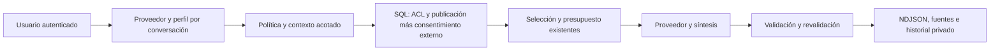

# LENY Gemini — SPEC-03: calidad conversacional

05/11/2026. **Candidata integrada en el ERP original; aceptación funcional y humana pendiente.**

## 1. Resumen ejecutivo

Qwen y Gemini permanecen habilitados, Qwen predeterminado. La candidata se ofrece por conversación como evaluación administrativa, sin activación global. El propietario decidió realizar personalmente las pruebas finales cuando haya RAM disponible.

Se conservaron B0 Gemini, C1 candidata, C2 candidata corregida y Qwen habitual, 20 turnos cada una. **C1 fue regresiva: ninguna respuesta documental emitida. C2 tuvo diez errores de memoria.** Las correcciones posteriores pasaron pruebas locales, SQL y reproducción offline del validador; no se presenta eso como mejora semántica demostrada ni nueva generación E2E.

## 2. Objetivo y alcance

Interpretación, continuidad y soporte conservando FastAPI, PostgreSQL/pgvector, React/Ant Design, JWT/Casbin, publicación/versiones, fuentes y NDJSON. Sin dependencias/modelos nuevos, reindexación ni herramientas comerciales autónomas. Se consultaron SPEC-01–04 en `specs/RAG/`, informes Gemini y código efectivo. Las pruebas anteriores no sustituyen B0.

## 3. Estado inicial de LENY

Respaldo privado inicial de 56 archivos, HEAD, hashes y huella del `.env`, sin copiar sus secretos. Se preservó el árbol de trabajo preexistente. Backend original sin autoreload. Al congelar el corpus había cuatro publicaciones, pero solo tres versiones tenían procedencia demostrable en las pruebas externas previamente autorizadas. La cuarta queda fuera de Gemini; Qwen conserva sus ACL locales.

Gemini `gemini-3.1-flash-lite`, `medium`, entrada 32678/salida 8192; cuotas autorizadas 15 RPM/250000 TPM/500 RPD, sin garantía permanente de Google. Qwen `qwen3.5:4b-q4_K_M`, 4096/768, temperatura 0. Embeddings CPU/1024. Recuperación híbrida existente: 20 candidatos y cinco **fragmentos**, no cinco documentos ilimitados. Los encabezados añadidos cuentan dentro del paquete. Vecinos generales apagados; contexto de sección/cobertura ya estaban encendidos.

## 4. Diagnóstico de limitaciones

- Contexto ordinario sin respuestas documentales y ancla temática breve: B0 pidió aclaración ante «¿Quién se encarga?» y «¿Dónde está documentado?».
- C1 invalidaba toda síntesis si Gemini rellenaba campos auxiliares de cantidad aunque la afirmación no contuviera cifras.
- Para la encargada se recuperaron cuerpo y encabezado, pero los soportes generados omitieron el encabezado. No era necesario sustituir embeddings.
- La primera barrera externa desplazaba un marcador SQL utilizado también para acotar título/IDs. Se corrigió y verificó con dos fuentes sintéticas aprobadas.
- La revisión independiente reprodujo intercambio de cantidad/cargo y omisión de condición temporal. Se añadieron controles acotados y pares positivos/negativos; no equivalen a NLI.
- C2 encontró aproximadamente 1 GB libre, por debajo del mínimo de 2 GiB antes del embedding. No se bajó la guarda ni se cerraron aplicaciones.

## 5. Línea base de calidad

| Ejecución | N turnos | Documental/parcial con fuentes | General | Aclaración | Errores | Rechazo operativo |
|---|---:|---:|---:|---:|---:|---:|
| B0 Gemini habitual | 20 | 12 | 4 | 2 | 1 HTTP sensible | 1 |
| C1 candidata inicial | 20 | 0 | 7 | 10 | 1 síntesis + 1 HTTP sensible | 1 |
| C2 candidata corregida | 20 | 0 | 7 | 1 | 10 memoria + 1 HTTP sensible | 1 |
| Qwen habitual | 20 | 6 | 3 | 10 | 0 | 1 |

Son estados de transporte/alcance, **no calidad certificada**. Fuentes accesibles: B0 24/24, Qwen 10/10, sin demostrar respaldo semántico. Texto persistido igual al emitido en 19/19 turnos admitidos de cada lote Gemini y 20/20 Qwen. El resumen bruto conserva también el intento Gemini bloqueado antes de generar en el denominador total de 20.

Preguntas y grupos conversacionales congelados privadamente. Ocho preguntas reservadas bajo custodia del propietario; no se abrieron los 36 holdout históricos. Hay respaldo inicial/manifiesto final, pero HEAD por sí solo no reproduce B0: no se guardó una copia separada de cada estado intermedio cargado entre cambios de seguridad y algoritmo.

## 6. Arquitectura antes y después



Un solo pipeline. Alembic 0025 aplicada con respaldo privado verificado: agrega `quality_profile` y CHECK en conversaciones LENY. Históricos baseline. Sin cambios comerciales ni alteración de documentos/publicaciones/ACL para favorecer pruebas.

## 7. Interpretación de preguntas

Guardas de seguridad primero. Una interpretación estructurada adicional solo ante referencias o intención no resuelta; no concede permisos. Redacción general puede responder sin forzar RAG. Referencia expresa a documentación/manual conserva búsqueda aunque el modelo diga concepto/consejo. Una solicitud mixta no pierde la señal de seguridad al reinterpretarse: se pide concretar la parte empresarial antes de inferir.

## 8. Seguimiento conversacional

Hasta tres pares completos, máximo 6000 bytes, de los últimos 14 mensajes. Revalidación de propietario, ACL, publicación y consentimiento de fuentes anteriores. Respuestas previas interpretan referencias; no prueban hechos ni tareas ejecutadas. Cambio de tema descarta contexto anterior; revocación sin antecedente válido bloquea reutilización. Hay pruebas de contrato de cambio de tema, revocación, cancelación y autorización por llamada. La continuidad final real sigue pendiente: el primer turno documental falló en C1 y fue bloqueado por RAM en C2.

## 9. Documentos y metadatos

Inventario autorizado: tres índices/50 fragmentos PDF_TEXT y DOCX_PARAGRAPH, mediana 138,5 caracteres; sin estilos/localizadores persistidos de encabezado en el inventario inicial. La lectura existente reconstruye algunas fronteras, no toda la estructura. Cero coincidencias de un patrón de encabezado MODISTA no demuestra ausencia de funciones en originales: falta gold humano.

Se conservan título, versión, índice, fragmento, orden, localizador y procedencia. La nueva vinculación cuerpo→encabezado usa `context_fragment_id`, mismo índice y piezas ya autorizadas/seleccionadas. No deriva cargos de nombres de archivo. No añadió descripción a embeddings ni inventó aprobación editorial. Sin cambios de originales/índices.

## 10. Selección y empaquetado

RRF, búsqueda por título autorizada, selección, cobertura y empaquetado ya existían. No se amplió 20/5 ni se activaron vecinos globales. El consentimiento por documento/versión/índice/SHA restringe SQL antes del ranking. Título/IDs intersectan esa relación; prueba real con dos fuentes aprobadas verifica que solicitar una no incorpora la otra.

## 11. Contexto Gemini

32678/8192 conservados, sin llenar el límite. Se mide paquete/esquema antes de enviar; cota local conservadora para pequeños y conteo remoto cuando corresponde, sujeto a cuota/privacidad. La candidata registra cotas UTF-8 de instrucciones, historial, pregunta, evidencia y esquema: **estimaciones, no tokens exactos ni desglose exacto aditivo de Google**. Sin llamadas adicionales para métricas. Qwen sin cambios de presupuesto.

## 12. Síntesis y validadores

Perfil spec03: un pase, hasta ocho afirmaciones y soporte por pasajes. Para cantidades emitidas requiere cita exacta, sujeto, magnitud, unidad y condición. Se separó magnitud/unidad para aceptar «5 días» correctamente. Anotaciones auxiliares no se emiten ni invalidan una paráfrasis sin cifras. La referencia estructural cuerpo→encabezado añade su soporte ya autorizado/contabilizado.

Referencias falsas siguen bloqueadas. Soporte multicargo ambiguo se omite; cada cargo debe tener su hecho separado. Cantidad/actor deben pertenecer a la misma cita numérica. Condiciones temporales admiten paráfrasis habituales y detectan omisiones acotadas. No es demostración universal: cargos/materiales no exhaustivos, números en palabras, condiciones distribuidas e implicaciones complejas necesitan revisión.

Sin juez LLM, bucles de reparación ni fallback extractivo silencioso. Causas diferenciadas: presupuesto, JSON, truncamiento, referencia, soporte, ámbito, estructura y proveedor. Reproducción offline: nueve salidas fijas aceptadas ahora, incluidas cinco rechazadas antes. **No es una nueva generación ni acredita fidelidad.**

## 13. Respuesta y fuentes

Selector Qwen/Gemini conservado. ADMIN con permiso efectivo puede crear Gemini y elegir «Perfil de revisión → Evaluación SPEC-03 (provisional)»; predeterminado «Habitual». Perfil fijo por conversación, persistido y sin cambio por mensaje. Otras cuentas conservan proveedores conforme a `leny:chat`, sin control de evaluación; el servidor exige autorización.

Fuentes navegables y revalidadas. Texto documental validado antes de emitir. Orientación general identificada sin fuentes empresariales. Publicación e ID de cita no certifican aprobación editorial ni respaldo semántico.

## 14. Archivos modificados

| Grupo | Archivos |
|---|---|
| Configuración y contratos | `backend/app/core/config.py`, `.env.example`, `.env` local aditivo, `app/schemas/leny.py` |
| Perfil persistido | `app/models/leny.py`, `services/leny_store.py`, `api/routers/leny.py`, migración `20261105_0025_leny_quality_profile.py` |
| Pipeline candidato | `services/leny_service.py`, nuevos `leny_spec03_context.py`, `leny_spec03_synthesis.py` |
| Seguridad y recuperación | nuevo `leny_external_scope.py`, `leny_rag_retrieval.py`, `leny_gemini.py` |
| Diagnóstico y cuota | `leny_gemini_usage.py`, `leny_rag_diagnostics.py`, `leny_review_capture.py` |
| Interfaz | `frontend/src/pages/leny/LenyPage.jsx`, `useLenyChat.js`, `LenyPage.test.jsx` |
| Evaluación | scripts `*leny*spec03*`, pruebas `test_leny_spec03*`, fixture sintético y `tests/integration/test_leny_spec03_scope.py` |

Rutas abreviadas del backend relativas a `backend/`. Hashes finales: `evidencias/leny_spec03_candidate_manifest.json`. Respaldo, candidata e inversa de archivos existentes en checkpoint privado; sin ramas/worktrees ni dependencias nuevas.

## 15. Pruebas automatizadas

Comandos desde raíz:

```powershell
backend\venv\Scripts\python.exe -B backend/scripts/run_leny_spec03_regression.py
& backend/scripts/test_leny_spec03_schema.ps1 -ScopeTests
backend\venv\Scripts\python.exe -B backend/scripts/revalidate_leny_spec03.py
backend\venv\Scripts\python.exe -B backend/scripts/build_leny_spec03_review.py
backend\venv\Scripts\python.exe -B backend/scripts/measure_leny_spec03_resources.py
backend\venv\Scripts\python.exe -B backend/scripts/collect_leny_spec03_status.py
```

Desde frontend: Vitest de `LenyPage`, `lenyTransport`, `documentAxios`, y ESLint de los tres archivos modificados. Resultados exactos: [reporte de pruebas](LENY_GEMINI_SPEC_03_PRUEBAS.md).

Fallos intermedios registrados: launcher protegido impidió el subintérprete de una prueba histórica de importación; ahora se ejecuta separadamente con sus guardas de sockets. Se corrigió también una expectativa textual de la prueba del paquete. No se debilitó la prohibición general de procesos/SQL para aprobar.

## 16. Integración real

B0/C1/C2/Qwen usaron API original y sesión normal, sin fabricar JWT. Cadena de siete turnos compartida; casos independientes en conversaciones nuevas. Se consumen todos los eventos y se conservan intentos, historial y accesos a fuentes. Primer delta/HTTP 200 no cuentan como éxito. Credenciales solo en memoria.

0025 ensayada con rollback y nueve comprobaciones, luego aplicada con respaldo verificado. Nueve pruebas SQL adicionales usan sintéticos en clúster identificado 55432, sin DDL/inferencias. La combinación final aún no tiene nueva prueba documental E2E: el propietario asumió esa ejecución cuando libere RAM.

## 17. Comparación Qwen/Gemini

No atribuir diferencias exclusivamente al modelo: presupuestos distintos y Qwen puede consultar un cuarto documento local excluido de Google. La configuración B estricta con evidencia fija idéntica y presupuesto comparable **no se ejecutó con ambos modelos**. El replay del validador es otra prueba, no la sustituye. No se declara superioridad de Gemini.

## 18. Revisión humana

Paquete protegido: `%LOCALAPPDATA%\BAB_VDOS\leny-spec03\20261105-134550\review\human-review\REVISION_HUMANA_SPEC03.html`. Contiene 20 preguntas/80 intentos, contexto, respuestas, fuentes, nueve criterios y ocho casillas vacías. Exporta/importa rúbrica local, sin red ni guardado automático en navegador. No asigna gold sintético a preguntas reales por ID.

Ocho preguntas nuevas bajo custodia del propietario, sin usarlas para ajustes. **Revisión humana pendiente**; ninguna valoración se completó por él ni se utilizó Gemini como único juez.

## 19. Seguridad y regresiones

JWT/Casbin, propiedad, ACL/publicación en servidor. Manifiesto externo finito con UUID/SHA válidos; publicaciones futuras no heredan consentimiento. Fuentes actuales/anteriores revalidadas antes de cada llamada. El payload saliente completo pasa detección determinista de correo/CI/teléfono y secretos, incluyendo evidencia/metadatos; no se elimina información silenciosamente para enviarla. Es una barrera parcial, **no anonimización universal** de nombres, datos financieros o identificadores en cualquier formato.

Pruebas críticas: referencia inexistente, cargos/cifras intercambiados citando dos pasajes, negación, condición temporal, revocación, instrucciones adversariales y capacidades no habilitadas. Cero filtraciones observadas en casos probados no certifica invulnerabilidad. Persisten límites semánticos incompatibles con aprobación global.

## 20. Rendimiento y cuotas

94 reservas HTTP de evaluación del día, por debajo de 150: preflight 4, B0 48, C1 28, C2 14. Tres llamadas fallidas de B0 sin tokens reportados; no se convierten en consumo cero conocido. Agregados: `evidencias/leny_spec03_effective_state.json`. Tokens locales Qwen y picos atribuibles por turno no disponibles.

Medianas descriptivas de 20 turnos heterogéneos **con errores**: B0 12,81 s; C1 5,09 s; C2 1,52 s; Qwen 53,19 s. No prueban aceleración: C1/C2 emitieron menos respuestas documentales y C2 falló antes por RAM. Tiempos individuales/rangos en JSON. Sin p95 ni frío/caliente por falta de 30 muestras comparables. Tres muestras ambientales RAM/VRAM/working set no son picos ni consumo atribuible a inferencia.

## 21. Problemas conocidos

Combinación corregida pendiente de prueba real con RAM suficiente, sobre todo cadena completa, encargada, inventario y can-can. Sin gold humano empresarial ni certificación de métricas. No atribuir a MODISTA funciones de asesoría para aprobar. Cantidades en palabras, condiciones distribuidas y relaciones semánticas complejas requieren evaluación. No se ejecutó A/B de evidencia idéntica ni experimento de ocho fragmentos; se conserva cinco. Correcciones finales de privacidad/título comprobadas localmente/SQL, sin nueva generación final Google.

## 22. Reversión

Operacional: conservar `LENY_LLM_PROVIDER=ollama`, `LENY_QUALITY_PROFILE=baseline`; establecer `LENY_SPEC03_EVALUATION_ENABLED=false` y recargar controladamente. Oculta nuevas selecciones sin borrar historial. **El flag controla creación/selector: candidatos existentes conservan su perfil y siguen ejecutables.** Para volver al habitual, crear conversación nueva; bloquear candidatos existentes exigiría una prohibición explícita adicional, no una mutación silenciosa del historial.

Para retirar código, consultar `candidate-snapshot.json` privado: inversa y hashes antes/después. Verificar hash actual y `git apply --check` antes de aplicar inversa; si hubo cambios nuevos, fusionar manualmente. No reset/clean ni HEAD. `.env` no se copia/restaura: retirar únicamente cuatro líneas añadidas según `env-change.json`, conservando valores anteriores y consentimiento externo si Gemini sigue habilitado. No borrar conversaciones ni bajar 0025 después de usar spec03: la migración lo rechaza. Mantener columna compatible. Para emergencia externa es posible desactivar Gemini sin afectar Qwen; **no se deja desactivado en esta entrega**.

## 23. Criterios de aceptación

SPEC-04 §8: activación sobre consultas con RAG esperado; falsos rechazos sobre legítimas; Hit@5 al menos un fragmento gold; Recall@5 macro sobre todos los gold elegibles; fidelidad sobre afirmaciones documentales; referencias incluyen respaldo/localizador, no HTTP solamente. K=5 fragmentos finales; candidatos K=20 separados.

| Criterio | Estado |
|---|---|
| Código original, perfiles, reversión y paquete | Implementados |
| ACL/publicación/consentimiento, contratos y regresión | Comprobaciones automatizadas ejecutadas, alcance limitado |
| Ambos proveedores habilitados, parámetros conservados | Configuración verificada |
| Continuidad/fidelidad de combinación final | Pendiente de prueba y revisión |
| Activación ≥95%, falso rechazo ≤5%, Hit@5 ≥90%, Recall@5 ≥85% | Sin gold empresarial adjudicado; no medidos |
| Fidelidad ≥90%, referencias ≥95%, abstención ≥95% | No certificados, revisión pendiente |
| Comparación fija A/B y evaluación reservada | Pendientes |
| Aceptación integral SPEC-03 | **No aprobada** |

## 24. Recomendación final

Mantener ambos proveedores activos y el perfil habitual predeterminado. El propietario probará la candidata desde el selector administrativo cuando se libere RAM, revisará los 20 casos y ejecutará las ocho preguntas reservadas. Decidir activación global después. Código, evidencia y revisión preparados; no declarar una calidad conversacional que las ejecuciones disponibles no demostraron.
