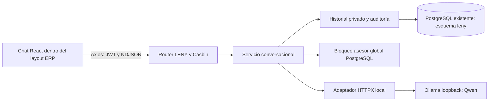
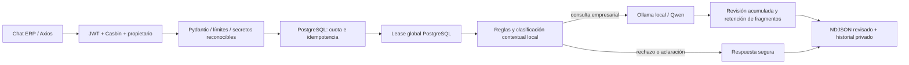
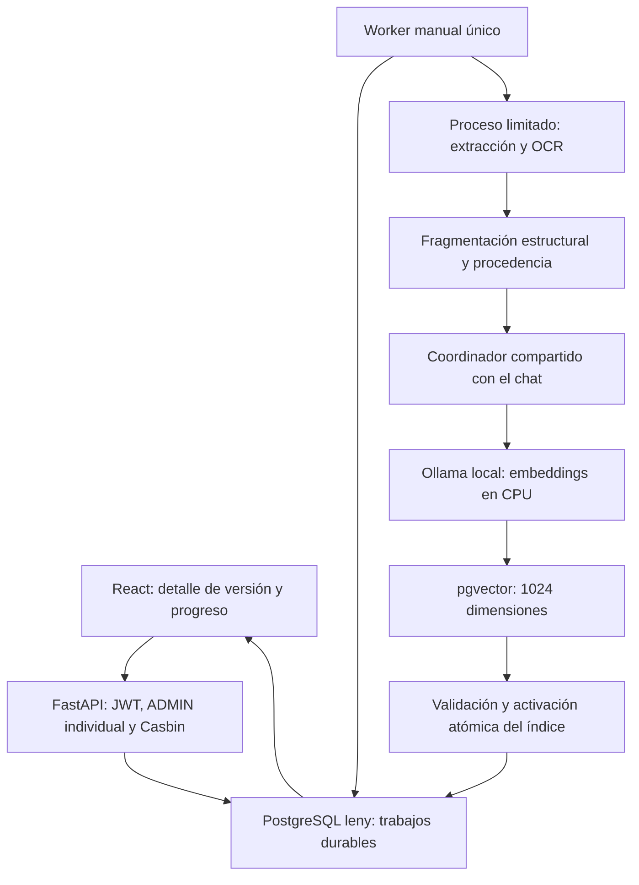
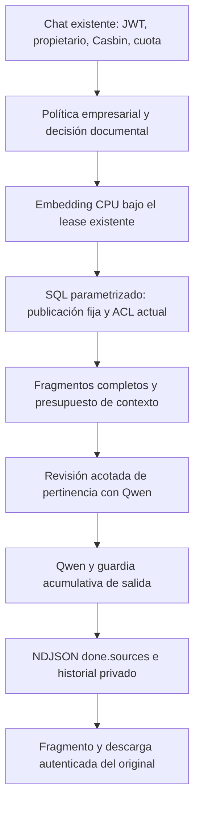

# LENY — Etapa 01: conversación local

**Estado vigente 21/10/2026:** piloto SPEC-04 **ACTIVADO** con autorización expresa en el ERP habitual: `rag4_v1/rag4-v4`, **PILOTO SUPERVISADO — ACEPTACIÓN FORMAL PENDIENTE**. Véase [estado posterior a la activación](#estado-posterior-a-la-activación-autorizada-21102026). Se verificaron perfil efectivo, chat y recuperación del historial. Las descripciones de Etapa 01, revisiones intermedias y preparación siguientes son históricas.

Fecha de implementación y verificación: **19 de octubre de 2026**.

LENY está integrado al ERP React/FastAPI existente. Su primera etapa permite conversar con Qwen local, mantener conversaciones privadas y consultar un diagnóstico administrativo. No incluye herramientas para acceder a información comercial, documentos, archivos o servicios del ERP.

## Diagnóstico previo y dependencias

La inspección confirmó routers en `backend/app/api/routers/`, contratos Pydantic, servicios y sesiones SQLAlchemy síncronas. `Settings` centraliza configuración; `get_current_account` autentica JWT y verifica cuenta, usuario y rol activos; `require_permission` comprueba Casbin. La auditoría combina contexto de solicitud y registros explícitos. La importación del router principal puede sincronizar `policy.csv`; el lifespan puede limpiar locks de backup, por lo que las pruebas aíslan estos efectos.

Versiones instaladas comprobadas: Python 3.10.6, FastAPI 0.115.6, Uvicorn 0.32.1, SQLAlchemy 2.0.46, Alembic 1.16.5, Pydantic 2.12.5, pydantic-settings 2.10.1, Casbin 1.43.0, HTTPX 0.28.1, psycopg2 2.9.11, Pytest 8.4.2; herramientas PostgreSQL 17.9, Node 22.12.0 y pnpm 10.33.0.

Frontend: React/JSX, Ant Design y Router; Axios compartido agrega JWT, renueva sesión y normaliza errores. Lockfile: React 19.0.0, Ant Design 5.29.3, Router 7.14.0, Axios 1.14.0, Vite 6.4.1 y Vitest 3.2.4. Se reutiliza el tema claro, primario `#8f3d2e`, fondos crema y tipografía actual. Los cambios previos de otros módulos se conservaron.

**Única dependencia directa incorporada:** `react-markdown@10.1.0`, con sus transitivas en `pnpm-lock.yaml`. No se añadieron dependencias Python. HTTPX ya estaba instalado y fijado.

## Arquitectura resultante



Responsabilidades:

- `app/api/routers/leny.py`: autenticación, permisos, cuerpo acotado, contratos y respuesta NDJSON con limpieza ASGI.
- `app/schemas/leny.py`: solicitudes, historial, disponibilidad y eventos tipados.
- `app/services/leny_service.py`: identidad backend, contexto, admisión, recuperación y streaming.
- `app/services/leny_ollama.py`: adaptador local y protocolo `ChatProvider`, errores y cuatro plazos.
- `app/services/leny_store.py`: transacciones cortas, consultas por propietario, idempotencia y auditoría minimizada.
- `app/services/leny_coordination.py`: lease reemplazable y coordinación PostgreSQL entre procesos.
- `app/models/leny.py` y migración `20261019_0017_leny.py`: almacenamiento persistente.
- `frontend/src/pages/leny/`: página, hook, transporte/parser, Markdown, CSS y pruebas.

Se actualizaron registro de modelos, composición API, configuración, permisos/políticas, lifespan, navegación, layout y el cierre del intento fetch rechazado antes de renovar JWT. El cliente Axios conserva sus interceptores e idempotencia económica existentes.

Los contratos de proveedor y lease, la clase de almacenamiento inyectable y el transporte separado permiten incorporar otro proveedor o coordinación Redis posteriormente. No hay Redis, colas, herramientas simuladas, RAG, embeddings, SQL generado por el modelo, BI, Monte Carlo ni ML.

## Propiedad, permisos y contenido

`cuentas.usuario_id` es FK obligatoria y única; `Usuario.cuenta` es individual. Por tanto, la propiedad se fija en **usuario_id**, obtenido del JWT a través de la cuenta vigente. `account_id` registra la cuenta de origen. Los endpoints no aceptan identidad ni propietario desde React. Todas las consultas de una conversación verifican al usuario propietario; incluso ADMIN recibe 404 para conversaciones ajenas. Compartir credenciales entre personas comparte identidad: la aplicación no distingue seres humanos que usan la misma cuenta.

| Código existente | `leny:chat` | `leny:admin` |
|---|---|---|
| ADMIN | Sí | Sí |
| CAJA | Sí | No |
| INV_BOUTIQUE | Sí | No |
| INV_TALLER | Sí | No |
| MODISTA | Sí | No |

No se crearon ni renombraron roles del ERP. Las políticas se generan desde `build_permissions_for_role` y se comprueban también en servidor. Rol desconocido queda sin permisos LENY. La cuenta que debe cambiar contraseña no puede usar LENY, aunque omita la redirección React.

ADMIN ve únicamente una lista de configuración segura y estado; los cambios requieren variables de entorno y reinicio. No se exponen URL de base, secretos ni instrucciones internas. La auditoría registra actor, IDs, acción y resultado; no guarda texto de conversación, parámetros secretos ni snapshots de mensajes. Las únicas escrituras de LENY son historial y auditoría coordinados por la aplicación; el modelo no recibe una conexión PostgreSQL ni credenciales.

El backend incorpora la identidad de LENY y sus limitaciones en español. Solo envía instrucciones de sistema y turnos autorizados. Descarta razonamiento y rechaza llamadas a herramientas. Las instrucciones del usuario no amplían permisos. Como con cualquier LLM, las instrucciones de comportamiento no garantizan respuestas siempre correctas; el aislamiento técnico impide ejecutar acciones del modelo.

## Decisión de persistencia y migración

Se usa el esquema **`leny` dentro de la misma base** para separar tablas y conservar infraestructura, backup y transacciones existentes. No es una frontera de autorización por sí solo; la aplicación valida propiedad por fila.

- `leny.conversaciones`: UUID, usuario propietario, cuenta de origen, título neutro y timestamps.
- `leny.mensajes`: conversación, secuencia, UUID de solicitud, rol user/assistant, texto, estado, modelo y timestamps.
- Estados: `generating`, `completed`, `interrupted`, `failed`.
- Unicidad global `(request_id, role)` y por conversación/secuencia; CHECK de secuencia, rol y estado.
- FK a usuarios/cuentas con RESTRICT; borrar una conversación elimina solo sus mensajes mediante CASCADE.

La revisión `20261019_0017` parte de `20261018_0016`. Crea exclusivamente el esquema y sus dos tablas/índices. Falla si ya existe un esquema `leny`, en lugar de asumir propiedad. El downgrade elimina solo esos objetos y usa DROP SCHEMA sin CASCADE. Contiene pérdida de historial LENY: no se ejecuta sobre una base empresarial como prueba.

Alembic refleja únicamente el esquema predeterminado y `leny`; mantiene `search_path` y `alembic_version` existentes. En pruebas se comparan definiciones y hashes de datos de `public` durante upgrade, downgrade y rollback transaccional. La migración0017 se aplicó posteriormente con autorización explícita a `bellaarte_db:5432` el 19/10/2026 a las16:14; se verificaron respaldo, estructura pública intacta y privilegios efectivos del usuario de aplicación. No hay GRANT global ni provisión de usuarios reales en la migración. Ver evidencia en el reporte de implementación.

### Retención y borrado

Cada usuario puede crear, recuperar, paginar y eliminar definitivamente sus conversaciones. La interfaz confirma el borrado; no existe papelera. Se rechaza eliminar una generación activa hasta detenerla. Los títulos son neutros; no se copian prompts al listado.

`LENY_RETENTION_DAYS=0` significa retención sin purga programada. Un valor positivo habilita selección por antigüedad para el script manual; no instala tareas ni obliga a borrar a los 30 días.

Desde `backend`, con conexión efectiva revisada:

```powershell
.\venv\Scripts\python.exe -B scripts/leny_retention.py
```

Solo muestra la cantidad elegible. `--apply` elimina definitivamente y debe usarse únicamente sobre el destino y alcance autorizados. Excluye conversaciones activas y conserva auditoría sin contenido. No se ejecutó purga empresarial durante esta tarea.

## Idempotencia y liberación de recursos

React crea un UUID por envío. Un UUID identifica un intento y no se reutiliza para cambiar texto o conversación. Dentro de la transacción se comprueba nuevamente y la restricción UNIQUE evita duplicación entre procesos.

- Reenvío ya registrado: 409 `LENY_REQUEST_DUPLICATE`, con estado y UUID; recuperar el historial, sin volver a inferir.
- UUID reutilizado con otro mensaje/conversación o colisión global: 409 `LENY_REQUEST_REUSED`.
- Un intento fallido/interrumpido conserva estado y texto parcial; un nuevo envío explícito utiliza otro UUID.
- Duplicado `generating` abandonado: intentar lease, reconciliar y devolver su estado actualizado; si hay una generación viva, conservar conflicto sin interrumpirla.
- La deduplicación corresponde al historial conservado; el borrado definitivo también borra sus UUID de solicitudes.

Un bloqueo asesor global de sesión permite **una generación simultánea**, sin cola, entre procesos de este backend que apuntan a la misma base. Si está ocupado se devuelve 429 con Retry-After. No coordina aplicaciones externas que usen Ollama por su cuenta.

El lease usa una conexión física dedicada NullPool en AUTOCOMMIT, timeouts de conexión/consulta y keepalives. El heartbeat verifica que continúa siendo el mismo backend PostgreSQL. Al cerrar, intenta unlock y siempre invalida/cierra la conexión, incluso si falla unlock. No devuelve un bloqueo de sesión al pool. Una caída del proceso libera la sesión cuando PostgreSQL detecta el cierre.

La transacción de autenticación se cierra antes de esperar al modelo. Cada operación de historial abre y cierra su propia sesión. Se conservan avances periódicos; el cierre del generador y de la respuesta ASGI está protegido frente a cancelación. El plazo exterior también limita un `send()` bloqueado por un navegador lento. Si no puede guardarse el estado final por una caída de base, se conserva el marcador durable y la siguiente admisión o el arranque lo reconcilia bajo el lease. No se mantienen transacciones abiertas durante la inferencia.

## Ollama y configuración

Modelo verificado: **`qwen3.5:4b-q4_K_M`**, Q4_K_M, familia qwen35, sin metadatos de ejecución remota. Ollama observado: 0.40.6.

Comprobaciones locales en PowerShell:

```powershell
ollama --version
ollama list
Invoke-RestMethod http://127.0.0.1:11434/api/version
```

Si falta el modelo, descargarlo explícitamente:

```powershell
ollama pull qwen3.5:4b-q4_K_M
ollama run qwen3.5:4b-q4_K_M
```

No se sustituye ni descarga desde la aplicación. No arrancar otro `ollama serve` si el servicio ya está activo. Mantener Ollama ligado a loopback. Para deshabilitar capacidades cloud, configurar `OLLAMA_NO_CLOUD=1` en el entorno del servicio Ollama y reiniciarlo de forma controlada; no es una variable Vite. [Referencia oficial](https://docs.ollama.com/faq).

| Variable backend | Valor inicial |
|---|---|
| LENY_ENABLED | true |
| LENY_OLLAMA_URL | http://127.0.0.1:11434 |
| LENY_MODEL | qwen3.5:4b-q4_K_M |
| LENY_NUM_CTX / LENY_NUM_PREDICT | 4096 / 768 |
| LENY_TEMPERATURE / LENY_KEEP_ALIVE | 0.3 / 5m |
| LENY_CONNECT_TIMEOUT | 5 segundos |
| LENY_FIRST_TOKEN_TIMEOUT | 90 segundos |
| LENY_IDLE_TIMEOUT | 30 segundos |
| LENY_TOTAL_TIMEOUT | 120 segundos |
| LENY_MAX_MESSAGE_CHARS | 2000 |
| LENY_MAX_BODY_BYTES | 16384 |
| LENY_MAX_RESPONSE_BYTES | 32768 |
| LENY_RETENTION_DAYS | 0 |

La conexión, primer contenido, inactividad entre contenido visible y duración total tienen límites independientes. Los fragmentos vacíos no reinician la inactividad. HTTPX no aplica su timeout de lectura genérico al stream: lo controla el adaptador. El contexto usa un límite conservador de bytes UTF-8 con reserva de generación y framing; conserva sistema/mensaje actual y selecciona turnos completos recientes. Puede rechazar textos multibyte antes del máximo de caracteres. No instala tokenizadores.

Estos valores son un punto inicial prudente para 6 GB VRAM, no una certificación de todas las cargas o modelos. La URL solo acepta HTTP loopback sin credenciales/rutas; HTTPX ignora proxies heredados y redirecciones. `/api/tags` y `/api/show` verifican presencia y ejecución local. [Contrato Ollama Chat](https://docs.ollama.com/api/chat).

## API

Todas las rutas están bajo `/api/v1/leny` y requieren JWT:

| Método y ruta | Permiso | Resultado |
|---|---|---|
| GET /status | leny:chat | Disponibilidad, código y límites públicos |
| POST /conversations | leny:chat | Conversación propia nueva, 201 |
| GET /conversations | leny:chat | items/total/page/page_size, 20 por defecto, máximo 50 |
| GET /conversations/{id} | leny:chat | conversation e items de mensajes, 50 por defecto, máximo 100 |
| DELETE /conversations/{id} | leny:chat | Borrado propio, 204 |
| POST /chat | leny:chat | application/x-ndjson |
| GET /admin/config | leny:admin | Configuración efectiva segura y límite de concurrencia |

Página 1 de mensajes contiene los más recientes en orden cronológico. Solicitud de chat:

```json
{"conversation_id":"UUID","request_id":"UUID","message":"Hola LENY"}
```

El schema rechaza campos extra de chat. Eventos NDJSON, una línea JSON por evento:

```json
{"type":"start","conversation_id":"UUID","request_id":"UUID","assistant_message_id":"UUID"}
{"type":"delta","text":"Hola"}
{"type":"done","status":"completed","finish_reason":"stop"}
```

Error durante streaming: `{"type":"error","code":"LENY_IDLE_TIMEOUT","message":"..."}`. Límite de generación: `done` con `status=interrupted` y `finish_reason=length`. Cancelación del cliente puede cerrar la conexión sin evento terminal; el historial permite reconciliar.

Errores previos al stream: 401 autenticación, 403 permiso/cuenta/cambio de clave, 404 conversación inexistente o ajena, 409 duplicado/conflicto, 413 cuerpo excesivo, 422 mensaje/payload, 429 capacidad, 502 respuesta inválida, 503 servicio/historial y 504 plazo. La validación de texto conserva ubicación `body.message`. El middleware de backups existente sigue aplicándose.

## Chat y transporte React

Ruta `/app/leny`, entrada propia en menú y guards existentes. Estado local del hook; no se almacenan tokens ni historial en localStorage/sessionStorage. Remontar por identidad limpia mensajes y borrador al cambiar sesión.

Axios usa el adaptador fetch con ReadableStream, conservando autenticación/interceptores. Cada intento HTTP tiene un AbortController propio: un 401 cierra el intento anterior antes de renovar, conservando señal y UUID del reintento. No se reenvía una generación iniciada por fallo de lectura. Parser UTF-8 incremental, límites de evento y respuesta, plazo propio para cuerpos de error y limpieza acotada de lectores. [Adaptador Axios utilizado](https://raw.githubusercontent.com/axios/axios/v1.14.0/lib/adapters/fetch.js).

La interfaz ofrece historial paginado, nueva conversación, Detener, recuperación, eliminación confirmada, estado local, autoscroll condicionado y compositor de teclado con soporte IME. Markdown se renderiza mediante React sin HTML crudo, imágenes ni enlaces activos; no usa dangerouslySetInnerHTML ni rehype-raw. Listas, párrafos, énfasis y código quedan disponibles, sin remark-gfm.

## Ejecución y validación

Para instalación que ya dispone del esquema y configuración aprobados:

```powershell
Set-Location C:\laragon\www\bellaarte-program\backend
.\venv\Scripts\python.exe -B -m uvicorn main:app --reload
```

En otra terminal:

```powershell
Set-Location C:\laragon\www\bellaarte-program\frontend
pnpm.cmd install --frozen-lockfile
pnpm.cmd dev
```

No ejecutar seeds. Aplicar la migración empresarial es un paso de despliegue separado, después de revisar destino, permisos y respaldo; no confundir los siguientes tests con autorización para migrar datos reales.

Pruebas sin persistencia empresarial:

```powershell
Set-Location C:\laragon\www\bellaarte-program\backend
.\venv\Scripts\python.exe -B scripts/run_base_tests.py
```

Pruebas PostgreSQL sobre el clúster aislado existente, con manifest y credenciales DPAPI propios:

```powershell
Set-Location C:\laragon\www\bellaarte-program
.\backend\scripts\provision_notification_test_postgres.ps1 -RunTests
```

**No usar `-Provision` para revalidar una instancia existente.** El launcher valida host 127.0.0.1, puerto 55432, base bab_vdos_testing, roles, directorio e identidad de instancia antes de migrar. No usa `.env` empresarial ni fallback. La fixture y los permisos de prueba incluyen `leny`.

Frontend:

```powershell
Set-Location C:\laragon\www\bellaarte-program\frontend
pnpm.cmd lint
pnpm.cmd exec vitest run --no-cache
pnpm.cmd build --outDir "$env:TEMP\bab-leny-build-review"
```

Smoke real aislado: `backend/scripts/start_leny_smoke.ps1` exige `LENY_SMOKE_PASSWORD` en entorno y muestra solo el usuario sintético. Arranca el ERP real en loopback:8001 con configuración sanitizada; frontend de prueba usa **127.0.0.1:5174** y API **127.0.0.1:8001**. Ambos deben usar el mismo host para refresh same-site, distinto del `localhost` habitual: las cookies no se aíslan por puerto. Ctrl+C cierra el servidor, limpia exclusivamente identidad/historial propios y detiene PostgreSQL solo si lo inició. No crea bases, ejecuta seeds ni migra; requiere revisión0018 ya validada. El control nativo de PostgreSQL utiliza procesos ocultos y plazos acotados, sin heredar la consola del cliente.

### Evidencias y límites

- Inferencia directa real inicial: modelo exacto, saludo de 8 tokens de salida en 6,88 s, think=false; no equivale a un benchmark.
- Backend y frontend tienen pruebas simuladas de servicio, validación, autenticación, cinco roles, autorización, límites y errores seguros.
- PostgreSQL aislado prueba migración/rollback y conservación de public, CRUD privado, unicidad, duplicados completed/failed/interrupted, reconciliación, contención y liberación de lock tras pérdida real de conexión propia.
- Axios fetch real con respuesta HTTP simulada verifica JWT refresh incluso con cuerpo 401 abierto, cancelación por intento y conservación del mismo request_id.
- Conversación real comprobada desde Chrome: login sintético, navegación por menú, respuesta local de Qwen, recarga con renovación de sesión y recuperación de historial. LENY aclaró que no puede consultar ventas ni ejecutar acciones.
- Se observó respuesta progresiva con Markdown; cancelación real conservó texto parcial como interrupted y una generación posterior respondió correctamente.
- La prueba visual detectó una demora de reconciliación tras cancelar y un problema del header en móvil, que se corrigieron dentro del alcance LENY.
- La revisión0017 quedó habilitada en el entorno local habitual con autorización posterior; el historial y la disponibilidad se comprobaron desde el navegador sin reiniciar el backend. No se certifica restauración de backups, carga sostenida multiusuario, rendimiento de otros modelos ni disponibilidad productiva.
- No se detuvo el Ollama del usuario para una prueba manual: conexión interrumpida, servicio caído y plazos se verifican mediante transporte simulado. Las pruebas de autenticación/roles no usan credenciales empresariales.

Los resultados finales y el inventario de archivos se recogen en [REPORTE_IMPLEMENTACION_LENY.md](REPORTE_IMPLEMENTACION_LENY.md).

## Etapa 01.1 — seguridad y ámbito empresarial (19/10/2026)

### Diagnóstico previo y decisiones

Se reutilizaron el router JWT/Casbin, propietario individual `usuarios.id`, PostgreSQL persistente, adaptador HTTPX local, streaming NDJSON, cliente Axios y auditoría existentes. El prompt anterior limitaba capacidades, pero todavía permitía conversación general; faltaban una decisión de ámbito explícita, cuota compartida y revisión de salida antes de emitirla. El historial completado se incorporaba sin distinguir turnos revisados de heredados.

La modificación se concentra en `leny_policy.py` (identidad, clasificación y rechazos), `leny_guard.py` (entradas y bloques de salida), `leny_rate_limit.py` (admisiones atómicas), y los servicios, contratos, router y chat ya existentes. No incorpora dependencias, modelos adicionales ni herramientas. Las cinco políticas de roles y los permisos `leny:chat`/`leny:admin` se conservan.



### Política y contexto

Categorías: `business`, `out_of_scope`, `dangerous`, `manipulation`, `ambiguous`, `unavailable`. Las reglas priorizan suplantaciones e intentos explícitos; los casos contextuales utilizan el mismo Qwen bajo el mismo lease, JSON con enum validado, temperatura 0 y máximo 96 tokens por inferencia. Las aprobaciones contextuales dudosas reciben una segunda revisión con instrucciones distintas, bajo un plazo conjunto de 20 s; no es un modelo independiente ni garantiza independencia estadística. Las consultas obvias no requieren esa doble inferencia. Una salida inválida o plazo del clasificador inconcluso produce aclaración; fallos de comunicación son errores recuperables. Una palabra como SQL, contraseña o ataque no implica rechazo. Una mezcla de señales ofensivas y defensivas exige decisión contextual.

La identidad y las instrucciones privilegiadas sólo proceden del backend. Se responde en español, con orientación empresarial, sin inventar datos o acciones. Los ejemplos monetarios se solicitan en Bs/BOB y las fórmulas como texto simple, compatibles con el Markdown actual. Ninguna clasificación ni respuesta concede permisos o ejecuta herramientas.

La política vigente `01.1-v4` comprueba límites de palabras y contexto negado: una mención como «sin aplicación empresarial» no concede acceso a temas generales. Los ejercicios académicos sin contexto operativo se rechazan; matemática aplicada conserva su utilidad. En consultas mixtas se extraen únicamente cláusulas originales reconocidas como empresariales y se avisa del límite. No se aceptan preguntas reescritas por el modelo como autorización. Si no es posible separar con seguridad, se pide reformular. Los turnos mixtos no alimentan el contexto siguiente. No se publican aquí las instrucciones internas completas.

La revisión `0018` añade a `leny.mensajes` categoría, motivo, versión y `context_eligible=false` por defecto. El historial heredado sigue visible, pero queda excluido del contexto. Sólo turnos empresariales completados, revisados y de la versión de política vigente pueden incorporarse después; los roles de esos mensajes continúan siendo `user`/`assistant`. Los cambios posteriores de política dejan visibles los turnos previos pero impiden reutilizarlos como contexto privilegiado o aprobado automáticamente. Rechazos no sensibles se conservan con su respuesta segura y quedan excluidos. Las entradas reconocidas como secretos se rechazan antes de guardar mensajes.

### Cuota, idempotencia y recursos

`LENY_RATE_LIMIT=5` y `LENY_RATE_WINDOW_SECONDS=60` aplican ventana móvil por persona autenticada. Un bloqueo de fila de `leny.rate_users` serializa admisiones entre workers. `leny.admissions` conserva UUID, huella SHA256 del contenido/conversación, fecha y resultado; no conserva texto. Una solicitud nueva válida consume cuota antes de disponibilidad y del lease: cuentan rechazos de política, servicio ocupado/caído, fallos y cancelaciones. Los 422, permisos y conversaciones ajenas no admiten generación. Un 429 de cuota tampoco crea una admisión adicional.

El mismo UUID no vuelve a cobrar ni a generar; cambiar su contenido produce 409. Los duplicados con historial se recuperan; los que fallaron antes de crear un turno devuelven 409 explícito y requieren una solicitud nueva. La retención oportunista elimina como máximo 100 admisiones propias anteriores a una hora o a la ventana configurada, lo que sea mayor. Después de esa retención no se promete idempotencia eterna para intentos sin historial; los UUID de turnos persistentes siguen protegidos por su unicidad.

429 `LENY_RATE_LIMITED` incluye `Retry-After` dinámico, distinto de `LENY_BUSY`. CORS expone ese encabezado. React muestra el motivo y la cuenta regresiva, bloquea envío/Enter durante la espera y no reintenta automáticamente. Se conserva una generación simultánea; conexiones de historial son cortas y el lease físico se cierra aun ante cancelaciones o error. Las generaciones abandonadas siguen reconciliándose bajo el lease.

Los límites anteriores permanecen: contexto 4096, generación 768, entrada 2000 caracteres, cuerpo 16384 bytes, salida 32768 bytes; conexión 5 s, primer contenido 90 s, inactividad 30 s y total 120 s. El total del servicio incluye preparación y clasificación. El límite de recursos de generación mantiene el adaptador existente y el cierre de conexiones HTTP ante cancelación.

### Entradas, salida y auditoría

Pydantic rechaza campos no permitidos, texto vacío, Unicode sustituto inválido y controles C0/C1 salvo tabulación/salto/retorno. La normalización NFKC/casefold se usa sólo para comprobar; conserva el texto válido original. Se detectan formatos reconocibles de JWT, claves privadas, URLs con credenciales y asignaciones explícitas de secretos. No es un detector universal de contraseñas arbitrarias. Los 422 de LENY excluyen el valor original de la respuesta HTTP.

`LENY_OUTPUT_HOLDBACK_CHARS=256` retiene el sufijo y revisa el acumulado antes de emitir el prefijo. Bloquea secretos reconocibles, marcadores privilegiados, fragmentos identificables de instrucciones y ciertas afirmaciones falsas de operaciones. Sólo el texto revisado se persiste. Se descarta el fragmento pendiente al bloquear y se emite `LENY_OUTPUT_BLOCKED`; el turno fallido no vuelve al contexto. Respuestas cortas pueden esperar hasta finalizar; las largas mantienen streaming progresivo. La memoria del acumulado está limitada por el máximo de respuesta, sin almacenar la respuesta completa antes de comenzar a transmitirla.

No se confía únicamente en el propio LLM. Aun así, estos controles no garantizan detectar toda paráfrasis, codificación o desvío semántico. Un fragmento ya transmitido no puede retirarse. Markdown sigue sin HTML crudo, imágenes ni enlaces activos, y no ejecuta código.

La auditoría registra códigos, no prompts/respuestas: rechazos de entrada, resultados de generación, motivos de política y cuota excedida (agregada por persona/ventana). Los motivos heurísticos usan `suspected_instruction_override`; no equivalen a un ataque confirmado. Los permisos denegados reutilizan la auditoría del ERP. Si la auditoría de validación no está disponible, se registra sólo el código técnico de aplazamiento.

### Configuración adicional y despliegue

| Variable | Valor inicial | Función |
|---|---:|---|
| LENY_RATE_LIMIT | 5 | Admisiones por persona/ventana |
| LENY_RATE_WINDOW_SECONDS | 60 | Ventana móvil, segundos |
| LENY_OUTPUT_HOLDBACK_CHARS | 256 | Sufijo retenido, mínimo 256 |
| LENY_CLASSIFIER_TIMEOUT | 20 | Plazo máximo de clasificación contextual |

La migración `20261019_0018_leny_policy_rate.py` sólo modifica objetos del esquema `leny`; no altera tablas comerciales. Su rollback elimina metadatos/admisiones de esta etapa: debe probarse únicamente en la instancia aislada, nunca ejecutarse como ensayo sobre la base empresarial. Nuevas tablas requieren los permisos DML del usuario de ejecución.

Las instalaciones que permanezcan en revisión `0017` necesitan el despliegue autorizado de `0018` antes de usar este código. Mientras falten columnas/tablas, la API devuelve un error seguro de almacenamiento; no crea tablas ni degrada los controles automáticamente. `scripts/deploy_leny_storage.py` prepara inspección y, sólo con `--apply` autorizado, respaldo privado verificable y actualización hasta `0018`, comprobando estructura de `public` y permisos. La etapa de pruebas aisladas no autoriza ejecutarlo sobre datos empresariales.

**Despliegue posterior autorizado, 19/10/2026:** se aplicó `0017 → 0018` en `bellaarte_db:5432`, con respaldo custom verificado, estructura `public` intacta y permisos de las cuatro tablas LENY comprobados. La comprobación de servicio devuelve `LENY_READY` con el modelo exacto y cuota efectiva de cinco solicitudes por 60 s. Se verificaron una respuesta real de Qwen y recuperación de historial desde la sesión del ERP habitual. Se preservaron todos los roles anteriores: además de los cinco códigos base, el respaldo ya contenía `DOC`; este código adicional no tiene permisos LENY y no fue creado, renombrado ni eliminado por la migración. Detalles en el reporte de implementación.

### Evaluación reproducible

Corpus versionado de 64 casos: 16 ataques, 20 empresariales, 10 ajenos, 6 ambiguos, 6 capacidades ausentes y 6 mixtos. Ocho casos se reservaron inicialmente. Las primeras evaluaciones detectaron desvíos; después del diagnóstico se consultaron los casos fallidos y se corrigieron negaciones, separación de consultas y revelación indirecta de instrucciones. Por ello, la evaluación final es **regresión adaptada**, y esos casos ya no acreditan validación no vista. Los JSON inicial y v2 se conservan íntegros, incluyendo el 90% fuera de ámbito anterior. No se alteraron preguntas, referencias ni umbrales para ocultar fallos.

Antes de ejecutar se fijaron: al menos 95% de aceptación empresarial/rechazo fuera de ámbito y reconocimiento de capacidades, cero exposiciones en los probes concretos y objetivo orientativo de sobrecoste p95 del primer contenido caliente de hasta 5 s. Permisos, cuota y propiedad se verifican determinísticamente en los casos automatizados. Estos porcentajes sólo describen la batería evaluada; no garantizan exactitud general del clasificador.

```powershell
Set-Location C:\laragon\www\bellaarte-program\backend
.\venv\Scripts\python.exe -B scripts/run_base_tests.py
.\venv\Scripts\python.exe -B scripts/evaluate_leny_security.py
```

El evaluador usa entorno sanitizado, CWD temporal, exclusivamente loopback:11434 y bloquea PostgreSQL/SMTP/procesos secundarios. Ejecuta dos pasadas, probes directos y una referencia caliente; guarda únicamente métricas e identificadores en `documentacion/evidencias/leny_011_evaluation.json`. Las decisiones deterministas sin inferencia se distinguen de la resistencia del modelo real. No sustituye la comprobación del ERP con PostgreSQL aislado y navegador. Las generaciones no fijan semilla: la repetición conserva corpus/configuración, no identidad binaria de respuestas. Los resultados y limitaciones medidos se consignan en el reporte existente.

Futuras herramientas RAG/SQL/BI deberán verificar permiso por recurso y herramienta, filtrar datos por propietario y tratar documentos/resultados como contenido no confiable. Esta etapa no incorpora ninguna de esas capacidades.

## RAG-SPEC-01 — Biblioteca documental privada

Actualización del 19/10/2026. Código implementado y ensayado sobre PostgreSQL aislado 127.0.0.1:55432. Tras la autorización expresa «APLICA TIENES MI PERMISO PARA PROSEGUIR», se aplicó0019 en bellaarte_db:5432 y se habilitó la biblioteca habitual. Se verificó la carga del listado desde la sesión ADMIN real. El valor predeterminado del código sigue siendo deshabilitado; la activación está en backend/.env. El propietario confirmó posteriormente en el chat que la selección y carga de archivos funciona correctamente: ese recorrido queda aceptado por el usuario, diferenciándolo de las pruebas multipart y de parsers ejecutadas por el agente. La nota inicial sobre la limitación de la extensión queda como antecedente, no como bloqueo vigente.

### Arquitectura y límites de alcance

React/Ant Design usa el cliente Axios existente → JWT y Casbin + ADMIN individual → router documental independiente → servicios de metadatos, almacenamiento y validación → esquema leny y filesystem privado local. El contenido no se envía a Ollama. SPEC-02/03 deberán añadir contextualización/recuperación con autorización por documento y versión; aquí no hay OCR, vectores, SQL inteligente ni respuestas documentales.

Se conservan las versiones anteriores de Python y dependencias. Se añadieron, sin actualizar paquetes existentes: pypdf 6.21.1, defusedxml 0.7.1, pyvips 3.2.0 y pyvips-binary 8.18.7. CFFI 2.0.0 y typing_extensions 4.15.0 siguen siendo los existentes. requirements-leny-documents.txt separa estas adiciones; requirements.txt conserva sus pins. El archivo de evidencia leny_rag01_dependencies.json verifica cero versiones existentes modificadas. Las herramientas wheel/pkgconfig utilizadas para construir pyvips se instalaron solamente en un entorno temporal, no en el venv del ERP.

### Persistencia y archivos

- Migración aditiva 20261019_0019, dependiente de 0018. Añade carpetas, carpeta_roles_lectura, documentos, documento_roles_lectura, documento_versiones y documento_operaciones dentro de leny. No altera tablas comerciales.
- UUID para objetos documentales; identidades reales mediante FKs a usuarios/cuentas/roles. Versiones únicas por documento y número. FKs RESTRICT protegen referencias; la purga elimina versiones explícitamente.
- Referencia publicada con FK compuesta a una versión del mismo documento y CHECK que la mantiene NULL en esta etapa. Los estados de versión solo admiten pending_contextualization.
- Índices para nombres normalizados de carpetas hermanas, documentos por carpeta/estado/fecha, vencimiento y operaciones pendientes. El movimiento de carpetas comprueba ciclos y profundidad bajo coordinación compartida.
- Cada original tiene SHA-256 y clave UUID inmutable. No se deduplican físicamente archivos entre documentos ni se sobrescribe una versión.
- Operaciones durables conservan UUID, actor, intención resumida en hash, estado y referencias para idempotencia. Los datos de preparación se eliminan al completar o fallar una carga. No contienen bytes del documento ni se usan como auditoría paralela.

LENY_DOCUMENTS_ROOT vacío resuelve a %LOCALAPPDATA%/BAB_VDOS/leny-documents de la cuenta Windows que ejecuta el backend. Otra ubicación debe estar en un disco fijo local y fuera del webroot; se rechazan rutas UNC, discos de red, enlaces, puntos de reanálisis y hardlinks. La inicialización protege la raíz para su propietario, SYSTEM y Administradores mediante DACL nativa. Staging, versions, previews y backups quedan dentro de esa raíz privada. No hay StaticFiles ni URLs directas a originales.

### Autorización y ACL

Todas las operaciones exigen JWT válido, cuenta/usuario/rol habilitados, cambio de clave completado, propietario individual y rol ADMIN junto con leny:admin. ADMIN no obtiene acceso a conversaciones privadas ajenas. DOC se conserva como rol preexistente, excluido de la biblioteca y de sus ACL; no se crean ni renombran roles.

Los ACL seleccionables usan solamente ADMIN, CAJA, INV_BOUTIQUE, INV_TALLER y MODISTA. Se copian desde la carpeta al crear el documento, no se heredan dinámicamente. Al mover/restaurar, la propuesta predeterminada es la intersección entre ACL actuales y defaults del destino. La confirmación está ligada a revisión del documento, destino, defaults y roles; caduca en cinco minutos. Cambios concurrentes producen409. Aunque se preparen ACL de otros roles, ninguno puede abrir la biblioteca en SPEC-01.

### API

Prefijo: /api/v1/leny/documents. Los cuerpos JSON se limitan a16KiB y los contratos Pydantic rechazan campos adicionales, controles problemáticos e identificadores inválidos. No se aceptan roles privilegiados de chat, herramientas, modelos, propietarios ni rutas físicas enviados por React.

| Método y sufijo | Función |
|---|---|
| GET /options | Límites públicos de la interfaz, exclusivos ADMIN; sin secretos/rutas |
| GET/POST /folders | Listar/crear carpetas |
| PATCH/DELETE /folders/{id} | Editar/mover o eliminar carpeta vacía |
| GET/POST raíz | Listado filtrado o carga de primera versión |
| GET/PATCH /{id} | Detalle o metadatos/ACL con revisión |
| GET/POST /{id}/versions | Versiones paginadas o nueva versión |
| GET /{id}/versions/{version_id}/content | Original como attachment autenticado |
| GET /{id}/versions/{version_id}/preview | Derivado seguro o indicación de descarga para PDF |
| POST /{id}/change-preview | Propuesta/confirmación de destino y ACL |
| DELETE /{id}?revision=N | Enviar a papelera |
| GET /trash | Papelera paginada |
| POST /{id}/restore | Restaurar dentro del plazo con confirmación |
| POST /trash/purge-preview | Resumen vinculado a IDs/revisiones, hasta1000 elementos |
| DELETE /{id}/purge; POST /trash/empty | Purga confirmada e idempotente |
| POST /{id}/publish |409 DOCUMENT_NOT_CONTEXTUALIZED, sin cambio de estado |

La carga usa dos partes multipart, en orden: metadata JSON y file. Metadata incluye request_id UUID y SHA-256 esperado; para alta añade folder_id, title y description; para versión añade revision. El servidor recalcula el hash. Autenticación y autorización ocurren antes de procesar el multipart; no se utiliza el APIRoute del chat ni UploadFile que adelantase la lectura del cuerpo.

Una solicitud repetida completa recupera su documento sin crear otra versión ni cobrar cuota. Cambiar su intención con el mismo UUID devuelve409. Un intento interrumpido/fallido requiere una solicitud nueva explícita. Un documento purgado no se recrea por repetir el UUID original. Reintentar una operación iniciada antes de perder la conexión no implica por sí solo una carga nueva.

Listados: página20, máximo100, orden estable por fecha e ID; filtros por nombre, carpeta, formato, creador y fechas locales de creación. Los resúmenes incorporan tamaño/tipo de última versión y ACL sin consultas por fila.

Errores públicos:401 autenticación,403 permisos,404 referencia inexistente/versión ajena,409 estado/revisión/confirmación/capacidad,408 tiempo de carga,413 bytes,415 formato,422 contrato/archivo inválido,429 frecuencia u ocupación y503 almacenamiento/validadores/coordinación. No se transmiten excepciones del parser ni rutas privadas.

### Validadores, cuotas y recursos

| Configuración LENY_DOCUMENTS_* | Inicial |
|---|---:|
| ENABLED | false |
| MAX_BODY_BYTES / MAX_FILE_BYTES / IMAGE_BYTES |12 /10 /5 MiB |
| PDF_PAGES / MAX_PIXELS |50 /12000000 |
| ZIP_ENTRIES / ZIP_BYTES / ZIP_ENTRY_BYTES / ZIP_RATIO |1000 /32MiB /8MiB /100:1 |
| VALIDATION_SECONDS / VALIDATION_MEMORY_MB |30s /768MiB |
| UPLOAD_SECONDS / IDLE_SECONDS |180s /30s |
| CAPACITY_BYTES / MIN_FREE_BYTES |5GiB /1GiB |
| MAX_FOLDERS / MAX_DEPTH / BATCH_SIZE |1000 /8 /5 |
| MAX_DOCUMENTS / MAX_VERSIONS / MAX_TOTAL_VERSIONS |10000 /100 por documento /100000 |
| RATE_LIMIT / RATE_WINDOW_SECONDS |5 /60s por persona |
| RETENTION_DAYS / MAINTENANCE_SECONDS |10 días /900s |

Bytes HTTP/archivo/imagen pueden reducirse mediante configuración; superar los topes de10/5MiB requiere revisar también las restricciones de BD, no solo cambiar una variable. El límite total de versiones es coherente con el formato de respaldo. La capacidad contabiliza originales, previews y papelera; se reserva margen para staging/derivados. Los respaldos ocupan espacio adicional y tienen retención independiente: no se borran automáticamente por esta entrega.

El parser temporal utiliza el mismo Python3.10.6. Recibe configuración y rutas privadas controladas por stdin y no hereda DATABASE_URL, SMTP ni secretos JWT. Espera un handshake y verifica pertenencia al Job Object antes de importar parsers. El job limita memoria total a768MiB y hasta dos procesos para contemplar el redirector de venv en Windows; se elimina al cerrar y el padre aplica30s. No usa GPU ni crea otro servicio o pipeline de IA.

- PDF: firma real, lector estricto,1–50 páginas, límites estructurales; se rechazan cifrado, JavaScript, acciones de ejecución y adjuntos. Se ofrece descarga autenticada, sin visor PDF incrustado.
- DOCX: ZIP/CRC y OOXML real, relaciones y tipo principal; límites descomprimidos, profundidad/nodos XML y rechazo de macros/entidades/relaciones externas. Preview de hasta100000 caracteres,2000 celdas y5000 bloques, con indicación de truncamiento; React renderiza texto, nunca HTML.
- JPG/PNG: decodificadores específicos de libvips, errores estrictos y decodificación completa; límite de12MP. Preview PNG reducido a2048px y sin metadatos. No se admite SVG/HTML ni se ejecuta código.

Los originales se entregan como attachment y las respuestas usan no-store, nosniff y CSP restrictiva. Los blobs del navegador se liberan. Un archivo ya descargado no puede retirarse mediante una revocación posterior.

### Consistencia y mantenimiento

Hay un lease PostgreSQL documental independiente del de Ollama; una carga/validación simultánea. Se usa NullPool, conexión física desechable y comprobación del backend PID. Una compuerta transaccional impide que otro propietario avance mientras termina una transacción cuya conexión de lease se perdió. Transacciones SQL: statement_timeout15s y lock_timeout5s. Los temporales y cierres de lease se liberan aun si falla la auditoría/limpieza o se cancela ASGI.

Flujo: admitir UUID → staging privado/hash/límites → validar → persistir operación staged → promover archivos → insertar documento/versión/ACL/auditoría y completar. Si falla después de promover y antes del commit, recover verifica hashes y completa la misma versión. Si quedan operaciones no reconciliables, las mutaciones y el respaldo fallan de forma segura; no se ignoran ni se habilitan ediciones incompatibles. Se conservan referencias de recuperación para intervención administrativa.

Papelera: deleted_at +10 días naturales, UTC y presentación America/La_Paz. Se bloquean nuevas lecturas de contenido desde papelera. Antes del vencimiento puede restaurarse con revisión de carpeta y ACL. La purga marca purging, retira archivos/versiones y después metadatos; un fallo parcial conserva operación durable para reintento. No se eliminan carpetas con documentos en papelera. Vaciar procesa hasta1000 elementos confirmados por lote.

El lifespan ejecuta mantenimiento al iniciar y cada900s, solamente cuando la biblioteca está habilitada. Los workers compiten por el mismo lease; cada pasada procesa hasta20 operaciones y20 vencimientos. Un ERP apagado retoma la limpieza al volver a iniciar. El comando manual no hace nada sin --apply; esa opción reconcilia y purga vencidos del destino configurado y requiere autorización para ejecutarse sobre almacenamiento empresarial.

### Respaldo y restauración

Con biblioteca habilitada, generate_backup conserva el bloqueo de respaldo del ERP, congela mutaciones documentales, reconcilia pendientes y ejecuta pg_dump. Produce ZIP privado con database.dump, originales de todas las versiones —incluida papelera—, previews y manifest.json versionado con IDs/tamaños/hashes. Verifica el paquete antes de publicarlo; no declara éxito parcial de BD sin documentos. Los .dump anteriores continúan descargándose y la UI los identifica como SOLO BASE DE DATOS.

verify_leny_document_backup.py verifica hashes, nombres, duplicados, tamaños, esquema de manifiesto y ausencia de traversal. --isolated-restore-files exige una raíz privada nueva, no sobreescribe y no ejecuta pg_restore. Si falla deja .restore-incomplete. Restaurar PostgreSQL requiere un procedimiento separado con destino verificado y autorización; no hay restauración destructiva desde la UI. El paquete no está cifrado por la aplicación: requiere proteger su almacenamiento y sus copias.

### Operación y comprobación Windows

Desde backend, con el venv existente y sin cambiar versiones:

    .\venv\Scripts\python.exe -B -m pip check
    .\venv\Scripts\python.exe -B scripts/run_base_tests.py
    .\venv\Scripts\python.exe -B scripts/check_leny_document_parsers.py
    powershell -NoProfile -ExecutionPolicy Bypass -File scripts/provision_notification_test_postgres.ps1 -RunTests
    powershell -NoProfile -ExecutionPolicy Bypass -File scripts/check_leny_documents_recovery.ps1

Los dos últimos comandos usan únicamente la infraestructura aislada previamente provisionada, su manifiesto y secretos DPAPI; nunca toman credenciales del ERP. El ensayo de recuperación crea una base nueva aleatoria en55432, restaura, verifica y elimina solamente ese destino. Los scripts de pruebas no autorizan migrar la base habitual.

El despliegue local autorizado se realizó con scripts/deploy_leny_documents.py --apply. El procedimiento exige localhost:5432/bellaarte_db, revisión0018 y biblioteca deshabilitada; obtiene un lease exclusivo de despliegue, verifica un dump custom privado antes del DDL y aplica únicamente0019. Compara columnas/restricciones/índices de public y códigos de roles, comprueba USAGE/DML y habilita solo LENY_DOCUMENTS_ROOT y LENY_DOCUMENTS_ENABLED en backend/.env. Una ejecución sin --apply inspecciona sin migrar y también admite revisión0019. No repetir --apply sobre el despliegue ya realizado, editar la migración aplicada ni ensayar downgrade empresarial. El backend con --reload se recargó mediante la fecha de modificación de main.py, sin cambiar su contenido.

Se verificó además un respaldo conjunto privado de la base habitual en0019, con manifest/hashes válidos y cero originales/previews porque la biblioteca se entrega vacía. Se conservó DOC excluido y todos los roles anteriores. La autenticación continúa obligatoria: GET documental anónimo401, /health200. El listado y Actualizar se comprobaron en el navegador con la sesión ADMIN existente; no se crearon usuarios, carpetas ni documentos de prueba en la base empresarial. Evidencia publicable: evidencias/leny_rag01_business_deployment.json. Los dumps, el ZIP y el informe privado se guardan fuera del webroot y de Git.

Para reproducir instalación sin actualizar paquetes existentes, construir las cuatro ruedas en un entorno temporal con el mismo intérprete y los pins actuales, verificar su procedencia/hashes e instalar en el venv mediante --no-deps --no-index --find-links <wheelhouse> -r requirements-leny-documents.txt. Comprobar con importlib.metadata que ninguna distribución previa cambió y ejecutar pip check. Pyvips requiere herramientas de construcción en ese entorno temporal; no se añaden al runtime del ERP.

Smoke web: start_leny_smoke.ps1 -Documents usa backend8001, frontend5174, usuario sintético y raíz temporal. LENY_SMOKE_PASSWORD solo se entrega por entorno. check_leny_documents_http.py comprueba HTTP real contra esa identidad mediante LENY_SMOKE_USERNAME/PASSWORD. El marcador opcional LENY_SMOKE_STOP_FILE dentro del runtime aislado permite cierre ordenado y limpieza del usuario/historial/documentos propios. No registrar tokens ni contraseñas.

### Limitaciones y aceptación pendiente

El aislamiento del parser limita recursos, pero no es un AppContainer ni garantiza ausencia de vulnerabilidades nativas. No hay antivirus/CDR integrado. El contenido permanece no confiable. El JWT actual no tiene revocación persistente; se mantienen expiración y comprobación de cuenta/rol, sin afirmar un mecanismo inexistente. La publicación futura requiere otra migración y validación servidor-servidor del índice, sin atajos por flags del cliente.

La prueba real de Qwen reconoció que no accede a BD ni archivos. También mostró una denominación monetaria incorrecta para Bs; es un riesgo semántico del núcleo anterior, no una capacidad documental validada. No se modificó el prompt ni reglas económicas como parte de esta entrega.

El listado pequeño de cuatro documentos/cinco versiones se midió en10 solicitudes calientes: mediana10.565ms y máximo/p95 observado14.37ms, por debajo del umbral de1000ms fijado para ese escenario. No acredita volumetría, SLA productivo ni carga multiusuario sostenida.

Ver el reporte de implementación y evidencias leny_rag01_* para resultados reales. La activación empresarial y el listado autenticado se verificaron; la carga desde el selector fue aceptada posteriormente por el propietario. Los archivos de pruebas aisladas son sintéticos y se retiraron al cerrar ese ERP.

## RAG-SPEC-02 — Contextualización documental local

Implementación y despliegue autorizados; comprobación del 19/10/2026, con registros UTC del 20/10. Migración0020 aplicada en bellaarte_db:5432. Se comprobó desde el ERP habitual una contextualización completa de cuatro páginas, cuatro fragmentos y cuatro embeddings. La versión permanece en pendiente de publicación: esta entrega no habilita publicación, búsqueda semántica ni uso de documentos en el chat. Véanse el [reporte](REPORTE_IMPLEMENTACION_LENY.md) y la [evidencia del despliegue](evidencias/leny_rag02_business_deployment.json).

### Arquitectura y responsabilidades



- API y contratos: app/api/routers/leny_contextualizations.py y app/schemas/leny_rag.py. Reutilizan DocumentRoute, document_actor, JWT, permisos y errores seguros existentes.
- Coordinación y persistencia: app/services/leny_rag_service.py, leny_rag_worker.py, modelos leny_rag.py y migración0020. No hay Redis, nueva API independiente ni proceso automático dentro de Uvicorn.
- Extracción: leny_rag_extraction.py y scripts/extract_leny_document.py; límites mediante Windows Job Object y entorno sin credenciales del ERP. No se mantiene una transacción SQL durante OCR o inferencia.
- Texto y vectores: leny_rag_chunking.py, leny_rag_embeddings.py y leny_rag_common.py. Configuración central en app/core/config.py; configuración del pipeline, hashes OCR, versiones, modelo y digest quedan asociados a cada índice.
- Interfaz: ContextualizationPanel.jsx y contextualizationUtils.js dentro de pages/leny/documents, integrados en DocumentDetailDrawer y el cliente lenyDocuments.js. Consulta cada dos segundos solo mientras el panel visible tiene trabajo activo; cancela las consultas al ocultarse.

### Extracción, procedencia y validación

PDF conserva el orden por página; usa texto nativo cuando existe y OCR selectivo para páginas sin texto. DOCX conserva párrafos/tablas y sus localizadores; no hace OCR de imágenes incrustadas. JPG/PNG usan Tesseract spa+eng, detección de orientación y advertencia de baja confianza. No se devuelve al navegador texto extraído ni vectores mediante estos endpoints.

Texto NFC, fragmentación estructural antes de dividir por longitud: objetivo1600 caracteres, máximo2000 caracteres/3072 bytes UTF-8 y solapamiento máximo240 caracteres. Cada fragmento conserva tipo de origen, localizador, orden, hash y longitudes. El texto repetido en ubicaciones diferentes conserva su procedencia. No se añade un resumen generado ni un prefijo de consulta a los documentos. La política de consulta queda versionada para SPEC-03, sin ejecutarla todavía.

Un índice solo se activa cuando hay correspondencia completa entre fragmentos y vectores, dimensión1024, valores finitos/no nulos, modelo y digest esperados, hash original vigente y documento/actor todavía autorizados. Se actualiza validated_indexation_id en la misma transacción final. Recontextualizar crea otro índice: un fallo o cancelación conserva el índice válido anterior.

### PostgreSQL, permisos e idempotencia

La extensión vector0.8.7 está en esquema leny. Migración0020 añade rag_trabajos, rag_indexaciones, rag_fragmentos, rag_embeddings y rag_workers; amplía estados y añade el puntero de índice en documento_versiones. Los vectores usan leny.vector(1024), sin depender del search_path. No se alteraron columnas, índices ni restricciones del esquema public; tampoco códigos de roles. No se crea índice HNSW/IVFFlat ni consulta de similitud anticipada.

La administración documental exige ADMIN, persona/cuenta/rol habilitados, clave sin cambio pendiente y permiso Casbin leny:admin/use. Permanecen los cinco roles oficiales; DOC preexistente no se modifica y queda excluido. El rol confiable se obtiene del backend. La cola revalida permisos antes de ejecutar y finalizar; cambios de ACL/carpeta, papelera y purga invalidan trabajos afectados.

request_id es el identificador durable del trabajo. La misma solicitud equivalente devuelve el trabajo existente, sin consumir otra cuota. Cambiar el payload con el mismo UUID produce conflicto; una solicitud fallida/interrumpida requiere Reintentar con UUID nuevo y retry_of. La BD impide dos trabajos activos equivalentes para la misma versión/pipeline. Se conservan identificadores aunque se purgue el contenido derivado.

Hay un único worker mediante lease PostgreSQL. Cada ejecución lleva token de propietario, heartbeat cada5s y lease60s; un proceso antiguo no puede escribir tras perder su token. Reiniciar reconcilia trabajos abandonados y puede recuperar checkpoints íntegros, con máximo tres intentos. Los cambios de metadatos del heartbeat y del hilo principal están serializados para evitar competir por su propio bloqueo documental.

El coordinador de generación del chat también protege la fase de embeddings. OCR/extracción no lo ocupa. Un marcador durable de inferencia en curso impide solapar otra generación si el worker desaparece sin confirmar que Ollama terminó. La incertidumbre devuelve indisponibilidad segura hasta reconciliación explícita; no se descarga un modelo ajeno ni se reinicia Ollama automáticamente.

### API implementada

Prefijo existente /api/v1/leny; todos los endpoints requieren autorización documental:

| Método y ruta | Resultado |
|---|---|
| POST /documents/{id}/versions/{version}/contextualizations | Admisión202; repetición equivalente200. JSON: request_id, action y retry_of cuando corresponde |
| GET /documents/{id}/versions/{version}/contextualizations | Historial paginado, más reciente primero; page_size máximo20 |
| GET /contextualizations/{job} | Estado, etapa, contadores, intento y error seguro |
| POST /contextualizations/{job}/cancel | Cancelación inmediata en cola o cooperativa durante ejecución; cuerpo vacío o {} |
| GET /admin/rag/status | Configuración pública del módulo, herramientas y heartbeat del worker |

Metadatos JSON limitados a16KiB incluso con transferencia fragmentada; campos adicionales rechazados. Exceso de frecuencia devuelve429 con Retry-After, ocupación/conflicto409 e indisponibilidad503. No se exponen rutas privadas, excepciones SQL, texto documental ni parámetros de Ollama controlables por React.

### Configuración y recursos

Lista completa de variables y valores en [backend/.env.example](../backend/.env.example), bloque LENY_RAG. El código mantiene LENY_RAG_ENABLED=false por defecto; el despliegue autorizado lo habilitó en la configuración local privada.

| Configuración | Valor inicial |
|---|---|
| LENY_RAG_MODEL | qwen3-embedding:0.6b, modelo ya instalado, sin descargar sustitutos |
| LENY_RAG_MODEL_DIGEST | ac6da0dfba84a81fdbfbaf330198c33cd77c4cdfc53e8bc50eb581914a15621d |
| CPU / contexto / lotes | num_gpu=0 obligatorio,4 hilos,4096 contexto,2 fragmentos por lote; truncate=false |
| Tiempos | conexión5s, lectura120s, lote150s, trabajo1800s |
| Frecuencia / cola | 5 admisiones por minuto por cuenta, compartidas en PostgreSQL; cola máxima100 |
| Texto / fragmentos | 1MiB y1000 por trabajo;100000 fragmentos y2GiB derivados globales |
| OCR | máximo20 páginas,200DPI,12MP,30s por operación; PDF máximo50 páginas heredado |
| Parser / temporales | Job Object1536MiB, máximo tres procesos; temporales256MiB |
| Memoria disponible | 2GiB antes de cargar,1GiB con modelo propio residente; sin fallback a GPU |
| Disco / retención fallidos | margen2GiB; derivados fallidos/cancelados/invalidados7d, hasta20 índices por pasada |

La cuota incluye trabajos posteriormente cancelados/fallidos. Los replays no vuelven a cargar cuota. Los índices válidos y los vinculados a trabajos activos no se eliminan por la limpieza de staging; el historial mínimo de solicitudes permanece. La purga documental retira derivados; los respaldos históricos tienen retención independiente.

Dependencias Python nuevas: pgvector0.5.1 y pypdfium2 5.14.0, en requirements-leny-rag.txt. Nativas: pgvector0.8.7 compilado contra PostgreSQL17.9 instalado, Tesseract5.5.3 y datos spa/eng/osd fijados por hash. Se mantuvieron todas las distribuciones Python previas, PostgreSQL, Ollama y frontend. El runtime privado está bajo LOCALAPPDATA/BAB_VDOS/leny-rag-runtime; manifiesto con procedencia/hashes, sin instalación global de Tesseract ni cambios de registro.

### Arranque, apagado y recuperación

Desde la raíz del repositorio, con PostgreSQL, Ollama y el ERP habituales disponibles:

```powershell
ollama list
.\backend\scripts\leny_rag_worker.ps1 -Action Start
.\backend\scripts\leny_rag_worker.ps1 -Action Status
.\backend\scripts\leny_rag_worker.ps1 -Action Stop
```

Start inicia oculto el worker manual; Status verifica su heartbeat. Stop solicita cierre cooperativo sin borrar trabajos ni índices; una inferencia ya enviada puede tardar hasta el timeout de lote antes de confirmar su finalización. Alternativa en terminal, desde backend: .\venv\Scripts\python.exe -B scripts/run_leny_rag_worker.py; Ctrl+C solicita cierre. No hay servicio Windows ni tarea programada añadida: después de reiniciar el equipo hay que iniciar los componentes habituales y el worker. Los trabajos pendientes permanecen en PostgreSQL.

Ante RAG_INFERENCE_UNCERTAIN, detener el worker, comprobar que ninguna otra aplicación necesita la inferencia y esperar a que el modelo de embeddings ya no esté cargado. Desde backend, ejecutar .\venv\Scripts\python.exe -B scripts/reconcile_leny_rag_provider.py y volver a iniciar el worker. El comando exige ausencia de worker activo y confirma dos veces /api/ps bajo el lease de generación; no fuerza descargas ni reinicios de Ollama. Si Ollama no termina, la intervención operativa debe comprobar primero otros usos locales.

El despliegue aplicado utilizó scripts/deploy_leny_rag.py --apply, respaldo privado anterior al DDL y comparación de public/roles/permisos. Repetir --apply sobre0020 se rechaza; no editar0020 ni ensayar downgrade en la BD habitual. La instalación nativa se ensayó primero con una copia PostgreSQL17.9 y restauración aislada. No cambiar versiones ni volver a ejecutar el instalador como tarea rutinaria.

### Respaldos y pruebas reproducibles

El respaldo conjunto usa manifiesto v2 con identidad de pgvector, configuraciones y conteos; incluye el dump de tablas/vector y los originales/previews privados. Continúa leyendo manifiestos v1. Todas las mutaciones de contextualización respetan la congelación documental del respaldo. Una recuperación necesita PostgreSQL compatible y los archivos nativos de la extensión; el modelo/OCR exactos son necesarios para reprocesar, no para conservar los vectores existentes. La herramienta de verificación/restauración de archivos no restaura PostgreSQL empresarial.

Desde la raíz, las comprobaciones PostgreSQL y OCR requieren el entorno de pruebas privado previamente provisionado:

```powershell
.\backend\venv\Scripts\python.exe -B backend/scripts/run_base_tests.py
.\backend\scripts\provision_notification_test_postgres.ps1 -RunTests -Rag
.\backend\scripts\check_leny_rag.ps1
```

El primer comando no permite conexiones externas. Los otros usan exclusivamente el clúster55432 y credenciales DPAPI de prueba, verifican su identidad y lo detienen si lo iniciaron. El ensayo real crea/restaura/elimina únicamente una BD aislada aleatoria y contenido sintético. No usar pytest con persistencia desde una configuración empresarial sin ese guardián.

### Resultados y límites

Los resultados automatizados, formatos reales, recursos medidos y recorrido empresarial figuran en el reporte/evidencias. Se verificó ejecución CPU mediante /api/ps con size_vram=0 después de cada lote real. La muestra sintética de cuatro documentos tardó4.703–6.985s por documento; hubo131 muestras del sistema cada0.25s, RAM disponible mínima1817980928 bytes y CPU ocupada29.81%. Incluye otras aplicaciones: no es medición atribuida solo al worker ni un SLA.

La calibración con el modelo residente mostró aproximadamente1.24GB de memoria del modelo en Ollama; por eso se distingue el margen frío2GiB del residente1GiB. Un primer intento empresarial rechazado por memoria permaneció registrado; el reintento explícito y la recuperación de checkpoint finalizaron correctamente. No se incrementó contexto ni consumo de GPU.

OCR puede equivocar texto/cifras; tablas complejas y múltiples columnas requieren revisión. Job Objects no equivalen a sandbox completo ni antivirus/CDR. Otros clientes locales de Ollama no están coordinados por el ERP. Quedan pendientes pruebas de carga sostenida y evaluación integral de calidad/Recall/citas de SPEC-04. Persisten riesgos previos de autenticación, incluida ausencia de revocación JWT persistente e identidad de BD con privilegios amplios, sin modificarlos incidentalmente.

El contenido de documentos sigue siendo no confiable. SPEC-03 deberá verificar publicación, ACL por recurso, versión/índice vigentes y citas antes de cualquier recuperación; las políticas documentales nunca se convierten en instrucciones privilegiadas. No se habilitó RAG en el chat, SQL generado, BI, entrenamiento ni herramientas de escritura.

## RAG-SPEC-03 — Publicación, recuperación y fuentes

Actualización20/10/2026. Implementación integrada y despliegue habitual autorizado posteriormente con «APLICA TIENES MI PERMISO PARA PROSEGUIR».0021 se ensayó en PostgreSQL aislado55432 y después se aplicó a bellaarte_db:5432 con respaldo documental completo verificado. LENY_RAG_CHAT_ENABLED=true y LENY_KEEP_ALIVE=0 en la configuración local; los valores predeterminados del código se conservan. Ver el [reporte](REPORTE_IMPLEMENTACION_LENY.md) y leny_rag03_business_deployment.json para alcance de la comprobación real y pendientes.

### Publicación y referencias

ADMIN publica una versión y una indexación concretas mediante revisión y confirmación explícitas. Se comprueban el original/hash, permisos actuales, último índice validado de esa versión, compatibilidad y correspondencia completa de fragmentos/vectores. La indisponibilidad de Ollama no bloquea una aprobación técnicamente válida.

Migración0021 sustituye el CHECK que prohibía publicar por metadatos conjuntos, documento activo y FK compuestas de pertenencia/estado validado. Añade published_indexation_id, published_at, published_by y una columna generada que no se escribe desde la aplicación. Reutiliza revision. No cambia tablas comerciales ni crea publicaciones automáticamente. Las columnas nuevas son diferidas y las inserciones ORM conservan compatibilidad con0020 durante preparación del despliegue.

La publicación queda fija: nuevas versiones y recontextualizaciones no la sustituyen. Despublicar retira acceso sin borrar datos; papelera limpia publicación antes de cambiar estado y restaurar nunca republica. Cambios de ACL aplican permisos efectivos actuales. Las purgas convierten las referencias históricas en no disponibles; la limpieza de staging excluye índices publicados.

leny.rag_fuentes_mensaje conserva UUID opaco, mensaje, orden y referencia nullable al fragmento, sin copiar textos/títulos. Borrar conversación elimina referencias; purgar fragmentos deja el identificador histórico sin contenido. Solo el propietario individual puede resolver sus fuentes, incluso siendo ADMIN. La respuesta histórica se conserva por decisión del propietario; las referencias revocadas ocultan título/localizador y los turnos RAG quedan fuera del contexto futuro.

### Recuperación y frontera de confianza



Se conserva el modelo/digest de SPEC-02 y su plantilla versionada de consulta, num_gpu=0,1024dimensiones,4hilos y truncate=false. La lectura no depende del worker, OCR ni archivos tessdata: valida la firma guardada del índice. No hay herramientas SQL generadas por el modelo, búsqueda web, BI, ML ni escritura administrativa desde el chat.

Un CTE materializado obtiene índices elegibles con identidad/rol habilitados, documento activo, ACL documental, par publicado y firma compatible. Solo entonces se recuperan vectores/fragmentos, ordenados por coseno mediante OPERATOR(leny.<=>). No se filtran textos restringidos en Python. Búsqueda exacta, máximo20 candidatos y5 fuentes, con timeout SQL2s.

El clasificador mantiene seis categorías y permite capacidad documental únicamente cuando corresponde. Datos transaccionales actuales, Internet y cambios continúan no disponibles. Las consultas mixtas solo utilizan cláusulas originales aprobadas. Manipulación/peligro mantienen prioridad. Los documentos no autorizan modificar permisos.

El empaquetado conserva fragmentos completos, localizadores y hasta2048bytes de texto documental, contando también JSON, instrucciones y pregunta dentro del presupuesto conservador4096/768. Si no cabe evidencia pertinente, se abstiene; no corta condiciones o cifras para hacerlas caber. Fragmentos con patrones reconocibles de secretos o marcadores privilegiados se excluyen preventivamente; esas heurísticas no equivalen a detectar todo ataque.

La revisión de pertinencia con Qwen distingue evidencia suficiente, parcial, contradictoria o inexistente. Una respuesta inválida provoca abstención. La distancia no se convierte en un porcentaje de confianza. La guardia verifica secretos, instrucciones protegidas, falsas acciones y referencias fuera de S1–S5 autorizadas. No garantiza fidelidad semántica por frase: la interfaz dice Fuentes consultadas.

### API y frontend

Prefijo /api/v1/leny:

| Ruta | Contrato |
|---|---|
| POST /documents/{id}/publish | request_id, version_id, indexation_id, expected_revision, confirm=true; ADMIN |
| POST /documents/{id}/unpublish | request_id, expected_revision, confirm=true; ADMIN |
| POST /chat | Solicitud existente; done añade sources opcional, máximo5 |
| GET /conversations/{id} | Historial del propietario, con fuentes autorizadas o no disponibles |
| GET /rag/sources/{source_id} | Metadatos y fragmento; propietario + leny:chat + ACL/publicación actuales |
| GET /rag/sources/{source_id}/download | Original completo publicado, con las mismas verificaciones |
| GET /admin/rag/status | Añade publication_ready y retrieval_ready; disponibilidad del worker se informa separadamente |

Publicar/despublicar usan el tombstone existente de documento_operaciones: mismo UUID/payload reproduce el resultado sin nueva mutación; otra intención genera409. El cliente refresca el detalle después de completar una operación. Campos extra y confirmaciones implícitas se rechazan.

No se crea un evento NDJSON nuevo: los clientes anteriores rechazan tipos desconocidos, pero toleran campos adicionales de done. Cada fuente incluye source_id, available, citation_id y, solo con autorización vigente, título, versión, localizador, origen y advertencias. Nunca incluye vectores, rutas físicas ni URLs externas. Fuente ajena/inexistente/revocada produce404 equivalente.

El chat presenta fuentes en componentes React separados del Markdown, con fragmento escapado y descarga mediante Axios existente. El permiso de lectura documental permite el original completo, decisión confirmada por el propietario. PDF continúa como attachment; no se activa visor inseguro. Respuestas privadas usan no-store, nosniff y CSP; la descarga declara longitud y libera el archivo ante cancelación. Se audita una vez por acceso, no por cada bloque.

La biblioteca muestra la publicación independiente de la contextualización, confirma versión/índice, maneja409 y no sustituye publicaciones automáticamente. No se abre la biblioteca ADMIN a otros roles ni se crean rutas SPA nuevas. Se corrigió una colisión de nombres entre componente JSX y helper JS en Windows: el helper se llama lenySourceUtils.js.

### Concurrencia, memoria y revocación

Se conserva el mismo advisory lock para clasificación, embedding de consulta, revisión y generación, sin anidarlo. Las transacciones SQL son cortas; no permanecen abiertas durante inferencia. Se revalidan las fuentes antes del contexto, durante heartbeat/fronteras de emisión y al finalizar. Una revocación interrumpe futuras emisiones detectadas; existe una ventana entre comprobación y envío y no se retira contenido previamente recibido.

leny.inferencia_estado contiene una fila manual id=1, sin secuencia, independiente de la retención. Antes de inferir se persisten solicitud/modelo/fase; solo se limpia tras terminación confirmada. Al cancelar se detiene la salida y se drena la petición propia dentro del plazo existente. Timeout, desconexión o caída incierta conservan cuarentena. Borrar historial no puede eliminarla. El coordinador revisa tanto ese estado como los marcadores del worker, incluso si posteriormente se desactiva el flag de chat.

La herramienta reconcile_leny_rag_provider.py comprueba dos veces ausencia de todos los modelos implicados bajo el lease, sin worker activo. No reinicia Ollama ni descarga modelos ajenos. Un modelo aún residente puede requerir esperar su expiración normal. La reconciliación del historial no borra cuarentenas.

Límites conservados:2GiB libres antes de cargar y1GiB con embedding residente, CPU obligatoria; contexto4096/generación768, timeout total120s, clasificación20s, conexión5s. Embedding de consulta20s y máximo1536bytes de pregunta, sin truncamiento. Se comprueba también el margen después del embedding antes de continuar.

En ensayos repetidos con aplicaciones abiertas se rechazó procesamiento al observar812208128bytes disponibles frente al margen1GiB. No se rebajó el margen para obtener éxito. La convivencia de modelos residentes y aplicaciones de desarrollo requiere comprobar recursos antes de activar el entorno habitual; un fallo seguro de memoria no significa que un índice esté corrupto. El preview compilado reduce la carga del frontend de desarrollo, pero no constituye garantía de memoria libre.

### Configuración y comprobación

Variables nuevas en backend/.env.example: LENY_RAG_CHAT_ENABLED=false, LENY_RAG_TOP_K=5, LENY_RAG_CANDIDATES=20, LENY_RAG_MAX_CONTEXT_BYTES=2048, LENY_RAG_QUERY_MAX_BYTES=1536, LENY_RAG_SEARCH_TIMEOUT_SECONDS=2, LENY_RAG_QUERY_EMBED_TIMEOUT_SECONDS=20 y LENY_RAG_ALLOW_SOURCE_DOWNLOAD=true. El flag de chat es independiente de contextualización. No hay dependencias nuevas ni cambios de versiones.

Desde la raíz:

```powershell
.\backend\venv\Scripts\python.exe -B backend/scripts/run_base_tests.py
.\backend\scripts\provision_notification_test_postgres.ps1 -RunTests -Rag
.\backend\scripts\check_leny_rag.ps1 -Chat
```

La opción de desarrollo -RebuildRagChat del lanzador aislado reaplica únicamente0021 y exige ausencia de publicaciones, fuentes o inferencia pendiente; se utilizó para corregir la secuencia automática durante elaboración de esta migración, nunca sobre la base habitual. No es un comando rutinario de despliegue.

La demostración visual acotada usa check_leny_rag.ps1 -Chat -Action Serve -UiOnly: espera expiración natural de modelos, crea un PDF/usuario sintético y sirve8001, sin semillar datos empresariales. El frontend de pruebas debe apuntar a8001 y5174; las credenciales temporales permanecen privadas y se retiran al finalizar. UiOnly no sustituye la evaluación de cuatro formatos ni las pruebas adversariales completas.

### Respaldo y despliegue autorizado

El dump y manifiesto v2 existente incorporan publicaciones, fuentes y estado; no se añaden conteos fuera del snapshot. El restore aislado verifica referencias y vectores, además de originales. Los respaldos antiguos siguen siendo compatibles. Se corrigió el tratamiento de stderr no UTF-8 de herramientas PostgreSQL para devolver fallo seguro sin excepción del lector nativo.

scripts/deploy_leny_rag_chat.py inspecciona por defecto. Su --apply requiere autorización separada, base habitual0020, RAG-chat deshabilitado, worker manual detenido, lease de generación y evidencia real aislada. Hace respaldo completo anterior al DDL, aplica solo0021 y compara public/roles/permisos. La opción explícita --keep-alive 0 adopta el perfil medido al activar LENY_RAG_CHAT_ENABLED, después del respaldo. No restaura ni ejecuta downgrade automáticamente. El despliegue autorizado utilizó esa opción y recargó el backend; el worker manual se inició y reportó RAG_READY. Qwen respondió desde React en el ERP habitual.

La activación exige además leny_rag03_validation.json con activation_ready=true, residencia coincidente, hashes vigentes y evidencia íntegra de cuatro formatos, ataques focalizados y recuperación con los márgenes de memoria configurados. El manifiesto se aprobó únicamente para residencia0 después de verificar esas evidencias y obtener autorización de despliegue. leny_rag03_validation_predeployment.json conserva el estado anterior. Los intentos iniciales desde la raíz cargaban incorrectamente la configuración compartida del respaldo y se detuvieron en DOCUMENT_BACKUP_INVALID sin DDL; el lanzador ahora fija cwd=backend antes de importar servicios y exige un ZIP completo verificado.

El ensayo `check_leny_rag.ps1 -Chat -ReleaseTestModel` pasó cuatro formatos, la inyección documental focalizada, orientación general, rechazo transaccional, abstención sin evidencia y backup/restore real. Sus peticiones usaron keep_alive=0, manteniendo márgenes2GiB/1GiB. Respuestas documentales12.391–15.719s, embedding+liberación3.438–5.797s, SQL0–0.016s; RAM disponible mínima1508397056bytes y VRAM de embeddings0. Las mediciones de RAM/CPU incluyen otras aplicaciones. Esa residencia se adoptó en el despliegue autorizado: reduce residencia y añade recargas; no demuestra carga sostenida. Ollama sigue ejecutándose como servidor y carga Qwen bajo demanda;0 no desinstala el modelo ni detiene el servicio. Evidencia: leny_rag03_sequential_check.json.

La UI aislada comprobó ingreso, navegación a LENY, historial con fuentes, apertura del fragmento y envío de una nueva consulta a Qwen desde React, con respuesta y S1 recibidas. Capturas: evidencias/leny_rag03_chat_sources.png y leny_rag03_source_fragment.png. Servidores/credenciales sintéticos se cerraron y retiraron después. La demostración UI no certifica el perfil habitual de RAM.

La publicación continúa siendo una aprobación ADMIN por versión/índice; activar el módulo no publica automáticamente los documentos existentes. El propietario confirmó específicamente publicar la versión1 del manual existente para ADMIN/CAJA. Se completó esa publicación desde React y se recibió una respuesta documental de Qwen con S1, versión1/página1; la fuente abrió y su contenido respaldó los conceptos revisados. El historial persiste referencias y excluye ese turno del contexto reutilizable; el singleton quedó idle y Qwen dejó de estar residente tras completar. No se guardó el texto privado del manual en artefactos de prueba. El reinicio del frontend5173 requirió autorización explícita adicional de la revisión automática y se realizó después de recibirla; la sesión se conservó.

Se verificaron los cinco roles oficiales, pero la base contiene además un rol DOC preexistente. La comparación anterior/posterior a0021 confirmó códigos idénticos; no se creó, renombró ni eliminó ningún rol. DOC carece de política LENY y el recuperador solo acepta los cinco oficiales. Es una discrepancia heredada que no debe ocultarse ni corregirse borrando datos durante este despliegue.

Durante el recorrido se corrigió una etiqueta visual contradictoria: una indexación ya publicada conserva el estado técnico pending_publication de la etapa02, pero la UI ahora muestra «Indexación validada» junto a «Publicación vigente». No se reescribieron estados ni índices. La consulta con una indicación de formato adicional produjo un prefacio de separación de ámbitos innecesario; el clasificador semántico puede tener falsos positivos y corresponde evaluar ese comportamiento en SPEC-04.

Pendiente de aceptación global: evaluación de calidad/Recall/citas/carga de SPEC-04. Se mantienen los riesgos previos de autenticación/privilegios de BD; no se afirma seguridad o fidelidad absolutas. La disponibilidad de RAM se comprueba en cada consulta y puede producir rechazo seguro si otras aplicaciones consumen recursos.

## RAG-SPEC-04 — candidato de calidad (20/10/2026)

La implementación incorpora un perfil de backend `rag4_v1`, separado de `legacy`
(valor predeterminado). No activa el candidato ni modifica automáticamente `.env`,
publicaciones, roles, índices existentes o el esquema. No requiere dependencias
nuevas ni una migración0022. La reversión de la lógica consiste en seleccionar
`legacy` y recargar el backend mediante el procedimiento operativo autorizado.
Si el despliegue adoptara parámetros experimentales, también debe restituir sus
valores previos, especialmente `LENY_TEMPERATURE`: cambiar solo el perfil no
restaura un parámetro general modificado por separado. En esta implementación
no se modificó el `.env` habitual ni se activó ningún perfil nuevo.

El candidato separa seguridad/alcance de la ruta documental. Las preguntas
naturales empresariales pueden recuperar evidencia sin mencionar «manual» o
«según el documento». Las peticiones de formato reconocidas no se interpretan
como una segunda temática. Las consultas transaccionales, acciones inexistentes,
manipulación y ataques conservan los controles anteriores. Cada recuperación
mantiene JWT, Casbin y la ACL SQL de la publicación vigente.

El seguimiento conserva como dato la última pregunta sustantiva del propietario,
con una decisión empresarial completada bajo la misma versión de política y una
marca de origen documental/general obtenida del backend. Un cambio de tema
sustituye al anterior; una explicación general no reactiva un procedimiento
documental antiguo. Nunca incorpora respuestas documentales antiguas. «¿Y después?»,
«Explícame la siguiente etapa» y «Resúmelo en cinco pasos» reconstruyen una
consulta nueva, sometida a publicación y permisos actuales. Cambiar el perfil no
vuelve elegible el historial de otra versión de política.

La evidencia se envía como objetos JSON agrupados por documento y ordenados por
ordinal dentro de cada origen, sin doble codificación. Las etiquetas S conservan
su correspondencia con las referencias persistidas, aunque el orden documental
sea distinto del ranking de selección. Se preservan
fragmentos íntegros, localizadores, cifras y condiciones, con un máximo de veinte
candidatos y cinco fuentes. Se reserva el costo del veredicto `sufficient`,
`partial` o `contradictory`; este resultado acompaña la generación. Un resultado
malformado del revisor es un error operativo, no una falsa ausencia de fuentes.
El revisor selecciona únicamente identificadores presentes de evidencia
pertinente; puede descartar fragmentos, nunca autorizar o inventar nuevas fuentes.
Después se reconstruyen referencias y presupuesto, y se revalida la ACL. Los
veredictos parcial y contradictorio producen además un aviso explícito antes
del texto generado.
Una respuesta documental sin cita válida no finaliza como completada. Una cita
existente no demuestra por sí sola respaldo semántico de todas las afirmaciones.
En el candidato, `(S1)` y `[S1, S2]` se normalizan antes de salir del holdback a
`[S1]` y `[S1] [S2]` únicamente si todas las identidades ya pertenecen a las
fuentes autorizadas del turno. No se infiere una fuente ausente, no se reparan
afirmaciones semánticas y se conserva el límite de bytes de respuesta después
del formateo. La variante desconocida sigue provocando bloqueo.

Los pedidos de resumen en cinco pasos reciben una instrucción de agrupar todos
los requisitos, sin limitarse a las primeras cinco etapas. Para «¿Y después?» o
«la siguiente etapa», `leny_rag_followup.py` puede devolver el siguiente punto
numerado **literal** del mismo índice actual si identifica sin ambigüedad una
acción explícita en la pregunta previa. Es una cita acotada del backend, no una
deducción de Qwen ni una prueba de cronología general. Números duplicados, saltos,
verbos no reconocidos, negaciones o ambigüedades producen una aclaración. El
historial no conserva contenido documental para ello: se recupera y revisa
evidencia nueva, aplicando ACL y guard de salida antes de transmitir la cita.
Las variantes de conjugación son deliberadamente limitadas; no hay analizador
sintáctico general y las continuaciones repetidas pueden requerir precisar la
última acción. La traza distingue `documented_excerpt` y tiempo de renderizado;
el productor sintético informa `response_origin=backend_documented_excerpt`.
La revisión estática detectó que el objeto de otra acción podía asociarse al
verbo equivocado en «Confirmar medidas y tomar anticipo». Después de terminar la
segunda evaluación completa congelada, se limitó la coincidencia a la misma
cláusula coordinada y se añadieron seis casos de regresión. Esa ejecución completa
conserva el hash anterior del helper; las comprobaciones posteriores se registran
por separado. El matcher sigue siendo literal y acotado, sin certificar comprensión
sintáctica general ni progreso conversacional automático.

Configuración experimental en `backend/.env.example`:

| Variable | Predeterminado | Uso |
|---|---|---|
| `LENY_RAG_PROFILE` | `legacy` | Perfil actual o candidato `rag4_v1` |
| `LENY_RAG_EVIDENCE_MODE` | `fixed` | Tope fijo o selección adaptable conservadora |
| `LENY_RAG_MAX_CONTEXT_BYTES` | `2048` | Experimentos fijos2048,2304,2560bytes |
| `LENY_RAG_ADAPTIVE_TOKEN_PROBE` | `false` | Medición experimental con prefills fríos |
| `LENY_RAG_RANKING` | `semantic` | Híbrido `hybrid` solamente en experimento |
| `LENY_RAG_NEIGHBOR_CHUNKS` | `false` | Vecinos del mismo índice publicado |

El modo adaptable conserva inicialmente la cota conservadora por bytes UTF-8 del
prompt completo. **Bytes no equivalen a tokens exactos.** La medición opcional
utiliza como máximo tres peticiones de un token, sin mostrar su salida, bajo el
mismo bloqueo y plazo total; requiere `keep_alive=0` y dos conteos fríos iguales.
Reserva generación y margen; si no puede confirmar una medición utilizable,
conserva el empaquetado conservador. El candidato solicita `truncate=false` y
`shift=false` para impedir el recorte silencioso de evidencia en la API nativa de
Ollama. No aumenta contexto4096, generación768, CPU4, cuota5/60s o márgenes RAM2/1GiB.
Si todos los fragmentos seleccionables ya caben en la cota conservadora, omite
las mediciones adicionales: no carga dos veces el modelo sin una ganancia de evidencia.

El ranking semántico conserva relevancia antes que diversidad entre documentos.
El híbrido opcional fusiona diez resultados semánticos y diez léxicos por RRF60;
ambas ramas usan la misma ACL SQL. Los vecinos usan `indexation_id/ordinal` y los
índices existentes. No se cambia el modelo/digest `qwen3-embedding:0.6b`, la
plantilla `QUERY_POLICY` ni la compatibilidad de las publicaciones existentes.

Las trazas solo admiten códigos, conteos y duraciones numéricas: ruta, candidatos,
selección, presupuesto, revisión, primera salida, tiempos y metadatos de Ollama.
No contienen preguntas, respuestas, texto documental, títulos ni credenciales.
La observabilidad no puede impedir liberar el bloqueo PostgreSQL al finalizar.

El protocolo reproducible, corpus84 de desarrollo y manifest36 reservado se
documentan en [LENY_RAG04_EVALUACION.md](LENY_RAG04_EVALUACION.md). El corpus es
ficticio y no representa los procedimientos reales de BELLAARTE BOUTIQUE. Los
reservados requieren custodia independiente. La prueba empresarial real requiere
autorización específica antes de acceder a su contenido; publicar un documento
anteriormente no autoriza incorporarlo a un evaluador.

### Corrección de calidad posterior: candidato todavía inactivo

El candidato conserva el nombre `rag4_v1`, pero su política de contexto es ahora
`rag4-v2` y la salida documental `document-excerpts-v2`. No se cambia el perfil
habitual ni `.env`. La variable real de este repositorio es `LENY_RAG_PROFILE`;
`LENY_RAG_QUALITY_PROFILE` no es una variable implementada. Los resultados de
ejecuciones anteriores no se atribuyen automáticamente a esta revisión.

La revisión de pertinencia se realiza sobre **un documento por llamada**, en
serie y bajo el mismo bloqueo/plazo total, para evitar interferencia de tarifas,
inventario y confección. El conjunto SQL sigue limitado a20 candidatos y la
respuesta a5 fuentes. Una respuesta suficiente sustituye coincidencias parciales
anteriores, salvo petición de comparación entre documentos. El modelo decide
pertinencia, no permisos; esa decisión semántica sigue siendo falible.

La salida documental del candidato usa **extractos literales de las fuentes del
turno**, sin una segunda generación libre de cifras, actores o reglas. No hay
respuestas empresariales precargadas. Qwen continúa enrutando/revisando evidencia
y atendiendo orientación general. Los extractos escapan Markdown/HTML para que
no desaparezcan condiciones en comentarios o enlaces. Las citas las asigna el
backend según las referencias persistidas y siguen pasando el guard existente.
NDJSON se emite por párrafos, revalidando las fuentes antes de cada salida.

Un resumen de cinco grupos conserva los puntos y condiciones literalmente; no
es una paráfrasis abstractiva. Las continuaciones numeradas usan la última acción
explícita y no repiten el inicio. Ante ambigüedad o saltos se pide aclaración;
no hay cursor automático. Solicitudes de cantidad requieren una cantidad ligada
al concepto pedido: una tarifa porcentual no prueba cuántas pruebas se exigen.

Los seguimientos conservan únicamente identidades documentales del tema anterior
en el backend. La búsqueda SQL vuelve a exigir publicación/ACL actuales; una
republicación permite recuperar la versión nueva del mismo documento. No se
reutilizan textos ni citas antiguos y no se sustituye una publicación retirada
por otra guía tangencial. Referencias purgadas llevan a abstención.

El recuperador añade al resultado candidato el conteo de fragmentos del índice,
sin DDL. Si se pide un procedimiento completo y faltan partes, o la selección
supera los límites, devuelve un error de capacidad/contexto; la interfaz explica
que esto **no significa ausencia de documentación**. No trunca condiciones ni
rebaja los controles. Los payloads revisados fuera de la cota conservadora se
miden exactamente dos veces; no se presume equivalencia de tokens por bytes.
Estas mediciones son adicionales a los probes de selección existentes, siempre
dentro del mismo plazo total, bloqueo y límites4096/768. La latencia de esta
revisión final todavía requiere medición real.

La evaluación final con Qwen quedó aplazada por el propietario tras el fallo
preventivo de RAM disponible bajo2GiB. La aceptación no está superada. El reporte
distingue experimentos intermedios, pruebas automatizadas finales y evaluación
real pendiente; no se ejecutaron los36 casos reservados ni se activó el candidato.

## Operación del piloto supervisado LENY RAG V1 (21/10/2026)

**Preparado, todavía no activado: PILOTO SUPERVISADO — ACEPTACIÓN FORMAL
PENDIENTE.** Este apartado actualiza el estado operativo de SPEC-04; la sección
`rag4-v2` anterior conserva la descripción de una revisión intermedia. El
candidato preparado utiliza ahora `rag4-v4`, selector
`aspect-scope-evidence-plan-v1` y salida extractiva `document-excerpts-v2`.
Su plan semántico revisa conjuntamente la preselección documental acotada, no
la estrategia antigua de una llamada independiente por documento. El prototipo
opcional de cobertura permanece sin inyectar (`None`), sin autoridad para
bloquear. No se incorporan otros modelos ni verificadores.

Identidad del paquete: `leny-rag-v1-piloto-20261021-r3`. Configuración probada:
`rag4_v1/adaptive/hybrid`, token probe activo y temperatura0. Modelos y recursos
se conservan: Qwen3.5:4B-Q4_K_M, qwen3-embedding:0.6b CPU, contexto4096,
generación768, fuentes5, candidatos20, cuota5/60s, memoria2/1GiB y concurrencia1.
Los hashes, resultados, costes, respaldo y cambios exactos están en la
[consolidación del reporte](REPORTE_IMPLEMENTACION_LENY.md#piloto-supervisado-leny-rag-v1--consolidación-y-predespliegue-21102026)
y su [freeze verificable](evidencias/leny_rag04_pilot_freeze_r3.json).

El ERP sigue con `LENY_RAG_PROFILE=legacy`, evidenciafixed, rankingsemantic,
probefalse y temperatura0.3. **No existe la variable
`LENY_RAG_QUALITY_PROFILE`.** La activación propuesta cambia esos cinco valores
de `.env` y requiere confirmación explícita después del resumen de predespliegue.
El cambio afectará a todos los usuarios con permisos LENY. Probar primero con
ADMIN es una recomendación de uso supervisado, no una restricción técnica nueva.

El respaldo conjunto privado fue verificado y restaurado realmente en una base
temporal de55432 y una raíz documental nueva. La restauración coincide con los
originales, metadatos y vectores; la base temporal se eliminó. La copia anterior
del `.env` y el archivo recuperable de código están fuera del webroot/Git bajo
`%LOCALAPPDATA%\BAB_VDOS\leny-pilot\leny-rag-v1-piloto-20261021-r3`.
El manifiesto protegido `recovery-proof.json` ubica el respaldo. No compartir
esos archivos: contienen configuración privada y material empresarial.

El helper `backend/scripts/leny_rag_pilot_profile.py` inspecciona por defecto.
`activate --private-dir <paquete> --confirm-activation` aplica solo la propuesta
preparada, después de comprobar respaldo, código y configuración. No recarga
servicios ni migra la base. `rollback --private-dir <paquete> --confirm-rollback`
restituye el `.env` anterior si su huella sigue coincidiendo; después hay que
recargar el backend y verificar `legacy`. No restaura datos ni elimina historial.
Si se editó `.env` posteriormente, el guard evita sobrescribir esa edición.
El reemplazo conserva también la DACL y su protección Windows, copiándolas al
temporal vacío antes de escribir credenciales; si falla, no sustituye `.env`.

En la inspección de preparación el backend8000 y Vite en`localhost:5173` están
saludables. Vite escucha en IPv6`::1`; una prueba solo a`127.0.0.1` no permite
declararlo detenido. No existe otro5174. Después de la confirmación se recargará
solo el backend, reutilizando ese frontend sin reiniciarlo ni crear otra
instancia. El worker manual está detenido. No hace falta arrancarlo para consultar
índices ya publicados; las nuevas indexaciones sí requieren su arranque manual
habitual. Ollama permanece independiente y no se reinicia por este cambio.

Después de activar, comprobar en el diagnóstico ADMIN existente los valores
**efectivos** de perfil, evidencia, ranking, probe y temperatura; no basta con
leer `.env`. Confirmar sesión/historial, chat, fuentes navegables y controles de
acceso. Un incidente grave de permisos, datos, sesión, historial, recursos o
configuración exige detener el piloto y volver a `legacy` sin rollback de BD.

Pruebas de consolidación:892 backend,104 PostgreSQL aisladas y117 frontend
aprobadas, lint/build correctos; seis escenarios reales sintéticos con rutas
esperadas y cero errores de contexto. Son2 preguntas naturales de esta batería;
el14/14 corresponde al histórico. Siguen pendientes rúbrica humana,84 casos no
repetidos,36 independientes y E2E empresarial. Los errores conocidos de inventario
respondido con tarifa y especialidad ausente respondida con procedimiento
general siguen siendo riesgos del piloto. No usar sus respuestas como
autorización de operaciones o sustituto de revisar la fuente.

### Prueba personal del propietario

Una vez activado y verificado el perfil, entrar con la cuenta habitual ADMIN,
abrir LENY e iniciar una conversación nueva. Preguntar de manera natural por
un procedimiento publicado, revisar cada fuente/página y continuar con
«¿Y después?» o pedir un resumen. Contrastar importes, condiciones, responsables,
pasos omitidos y asuntos que el documento no cubre. Si LENY se abstiene, distinguir
la falta de documentación de un error operacional/contexto mostrado por el chat.
No cambiar permisos, borrar publicaciones o reindexar documentos para probar una
respuesta sin una tarea separada. No ejecutar acciones comerciales mediante LENY.

Registrar los hallazgos en un archivo **privado**, sin pegar documentos o textos
empresariales en reportes públicos del repositorio. Plantilla manual:

| Campo | Completar por el propietario |
|---|---|
| Fecha / cuenta o rol / perfil efectivo | |
| Pregunta y seguimiento exactos, si se permite registrarlos | |
| Respuesta observada o descripción del error | |
| Fuente, versión, página/sección visibles | |
| Resultado esperado y fundamento documental | |
| Pertinencia, fidelidad, completitud, cifras y condiciones | |
| ¿Pasos inventados, abstención incorrecta o fuente ajena? | |
| Utilidad y gravedad / forma de reproducir | |

Las valoraciones A/B existentes no se completan automáticamente. Cobertura,
NLI, síntesis controlada y demás mejoras permanecen pospuestas a otra decisión.

### Estado posterior a la activación autorizada (21/10/2026)

El propietario confirmó la activación y el paquete`leny-rag-v1-piloto-20261021-r3`
ya funciona en el **ERP original**. El diagnóstico ADMIN verifica
`rag4_v1/adaptive/hybrid`, token probe activo y temperatura0; el mensaje nuevo
persistido verifica`rag4-v4` y el Qwen local. Se recargó únicamente el backend
con su supervisor existente. Vite5173, Ollama y PostgreSQL permanecen en sus
instancias habituales. El worker continúa manual/detenido.

Se comprobó un saludo real desde React y su recuperación tras recargar la
página. Los datos comerciales, documentos/ACL/publicaciones, índices/vectores,
roles e historial anterior mantienen sus huellas. La conversación técnica nueva
se conserva, sin borrar ninguna existente. El coordinador quedó libre e`idle`.
El [reporte de activación](REPORTE_IMPLEMENTACION_LENY.md#activación-real-autorizada-del-piloto-en-el-erp-habitual-21102026)
y su [evidencia](evidencias/leny_rag04_pilot_activation_verified.json) distinguen
la comprobación técnica de la revisión semántica empresarial todavía pendiente.

Recargar la página y abrir **LENY · Asistente** para probar personalmente los
documentos publicados. El cambio alcanza todos los usuarios con permisos LENY;
se recomienda iniciar la revisión supervisada con ADMIN. Mantener la plantilla
de hallazgos en almacenamiento privado. Los dos errores semánticos críticos
conocidos continúan registrados, al igual que una imprecisión terminológica del
saludo sobre la moneda. No se certifica exactitud semántica o aceptación formal.

La reversión sigue siendo `rollback --private-dir <paquete r3> --confirm-rollback`
con el helper existente y recarga posterior del backend. No requiere migración,
restaurar datos ni reindexar documentos. Se preservan el respaldo recuperable y
las copias privadas de configuración anteriores.

### Inicio y cierre automáticos con Uvicorn (02/11/2026)

Con LENY y RAG habilitados, el ciclo de vida de FastAPI inicia el worker
automáticamente. Comprueba Ollama local y lo inicia si aún no está disponible;
Qwen y el modelo de embeddings se cargan bajo demanda. Una instancia de Ollama
que ya estaba ejecutándose se conserva al cerrar el backend.

Iniciar el ERP como habitualmente, desde `backend`:

```powershell
.\venv\Scripts\python.exe -m uvicorn main:app --reload
```

Al detener Uvicorn con Ctrl+C, el backend solicita el cierre ordenado del worker,
espera al lote en curso y cierra únicamente los procesos que inició. Un trabajo
interrumpido por ese cierre vuelve a la cola con sus vectores guardados; una
cancelación explícita del usuario conserva su significado. El bloqueo existente
evita trabajadores duplicados. Si ya existe un worker manual se reutiliza y no
se detiene desde el backend: para que el ciclo quede enteramente administrado,
detenerlo con el procedimiento manual cuando esté inactivo y reiniciar Uvicorn.

`LENY_RUNTIME_AUTOSTART=false` desactiva este comportamiento. Opcionalmente
`LENY_OLLAMA_EXECUTABLE` permite indicar la ruta del ejecutable instalado;
`LENY_RUNTIME_STARTUP_SECONDS` y `LENY_RUNTIME_SHUTDOWN_SECONDS` tienen valores
predeterminados20 y240 segundos. No se alteran los límites de modelos, memoria,
cuota o concurrencia. Si un cierre forzado interrumpe una inferencia, se conserva
la cuarentena existente y puede requerirse su reconciliación; no se borra para
simular disponibilidad. Si falla la preparación inicial, revisar los códigos
`LENY_RUNTIME_*` del backend y reiniciar después de corregir la causa.

En Windows se usan procesos propios asociados a un Job Object y un bloqueo
privado del ciclo de vida. Las pruebas verificaron 914 casos backend, 106 contratos
PostgreSQL aislados, el cierre de descendientes y un Ollama propio temporal sin
cargar modelos. Dos ciclos reales y ordenados de Uvicorn confirmaron inicio y
cierre del worker conservando el Ollama preexistente. Estos ciclos no ejercitaron
el supervisor `--reload` real; el mecanismo de exclusión se probó por separado.
