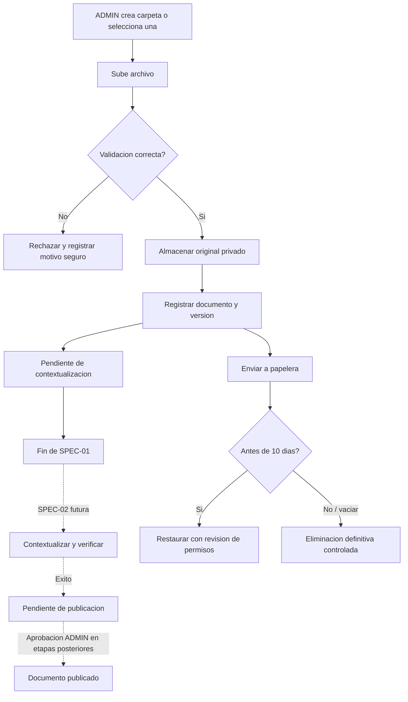

# RAG-SPEC-01 — GESTIÓN DOCUMENTAL, SEGURIDAD, VERSIONES Y PAPELERA

**Proyecto:** BELLAARTE BOUTIQUE — ERP BAB_VDOS + agente inteligente LENY  
**Subsistema:** LENY RAG V1  
**Documento:** Especificación técnica y funcional de la primera entrega RAG  
**Versión de la especificación:** 1.0 — Propuesta lista para análisis y planificación  
**Estado:** `REVIEW` — requiere diagnóstico del repositorio, plan y validación antes de implementación  
**Seguimiento 19/10/2026:** plan aprobado e implementación realizada; validación técnica aislada aprobada. Tras autorización expresa posterior se aplicó0019 y habilitó la biblioteca empresarial, con respaldo privado verificado, public/roles intactos y listado/actualización comprobados en la sesión ADMIN habitual. El propietario confirmó después que la carga mediante el selector funciona correctamente: aceptación del usuario registrada, distinta de las pruebas multipart ejecutadas por el agente. Esta nota no cambia los requisitos ni declara validación integral sin límites. Se decidió conservar `DOC` preexistente excluido, respaldar BD+archivos y mantener todas las versiones actuales. Evidencias: `documentacion/REPORTE_IMPLEMENTACION_LENY.md`, sección RAG-SPEC-01 y `documentacion/evidencias/leny_rag01_business_deployment.json`; seguimiento de la aceptación en `leny_rag02_business_deployment.json`.
**Entorno objetivo inicial:** Windows nativo, ERP FastAPI + React, PostgreSQL, Ollama local  
**Ubicación propuesta en el repositorio:** `specs/RAG/LENY_RAG_SPEC_01_GESTION_DOCUMENTAL.md`

> **Instrucción principal para el agente de desarrollo:** este archivo es una **SPEC**, no una orden de ejecutar cambios inmediatamente. **Primero** inspecciona el código y la documentación del ERP, contrasta supuestos, presenta un plan por archivos con dependencias, migraciones, riesgos y pruebas y espera la aprobación del responsable antes de implementar. No modifiques ni migres la base habitual sin autorización expresa e independiente. Si un requisito entra en conflicto con el código real, documenta el conflicto y solicita decisión; no improvises una solución silenciosa.

---

## 1. Contexto, antecedentes y estado conocido

LENY es el agente inteligente de analítica aumentada incorporado al ERP BAB_VDOS de BELLAARTE BOUTIQUE. Su primera entrega implementó un chat en React, API FastAPI conectada a Ollama local, Qwen3.5:4B, streaming NDJSON, historial persistente en PostgreSQL (`leny`), autenticación JWT, autorización Casbin, auditoría y diagnóstico administrativo.

**Fuentes internas a inspeccionar obligatoriamente (si están presentes):**

- `AGENTS.md`.
- `documentacion/MODULO_LENY.md`.
- `REPORTE_IMPLEMENTACION_LENY.md` y/o reportes posteriores.
- Archivos reales de rutas, modelos SQLAlchemy, servicios, dependencias de autorización, política Casbin, Alembic y frontend.
- Código y reporte de la **Etapa 01.1** de endurecimiento del chat, si ya fueron implementados; su estado no debe darse por supuesto.

La entrega 01 había informado, entre otros puntos, estos lugares de integración: `backend/app/api/routers/leny.py`, `backend/app/models/leny.py`, `backend/app/services/`, `backend/alembic/`, `frontend/src/pages/leny/` y `frontend/src/layout/AuthenticatedLayout.jsx`. **Son referencias, no órdenes de crear archivos duplicados ni garantías de que sigan iguales.**

El ERP tiene **exactamente cinco roles**, cuyos identificadores técnicos registrados en el reporte fueron: `ADMIN`, `CAJA`, `INV_BOUTIQUE`, `INV_TALLER`, `MODISTA`. Las denominaciones visibles son ADMIN, CAJERA(O), ENCARGADA(O) DEL INVENTARIO BOUTIQUE, ENCARGADA(O) DEL INVENTARIO TALLER y MODISTA. **No crear un sexto rol, no renombrarlos y no alterar sus privilegios ajenos a LENY.**

### 1.1. Secuencia completa de RAG V1

| Entrega         | Tema                                                                                                                  | Estado en esta SPEC                                    |
| --------------- | --------------------------------------------------------------------------------------------------------------------- | ------------------------------------------------------ |
| **RAG-SPEC-01** | Gestión documental, carpetas, metadatos, permisos, versiones, visualización, publicación controlada y papelera        | **Alcance actual**                                     |
| RAG-SPEC-02     | Extracción documental, OCR, fragmentación, embeddings, motor de contextualización, progreso y procesamiento asíncrono | **Fuera de alcance; preparar contratos mínimos**       |
| RAG-SPEC-03     | Recuperación semántica autorizada, integración con chat, fuentes y citas                                              | **Fuera de alcance**                                   |
| RAG-SPEC-04     | Evaluación integral, pruebas adversariales, calidad de recuperación y optimización                                    | **Fuera de alcance, salvo pruebas propias de SPEC-01** |

**Regla clave:** al terminar SPEC-01 el ERP tendrá una **biblioteca documental funcional y segura**, pero **LENY aún no podrá contestar preguntas sobre esos documentos**. No simular contextualización ni recuperación. No marcar documentos como “contextualizados” o “publicados para RAG” sin evidencia real de las etapas posteriores.

---

## 2. Objetivo de SPEC-01

Diseñar e implementar, **tras la aprobación del plan**, la base de gestión documental de LENY RAG V1 dentro del ERP existente, permitiendo exclusivamente al rol ADMIN organizar carpetas y documentos, subir archivos PDF/DOCX/JPG/PNG, consultar su información y contenido de forma segura, establecer los permisos de lectura por documento, administrar versiones, enviar documentos a una papelera de diez días, restaurarlos y eliminarlos definitivamente, manteniendo trazabilidad y preparando interfaces para contextualización y publicación posterior.

### 2.1. Resultados obligatorios

1. Biblioteca administrativa integrada visualmente a BAB_VDOS.
2. Carpetas y organización lógica con permisos predeterminados.
3. Carga y validación segura de originales PDF, DOCX, JPG y PNG.
4. Archivo original almacenado fuera del acceso web público y metadatos persistidos en PostgreSQL.
5. Visualización segura de metadatos y contenido compatible, sin servir rutas directas del filesystem.
6. Versionado sin sobrescribir archivos previos.
7. Permisos por documento, inicialmente copiados de la carpeta al crear el documento.
8. Política de publicación **bloqueada** hasta cumplir la contextualización y revisión requeridas.
9. Papelera con recuperación hasta diez días y eliminación definitiva controlada.
10. Auditoría, pruebas aisladas, documentación y evidencia de ausencia de regresiones.

### 2.2. Fuera de alcance estricto

- Instalar y ejecutar modelos de embeddings; descargar o configurar `qwen3-embedding:0.6b` o BGE-M3.
- Generar vectores, fragmentar documentos para RAG, instalar `pgvector` o consultar índices semánticos.
- OCR de imágenes o PDF escaneados; comprensión visual avanzada.
- Responder preguntas basadas en documentos desde el chat; añadir orquestación RAG a Qwen.
- Implementar colas Redis, pipelines de IA, trabajadores de contextualización o índices vectoriales.
- Machine Learning, AutoML, Monte Carlo, SQL inteligente o BI.
- Editor de contenido DOCX/PDF dentro del ERP (la “edición” documental de esta SPEC es editar **metadatos y permisos** o **subir una nueva versión del archivo**).
- Otorgar administración documental a roles diferentes de ADMIN.
- Crear microservicios o reconstruir LENY.

---

## 3. Principios y decisiones de diseño ya aprobadas

1. **ADMIN es el único responsable de crear, modificar, versionar, publicar, eliminar y restaurar documentos y carpetas.**
2. Los otros cuatro roles **podrán consultar** en el futuro solamente documentos publicados y permitidos; la consulta RAG se implementará en SPEC-03.
3. Los permisos efectivos serán **por documento**, inicializados al crearlo a partir de la carpeta elegida. Son autorizaciones del backend, no etiquetas de presentación.
4. Una **nueva versión nunca reemplaza físicamente la anterior** durante su preparación; la activación es controlada.
5. Un documento solo será consultable por RAG tras **contextualización exitosa + revisión/publicación de ADMIN**; en SPEC-01 la contextualización no existe, así que no puede publicarse de verdad.
6. Los documentos enviados a papelera dejan de ser elegibles para consulta de inmediato; restauración durante **10 días naturales** y función **Vaciar papelera** solo para ADMIN.
7. Los **formatos admitidos ahora** son `.pdf`, `.docx`, `.jpg`, `.jpeg`, `.png`; `.doc` antiguo queda fuera.
8. Límites iniciales ajustables: PDF 10 MiB / 50 páginas; PDF con OCR futuro hasta 20 páginas; DOCX 10 MiB; imagen 5 MiB / 12 megapíxeles.
9. En la interfaz se utilizará el término **Contextualizar**, aunque la implementación real será responsabilidad de SPEC-02.
10. Protección local, persistencia en PostgreSQL y almacenamiento privado; sin servicios de IA o repositorios cloud.
11. Reutilizar la seguridad, auditoría, el tema React/Ant Design y las prácticas de SQLAlchemy/Alembic existentes.

---

## 4. Descubrimiento obligatorio del ERP antes del plan

El agente debe revisar al menos:

- **Stack real y versiones:** Python, FastAPI, Pydantic, SQLAlchemy, Alembic, PostgreSQL, React, Ant Design, Axios, librerías de archivos ya instaladas.
- **Autenticación y autorización:** cómo se obtiene la identidad efectiva del usuario; JWT, Casbin, sincronización de políticas, protección de menús y APIs.
- **Modelo de datos:** esquema `leny`, `Base` compartida, heads de Alembic, FKs a identidades reales, convención de fechas/UUID, índices, auditoría y respaldos.
- **Patrones de frontend:** rutas, menú, formularios, tablas, subida de archivos, tokens del tema, manejo de errores, hooks y tests existentes.
- **Almacenamiento local:** rutas privadas admitidas, servicio de archivos existente, seguridad de Windows y procedimiento de backup/restore.
- **Interacción con LENY:** cómo se mantiene el chat y cómo exponer la biblioteca como una sección administrativa sin alterar el chat ni su historial.
- **Estado de Etapa 01.1:** verificar implementación real de rate limiting, clasificación empresarial y protección del chat; si falta, marcarlo como dependencia/riesgo, no declararlo implementado.

**Antes de implementar, entregar:** arquitectura actual, brechas, diseño de tablas/servicios/API/UI, lista precisa de archivos propuestos, dependencias justificadas, estrategia de migraciones, política de respaldo, casos de prueba y decisión de aprobación requerida.

---

## 5. Modelo funcional de la biblioteca

### 5.1. Organización de carpetas

- ADMIN puede crear, renombrar, describir y reorganizar carpetas.
- Una carpeta puede tener una carpeta padre, si esta estructura no genera complejidad injustificada; impedir ciclos y profundidad excesiva mediante configuración.
- Permitir categorías iniciales tales como `GENERAL`, `ADMINISTRACION`, `CAJA`, `INVENTARIO_BOUTIQUE`, `INVENTARIO_TALLER` y `PRODUCCION` **como carpetas o categorías, nunca como nuevos roles**.
- ADMIN establece los **roles de lectura predeterminados** de cada carpeta; esos permisos se **copian al documento** cuando se crea.
- Una carpeta no es, por sí sola, una fuente de verdad que cambie automáticamente los permisos de todos sus documentos existentes.
- Cambios masivos de ACL deben requerir operación explícita, resumen de afectados, confirmación y auditoría; pueden reservarse para versión posterior si no son indispensables a SPEC-01.
- No permitir eliminar una carpeta que contenga documentos o subcarpetas activos; exigir primero reubicación/eliminación controlada, sin borrado recursivo implícito.
- Impedir carpetas con nombres duplicados dentro de un mismo padre si así lo permiten las convenciones del ERP; documentar normalización y reglas de unicidad.

### 5.2. Documento lógico

El documento es una entidad estable que puede contener **varias versiones** del archivo.

Metadatos de referencia: UUID, nombre visible, descripción, carpeta, clasificación/área (si no deriva de la carpeta), creador, fechas, estado, fecha de eliminación, vencimiento de papelera, versión vigente, permisos de lectura y marcas de auditoría.

- No usar nombres aportados por el usuario como rutas físicas.
- Los campos visibles no pueden incluir HTML ejecutable ni instrucciones operativas para el servidor.
- Permitir filtros por nombre, carpeta, fecha, formato, estado, creador y papelera; listados paginados y ordenados.
- No crear registros “publicados” automáticos al subir archivos.

### 5.3. Versiones del documento

- La primera carga crea una **versión 1** vinculada al documento lógico.
- Reemplazar el archivo significa **crear versión N+1**, no modificar la versión N in situ.
- Cada versión conserva su archivo físico, tipo validado, tamaño, hash SHA-256, fecha, autor y estado de procesamiento de referencia.
- Las versiones anteriores son visibles en la administración y no se sobrescriben.
- Un nuevo archivo cargado para sustituir una versión publicada **no se activa automáticamente**.
- Preparar una referencia explícita a `version_publicada_id` o equivalente; inicialmente será nula.
- No ofrecer “restaurar versión” como un simple cambio silencioso de puntero: más adelante debe obedecer la regla de publicación y la compatibilidad de su contextualización.
- No permitir borrar individualmente una versión publicada o una versión referenciada por procesamiento en curso sin procedimiento de consistencia definido.

### 5.4. Papelera

- Eliminar significa inicialmente **eliminación lógica** del documento, no destrucción física.
- Al mover un documento a papelera, registrar `deleted_at`, `purge_after` (= `deleted_at` + 10 días naturales) y actor.
- La ocultación frente a usuarios no administradores y futuros procesos RAG es **inmediata**.
- Conservar sus archivos, versiones y permisos durante el periodo de recuperación.
- Solo ADMIN puede restaurar, dentro del plazo, con revisión de carpeta de destino y permisos. Una restauración **no debe aumentar automáticamente los permisos**: ante cambios de ACL o carpetas, requerir revisión/confirmación de ADMIN.
- Si la limpieza vence con el ERP apagado, reanudarla mediante mantenimiento controlado al volver a ejecutar la aplicación o la tarea; documentar el mecanismo exacto sin asumir un scheduler disponible.
- **Vaciar papelera** requiere confirmación explícita, lista/resumen de afectados y autorización backend.
- La eliminación definitiva retira versiones, archivos privados, metadatos operativos y referencias asociadas en el orden seguro que permita recuperar/registrar fallos parciales. No dejar archivos huérfanos recuperables públicamente.
- Documentar comportamiento de respaldos y restauraciones: borrar en la aplicación **no garantiza borrar copias históricas del backup**; definir reglas de retención de backups por separado.
- Cuando exista SPEC-02/03, una eliminación deberá invalidar además fragmentos, embeddings, resultados cacheados y elegibilidad de recuperación; SPEC-01 deja las relaciones/contratos previstos, sin crear vectores ficticios.

---

## 6. Ciclo de vida y máquina de estados

Separar **estado del documento lógico** de **estado de la versión/contextualización**. Una actualización de archivo no debe poner en riesgo una versión vigente previamente publicada.

### 6.1. Estados del documento (modelo conceptual)

- `ACTIVO`: documento administrable, fuera de papelera; puede no tener versión publicada.
- `PAPELERA`: eliminación lógica, excluido de toda recuperación o visualización no administrativa.
- `ELIMINADO`: eliminado definitivamente del almacenamiento operativo; no mantenerlo como documento accesible. Los eventos mínimos de auditoría podrán permanecer según política vigente.

### 6.2. Estados de versión (modelo conceptual)

- `PENDIENTE_CONTEXTUALIZACION`: versión subida, validada y guardada, pero aún sin indexación RAG.
- `CONTEXTUALIZANDO`: reservado para SPEC-02.
- `ERROR_CONTEXTUALIZACION`: reservado para SPEC-02; el original se conserva.
- `PENDIENTE_PUBLICACION`: reservado para SPEC-02 tras una contextualización verificada.
- `PUBLICADA`: solo ADMIN y únicamente cuando existe la contextualización vigente y aprobada; transición habilitada en etapas posteriores.
- `REEMPLAZADA`: versión anterior desactivada tras publicar una sucesora; conserva historial.

**En SPEC-01 únicamente se materializa la subida en `PENDIENTE_CONTEXTUALIZACION`.** Si se reservan estados adicionales en BD, no implementarlos como funcionalidad simulada.

### 6.3. Regla innegociable de publicación

Una petición de publicar **debe fallar de forma segura** si la versión no tiene contextualización real, íntegra, validada, compatible con el modelo de embeddings seleccionado y disponible para recuperación autorizada. En SPEC-01 todavía no existe ese resultado: por tanto, `PUBLICAR` estará deshabilitado en UI y prohibido en backend (por ejemplo, `409 Conflict` o un error de dominio equivalente).

No confiar en una marca booleana editable por el frontend para validar contextualización. Preparar una interfaz de verificación para SPEC-02/03.

### 6.4. Flujo

---

## 7. Seguridad y política de autorización

### 7.1. Matriz de acceso

| Operación                                       | ADMIN | CAJA     | INV_BOUTIQUE | INV_TALLER | MODISTA  |
| ----------------------------------------------- | ----- | -------- | ------------ | ---------- | -------- |
| Entrar a biblioteca administrativa              | Sí    | No       | No           | No         | No       |
| Crear/editar/mover carpetas                     | Sí    | No       | No           | No         | No       |
| Subir/editar metadatos/versionar                | Sí    | No       | No           | No         | No       |
| Gestionar permisos por documento                | Sí    | No       | No           | No         | No       |
| Ver/previsualizar originales no publicados      | Sí    | No       | No           | No         | No       |
| Publicar (cuando SPEC-02 lo habilite)           | Sí    | No       | No           | No         | No       |
| Papelera, restauración, vaciado                 | Sí    | No       | No           | No         | No       |
| Consultar fuentes publicadas por chat (SPEC-03) | Sí    | Solo ACL | Solo ACL     | Solo ACL   | Solo ACL |
| Ver un documento fuente publicado (SPEC-03)     | Sí    | Solo ACL | Solo ACL     | Solo ACL   | Solo ACL |

**Permisos:** reutilizar `leny:admin` para operaciones de administración si la convención real lo admite; si es necesaria mayor granularidad, proponer identificadores de permiso Casbin específicos (por ejemplo, `leny:documents.manage` y `leny:documents.read`) sin crear nuevos roles. Los identificadores son orientativos, sujetos a inspección.

- `leny:chat` **no significa** acceso universal a documentos.
- Las operaciones de escritura requieren autorización ADMIN real del backend, **en cada petición**, no solo navegación oculta.
- La lectura de fuentes deberá exigir documento **ACTIVO + versión PUBLICADA + permiso explícito del rol del usuario + no revocado**; esta lectura para no-ADMIN se activará en SPEC-03.
- Identidad y rol efectivo obtenidos desde dependencias confiables del ERP, nunca del body/header enviado por el navegador.
- ADMIN puede administrar documentos empresariales pero **no obtiene por ello acceso a historiales privados de conversaciones de otros usuarios** (preservar norma previa).

### 7.2. Permisos por documento y cambio de carpeta

- Al cargar documento, copiar como **ACL inicial** los roles autorizados en la carpeta.
- ADMIN puede editar ACL del documento posteriormente, respetando los cinco roles existentes.
- Cambiar ACL de carpeta modifica los **valores predeterminados futuros**, no los ACL previamente copiados a documentos.
- **Mover un documento requiere revisar el ACL efectivo**. Si el destino tiene permisos más restrictivos, no mantener silenciosamente accesos que contradigan la nueva clasificación. Proponer al ADMIN la intersección restrictiva por defecto y una confirmación explícita para cualquier ampliación.
- No conceder acceso por el simple nombre de una carpeta; la autorización efectiva se obtiene de un registro confiable en base de datos.
- Toda modificación de ACL debe ser atómica, auditada y surtir efecto de inmediato en nuevas solicitudes.

### 7.3. Seguridad de carga

- Autenticación y autorización previas a aceptar/guardar bytes significativos (compatible con el middleware actual).
- Lista positiva de extensiones y validación del **tipo real del contenido**, no solo `Content-Type` o extensión.
- Rechazar `.doc`, `.docm`, `.exe`, `.js`, `.html`, SVG y demás tipos no aprobados. No habilitar macros.
- Comprobar PDF/DOCX/JPG/PNG estructuralmente con analizadores seguros y límites de trabajo; tratar los documentos como entradas no confiables.
- DOCX es un contenedor ZIP: controlar tamaño descomprimido, entradas, compresión anómala, enlaces externos/relaciones peligrosas y tiempo de procesamiento; evitar ZIP bombs.
- Imágenes: validar formatos con decodificación limitada, dimensiones/píxeles, archivos truncados y consumo máximo de memoria.
- PDF: comprobar tamaño y límite de páginas **sin ejecutar contenido activo**; si no es viable validar seguro en SPEC-01 sin nueva dependencia justificada, declarar el bloqueo en el plan antes de implementar.
- Asegurar escritura por streaming con tamaño límite acumulado, archivo temporal privado y promoción atómica solo tras validar.
- Usar UUID/identificadores generados por servidor para rutas y nombres físicos. Bloquear traversal, rutas absolutas, NUL, symlinks, hardlinks y referencias fuera del directorio privado.
- Nunca ejecutar el contenido de los archivos, ni abrir enlaces o recursos remotos embebidos en DOCX/PDF.
- Aplicar controles de recursos, cantidad de cargas concurrentes y límites de tiempo; no convertir el upload en una vía para agotar el disco/RAM.
- Si no hay antivirus local disponible, no fingir un escaneo. Documentar el riesgo residual; no publicar ni servir contenido activo no verificado.

### 7.4. Seguridad en descarga/previsualización

- Archivos almacenados **fuera de `public`, `static` o rutas de frontend expuestas**.
- Descargas y vistas previas siempre a través de endpoints autenticados y autorizados, con IDs opacos, verificaciones de pertenencia y estado.
- Encabezados correctos: tipo seguro, `Content-Disposition` controlado, `X-Content-Type-Options: nosniff`, CSP/aislamiento apropiado cuando corresponda, y `Cache-Control: no-store` para información sensible.
- Nunca revelar rutas físicas, credenciales ni URLs directas al almacenamiento.
- Para PDF, si el visor inline del navegador no puede aislarse adecuadamente, preferir **descarga autorizada** en lugar de un embed inseguro; documentar la decisión y probarla.
- Para PNG/JPG, renderizar por ruta autenticada con verificación de tamaño y contenido; si es necesario, generar una versión segura de previsualización.
- Para DOCX, ofrecer **vista de texto segura y acotada** (párrafos y tablas básicos, sin macros/HTML/recursos externos) mediante un extractor mínimo justificable o, si la arquitectura actual obliga a aplazar esa visualización, documentar la brecha y no declarar cumplida la previsualización hasta corregirla. La extracción completa, OCR y contextualización siguen reservadas para SPEC-02.
- No permitir que documentos administrados ingresen como instrucciones en el prompt del LLM durante SPEC-01.

### 7.5. Auditoría y confidencialidad

Registrar: actor, tipo de operación, ID de documento/carpeta/versión, fecha, resultado, código de razón y metadatos técnicos mínimos. Especial interés en cambios de permisos, eliminación definitiva, restauración, reemplazos y accesos denegados.

No guardar copias de archivos, fragmentos completos, contraseñas, tokens o contenido sensible en auditoría/logs. Mantener privacidad del historial conversacional existente.

---

## 8. Modelo de datos conceptual — esquema PostgreSQL `leny`

**No crear tablas hasta validar el modelo vigente, las revisiones Alembic y la aprobación del plan.** Se recomiendan entidades separadas; los nombres son sugerencias sujetas a convenciones reales.

| Entidad sugerida                                              | Contenido mínimo                                                                                                          | Reglas principales                                  |
| ------------------------------------------------------------- | ------------------------------------------------------------------------------------------------------------------------- | --------------------------------------------------- |
| `leny.carpetas`                                               | UUID, padre opcional, nombre, descripción, creador, fechas, estado                                                        | Unicidad lógica y protección contra ciclos          |
| `leny.carpeta_roles_lectura`                                  | FK carpeta, código/ID rol existente                                                                                       | Permisos **predeterminados**, no roles nuevos       |
| `leny.documentos`                                             | UUID, carpeta, título, descripción, creador, estado, fechas, `version_publicada_id` opcional, `deleted_at`, `purge_after` | Identidad estable y soft delete                     |
| `leny.documento_roles_lectura`                                | FK documento, código/ID de rol existente                                                                                  | ACL efectiva del documento; índices/únicos          |
| `leny.documento_versiones`                                    | UUID, documento, número, ruta/identificador privado, hash SHA-256, tamaño, tipo real, estado, autor, fechas               | Inmutabilidad del archivo por versión; número único |
| `leny.documento_eventos` (si la auditoría existente no basta) | IDs, acción, estado y fechas                                                                                              | Preferir auditoría del ERP; evitar redundancia      |

**Reservar relación lógica futura** hacia trabajos de contextualización, fragmentos y embeddings, pero **no crear tablas vectoriales ni trabajos ficticios ahora**.

### 8.1. Invariantes del modelo

1. Una versión pertenece a exactamente un documento.
2. Una carpeta no puede ser su propia descendiente.
3. Número de versión único por documento, generado de manera transaccional y segura bajo concurrencia.
4. Dos cargas simultáneas no deben producir el mismo número de versión.
5. Un documento en papelera no puede ser publicado ni entregado por RAG.
6. `version_publicada_id`, cuando exista, debe pertenecer al documento y tener una contextualización verificada según las etapas posteriores.
7. Al insertar un archivo, si falla la BD o almacenamiento, no dejar registros “correctos” con archivo inexistente ni archivos huérfanos sin recuperación.
8. Los límites, roles y permisos deben validarse desde el servidor; ninguna decisión de seguridad depende del frontend.
9. El volumen de archivo original no se guarda en una columna BLOB de PostgreSQL por defecto: almacenar archivos **en filesystem privado**, referencias/metadata en BD, salvo justificación fundamentada.
10. Mantener claves, índices y restricciones compatibles con la convención real del ERP y asegurar transacciones para cambios de ciclo de vida.

### 8.2. Recomendaciones de índices

- Carpetas por padre y nombre normalizado.
- Documentos por carpeta, estado, fecha de creación y papelera/vencimiento.
- Versiones por documento y número descendente.
- ACL por documento/rol.
- Auditoría por tipo de evento e identificador cuando el sistema existente lo admita.

No añadir índices innecesarios sin consulta o restricción que los justifique.

---

## 9. Almacenamiento de originales y consistencia

1. Directorio privado configurable: por ejemplo `backend/storage/leny/documents/`, **solo si el layout real y permisos OS lo permiten**. No escribir dentro de `frontend/public` ni rutas del web server.
2. Rutas físicas generadas por identificadores internos; conservar nombre original solo como metadato saneado para UI.
3. Escritura inicial en staging privado con permisos restrictivos; calcular hash y validar antes de promoción.
4. Promoción atómica a ubicación de versión, seguida de transacción/compensación consistente; definir estrategia idempotente para fallos parciales.
5. Limpiar temporales tras errores y en mantenimiento, con protección para cargas activas.
6. Conservar versiones anteriores, incluso cuando se cargue una nueva.
7. Respetar límites de disco y prever crecimiento con copias de seguridad y futuras indexaciones.
8. No registrar directorios privados en Git; comprobar `.gitignore` y posibles exposiciones por servidor web.
9. Diseñar restauración de archivos y metadatos **en conjunto**, no solo de la BD. La coherencia del backup es requisito de recuperación de la biblioteca.
10. Proteger frente a borrado concurrente y operaciones que compitan sobre la misma versión.

---

## 10. API conceptual (adaptar convenciones reales)

Los endpoints propuestos quedan bajo `/api/v1/leny/` y respetarán el middleware JWT/Casbin existente. No crear rutas duplicadas si ya existe una convención equivalente.

| Método   | Ruta propuesta                                  | Acción                                                         | Acceso SPEC-01   |
| -------- | ----------------------------------------------- | -------------------------------------------------------------- | ---------------- |
| `GET`    | `/documents/folders`                            | Listar árbol/carpetas                                          | ADMIN            |
| `POST`   | `/documents/folders`                            | Crear carpeta y ACL por defecto                                | ADMIN            |
| `PATCH`  | `/documents/folders/{id}`                       | Renombrar/editar/mover y ACL por defecto                       | ADMIN            |
| `DELETE` | `/documents/folders/{id}`                       | Eliminar carpeta vacía                                         | ADMIN            |
| `GET`    | `/documents`                                    | Listar y filtrar documentos                                    | ADMIN            |
| `POST`   | `/documents`                                    | Crear documento con primera versión (multipart)                | ADMIN            |
| `GET`    | `/documents/{id}`                               | Metadatos y versiones                                          | ADMIN            |
| `PATCH`  | `/documents/{id}`                               | Metadatos, carpeta y permisos                                  | ADMIN            |
| `POST`   | `/documents/{id}/versions`                      | Subir nueva versión (multipart)                                | ADMIN            |
| `GET`    | `/documents/{id}/versions/{version_id}/content` | Descarga/vista previa autorizada                               | ADMIN            |
| `GET`    | `/documents/{id}/versions/{version_id}/preview` | Previsualización segura según formato                          | ADMIN            |
| `DELETE` | `/documents/{id}`                               | Enviar a papelera                                              | ADMIN            |
| `GET`    | `/documents/trash`                              | Listar papelera, paginada                                      | ADMIN            |
| `POST`   | `/documents/{id}/restore`                       | Restaurar desde papelera                                       | ADMIN            |
| `DELETE` | `/documents/{id}/purge`                         | Eliminación definitiva explícita                               | ADMIN            |
| `POST`   | `/documents/trash/empty`                        | Vaciar papelera con confirmación                               | ADMIN            |
| `POST`   | `/documents/{id}/publish`                       | **No habilitar aún**: debe rechazar si no está contextualizado | ADMIN, bloqueado |

**Evitar conflictos entre rutas fijas y dinámicas** (`/documents/trash` versus `/documents/{id}`): definir orden o prefijos sin ambigüedad según FastAPI real. Rutas son propuestas, no una API aprobada rígidamente.

### 10.1. Contratos y respuestas

- Emplear Pydantic siguiendo convenciones existentes; errores 400/401/403/404/409/413/415/422/429/500 según causa real.
- Uso de UUIDs, paginación, límites máximos, orden estable y filtros permitidos; evitar enumeración de recursos ajenos.
- Para errores de seguridad, devolver mensajes públicos sin paths físicos ni detalles de parser.
- Para cargas duplicadas accidentalmente, evaluar `request_id` o idempotencia desde backend; no crear versiones repetidas por reintentos sin control.
- Respuestas deben indicar claramente: `uploaded`, `pending_contextualization`, `in_trash`, `not_published` o sus equivalentes de contrato. No declarar estados que todavía no existen.
- Paginar listas y versiones; controles de tamaño y cantidad tanto en API como en capa de servicio.

### 10.2. Publicación futura: contrato de integración

La habilitación del endpoint de publicación deberá depender de una comprobación **servidor-servidor** de contextualización válida y de un commit consistente del índice. No crear un flag artificial para eludir esta condición. En SPEC-01 se documenta esta interfaz y se prueban los rechazos; la funcionalidad positiva queda para entregas posteriores.

---

## 11. Interfaz React / Ant Design

Incorporar una **Biblioteca documental** dentro de LENY o un subapartado administrativo visible solo con autorización de ADMIN, siguiendo las rutas y estilos reales del ERP (paleta existente, primario `#8f3d2e` conforme al reporte anterior, sujeto a verificación con el tema vigente).

### 11.1. Vistas mínimas

1. **Explorador de carpetas:** árbol o navegación simple, ruta actual, creación/edición y ACL por defecto.
2. **Listado de documentos:** nombre, tipo, carpeta, versión, fecha, peso, estado, permisos resumidos y acciones habilitadas.
3. **Carga de documentos:** selección/arrastrar archivos, límites visibles, validación previa informativa, progreso real **de transferencia**, errores por archivo.
4. **Detalle documental:** metadatos, permisos, versiones, SHA/tamaño si procede, autor y estado `Pendiente de contextualización`.
5. **Previsualización:** según seguridad/tipo, visualización o descarga autenticada; nunca ejecutar contenido activo.
6. **Nueva versión:** seleccionar reemplazo y mostrar que no altera versiones existentes.
7. **Papelera:** fecha de eliminación, días restantes, restaurar, eliminar definitivamente y vaciar papelera.
8. **Confirmaciones:** operaciones destructivas, movimientos que afecten ACL y vaciado, con feedback visible.

### 11.2. Estados y acciones futuras

- El botón **Contextualizar** puede aparecer **deshabilitado con una explicación** (“Disponible en RAG-SPEC-02”), o reservarse visualmente si el patrón del ERP lo justifica; no debe disparar procesamiento ficticio.
- **Publicar** permanecerá deshabilitado mientras no exista un índice real verificado.
- **No crear barras falsas de progreso de embeddings**: en SPEC-01 solo se mide progreso real de carga del archivo y verificaciones disponibles.
- No modificar el chat existente para insinuar que ya consulta documentos.
- Los usuarios sin permiso de biblioteca no deben visualizar rutas o navegación administrativas y, aun si las invocan directamente, el backend debe denegarlas.
- Confirmaciones no pueden ser el único control: verificar todo en backend.

### 11.3. Usabilidad y accesibilidad

- Diseño responsive para escritorio y móvil; acceso por teclado, labels, feedback de errores, estados vacíos y loading.
- No copiar identidad gráfica de ChatGPT; mantener identidad visual de BELLAARTE BOUTIQUE.
- Mensajes claros, en español, centrados en acciones empresariales.
- Para documentos no contextualizados, mostrar “Archivo almacenado. Pendiente de contextualización” y nunca “Listo para consultas LENY”.

---

## 12. Requisitos funcionales — RF

| ID           | Requisito verificable                                                                                                | Prioridad |
| ------------ | -------------------------------------------------------------------------------------------------------------------- | --------- |
| `RAG1-RF-01` | ADMIN puede crear, consultar, renombrar y organizar carpetas.                                                        | Alta      |
| `RAG1-RF-02` | ADMIN define roles de lectura predeterminados en carpetas.                                                           | Alta      |
| `RAG1-RF-03` | La carga de un documento crea sus permisos iniciales por copia desde la carpeta.                                     | Alta      |
| `RAG1-RF-04` | ADMIN puede asignar/restringir individualmente los roles lectores de un documento.                                   | Alta      |
| `RAG1-RF-05` | ADMIN sube archivos PDF/DOCX/JPG/PNG bajo los límites autorizados.                                                   | Alta      |
| `RAG1-RF-06` | El servidor rechaza formatos prohibidos, extensiones engañosas y archivos malformados.                               | Alta      |
| `RAG1-RF-07` | El archivo original queda protegido en almacenamiento privado, con hash, tamaño, tipo y autor.                       | Alta      |
| `RAG1-RF-08` | ADMIN lista, filtra y consulta metadatos de documentos con paginación.                                               | Alta      |
| `RAG1-RF-09` | ADMIN visualiza o descarga de manera autenticada el contenido mediante una opción segura compatible con el formato.  | Alta      |
| `RAG1-RF-10` | ADMIN puede modificar metadatos y mover documentos con revisión de permisos.                                         | Alta      |
| `RAG1-RF-11` | Reemplazar un archivo crea una versión nueva e inmutable, preservando las anteriores.                                | Alta      |
| `RAG1-RF-12` | Se muestra la lista de versiones y la versión activa/publicada cuando corresponda.                                   | Alta      |
| `RAG1-RF-13` | La carga deja el documento pendiente de contextualización, sin publicación automática.                               | Alta      |
| `RAG1-RF-14` | La publicación se bloquea hasta que exista evidencia real de contextualización y revisión ADMIN.                     | Alta      |
| `RAG1-RF-15` | ADMIN puede enviar un documento a papelera, retirándolo inmediatamente de cualquier elegibilidad de búsqueda futura. | Alta      |
| `RAG1-RF-16` | ADMIN puede restaurar documentos dentro de diez días con controles sobre permisos y carpeta.                         | Alta      |
| `RAG1-RF-17` | ADMIN puede borrar definitivamente elementos seleccionados o vaciar papelera tras confirmación.                      | Alta      |
| `RAG1-RF-18` | Existe una política de mantenimiento para documentos vencidos y recuperabilidad ante fallos.                         | Alta      |
| `RAG1-RF-19` | Todas las operaciones administrativas están protegidas por JWT y Casbin, sin agregar roles.                          | Alta      |
| `RAG1-RF-20` | Creación, eliminación, cambios de ACL, restauración y reemplazo generan auditoría apropiada.                         | Alta      |
| `RAG1-RF-21` | Se manejan cargas/cambios concurrentes e interrupciones sin corrupción documental.                                   | Alta      |
| `RAG1-RF-22` | Se conserva el funcionamiento previo de conversaciones, streaming y diagnóstico LENY.                                | Alta      |

---

## 13. Requisitos no funcionales — RNF

| ID            | Categoría              | Condición / validación                                                                                                  |
| ------------- | ---------------------- | ----------------------------------------------------------------------------------------------------------------------- |
| `RAG1-RNF-01` | Seguridad              | Cero accesos exitosos no autorizados en la batería de pruebas; ninguna decisión confiada solo al frontend.              |
| `RAG1-RNF-02` | Privacidad             | Los archivos permanecen en infraestructura local; ninguna carga envía contenido a servicios externos.                   |
| `RAG1-RNF-03` | Integridad             | Hash SHA-256 por versión y comprobaciones de consistencia entre archivo, BD y metadatos.                                |
| `RAG1-RNF-04` | Recuperación           | Fallos de carga, actualización, restauración o purga no producen pérdida silenciosa ni inconsistencias no recuperables. |
| `RAG1-RNF-05` | Protección de recursos | Límites configurables de bytes, páginas/píxeles, almacenamiento, concurrencia y tiempos de validación.                  |
| `RAG1-RNF-06` | Trazabilidad           | Eventos de administración auditables sin registrar bytes del documento o secretos.                                      |
| `RAG1-RNF-07` | Compatibilidad         | Respetar stack FastAPI/React/PostgreSQL, patrones del ERP y las cinco políticas de rol.                                 |
| `RAG1-RNF-08` | Mantenibilidad         | Servicios separados de almacenamiento, autorización, metadatos y ciclo de vida con interfaces claras.                   |
| `RAG1-RNF-09` | Usabilidad             | Administración en español, responsive y con indicadores de estado verídicos.                                            |
| `RAG1-RNF-10` | Evolución              | Contratos preparados para SPEC-02/03 sin instalar todavía motores vectoriales.                                          |
| `RAG1-RNF-11` | Migraciones            | Migraciones aditivas, reversibles o con rollback documentado; estructura empresarial no afectada.                       |
| `RAG1-RNF-12` | Rendimiento            | Definir umbrales reales tras mediciones de carga/listado/previsualización; no inventar tiempos.                         |

---

## 14. Límites y validaciones iniciales

| Formato                 | Máximo de bytes | Máximo adicional                                                 | Notas                                                                               |
| ----------------------- | --------------: | ---------------------------------------------------------------- | ----------------------------------------------------------------------------------- |
| `.pdf`                  |          10 MiB | 50 páginas                                                       | PDFs escaneados: OCR se habilitará en SPEC-02 con límite inicial de 20 páginas OCR. |
| `.docx`                 |          10 MiB | Texto/elementos/ZIP descomprimido limitados por política técnica | **No aceptar** `.doc` ni `.docm`.                                                   |
| `.jpg`, `.jpeg`, `.png` |           5 MiB | 12 megapíxeles                                                   | Imágenes con texto serán procesadas por OCR en SPEC-02.                             |

Definir en el plan valores iniciales de límites adicionales **descomprimidos** y de coste para DOCX, PDF e imágenes, después de inspeccionar parsers y memoria reales. No asumir que un archivo pequeño comprimido sea seguro.

La cantidad de archivos por lote, capacidad total de biblioteca, cantidad de carpetas, profundidad máxima y uso simultáneo deben ser **configurables** y justificarse para el entorno local.

Los límites numéricos anteriores son conservadores **para empezar** y se revisarán tras medir uso real de memoria/CPU. No equivalen a límites de tokens del modelo de embeddings, porque SPEC-01 todavía no vectoriza.

---

## 15. Casos de uso de SPEC-01

| Código       | Caso de uso                       | Actor                                | Resultado                                         |
| ------------ | --------------------------------- | ------------------------------------ | ------------------------------------------------- |
| `RAG1-CU-01` | Administrar carpetas              | ADMIN                                | Estructura organizada y validada                  |
| `RAG1-CU-02` | Configurar ACL de carpetas        | ADMIN                                | Predeterminados para documentos nuevos            |
| `RAG1-CU-03` | Subir documento                   | ADMIN                                | Original privado y versión 1 pendiente            |
| `RAG1-CU-04` | Buscar y visualizar archivo       | ADMIN                                | Acceso seguro al contenido/metadatos              |
| `RAG1-CU-05` | Editar metadatos y permisos       | ADMIN                                | Cambios consistentes y auditados                  |
| `RAG1-CU-06` | Crear nueva versión               | ADMIN                                | Versión nueva sin reemplazar versiones existentes |
| `RAG1-CU-07` | Enviar documento a papelera       | ADMIN                                | Ocultación inmediata y vencimiento fijado         |
| `RAG1-CU-08` | Restaurar documento               | ADMIN                                | Recuperación con permisos revisados               |
| `RAG1-CU-09` | Eliminar definitivamente          | ADMIN                                | Purga controlada y auditada                       |
| `RAG1-CU-10` | Intentar publicar sin contexto    | ADMIN                                | Rechazo seguro: no indexado                       |
| `RAG1-CU-11` | Intentar acceder sin autorización | Otros roles / usuario no autenticado | Acceso denegado sin revelar contenido             |

---

## 16. Pruebas obligatorias y criterios por escenario

### 16.1. Seguridad y autorización

- API y UI: ADMIN autorizado; CAJA, INV_BOUTIQUE, INV_TALLER y MODISTA no administran biblioteca.
- JWT expirado/ausente/revocado; Casbin deniega incluso con menú manipulado.
- Identificadores ajenos, UUID inválidos, consultas no autorizadas y accesos directos al endpoint de contenido.
- Intentos de path traversal, symlinks, cambio de nombre y lectura fuera de la raíz privada.
- Cambios de carpeta/ACL no amplían permisos silenciosamente.
- Pruebas de exposición de rutas físicas, mensajes internos y contenido sensible en logs/auditoría.
- Frontend no expone originales mediante assets públicos ni mediante cache persistente insegura.

### 16.2. Validación documental

- PDF, DOCX, JPG y PNG válidos dentro de límites se almacenan correctamente.
- `.doc`, `.docm`, SVG, archivos ejecutables, HTML, extensiones falsificadas y archivos truncados se rechazan.
- PDF con páginas fuera de límite y archivos PDF malformados.
- DOCX anómalo, contenedor ZIP no válido, compresión excesiva, tamaños descomprimidos peligrosos y relaciones externas.
- Imágenes con dimensiones extremas, metadatos dañados y archivos que no sean imágenes reales.
- Cargas interrumpidas, archivos vacíos, cuerpo multipart inválido y requests mayores al límite.

### 16.3. Versiones, concurrencia y consistencia

- Subir versión nueva no cambia ni sobrescribe el archivo de versión anterior.
- Hash y bytes almacenados corresponden al archivo subido.
- Dos cargas paralelas no colisionan en versión ni generan archivos mezclados.
- Fallo tras escribir archivo, antes de confirmar BD; fallo tras BD, antes de finalizar operación; repetición idempotente.
- Carga duplicada por reintento no crea versiones indeseadas.
- Editar permisos y mover documento se realizan con transacción consistente.
- Intento de publicar en SPEC-01 rechazado sin falsear éxito.

### 16.4. Papelera y mantenimiento

- Eliminar oculta el documento y conserva sus archivos durante los diez días.
- Restaurar antes del plazo funciona con revisión de ACL.
- Restaurar después del plazo se rechaza si ya fue purgado, sin inconsistencias.
- Vaciar papelera afecta solo elementos seleccionados/confirmados y nunca documentos activos.
- Purga parcial por fallo del disco/BD registra estado recuperable e intenta compensación/reintento seguro.
- Vencimiento con aplicación apagada y reanudación del mantenimiento.
- Acceso concurrente a archivo mientras se mueve a papelera o se purga; impedir entrega tras revocación en nuevas peticiones.

### 16.5. Frontend y regresiones

- Componentes, navegación y guards de biblioteca.
- Validación visual y errores de carga reales, progreso de transferencia auténtico.
- Detalle, versiones, descargas/previsualización seguras, papelera, confirmación de eliminación.
- Markdown y conversación actual de LENY continúan funcionando.
- Estilos existentes (Ant Design), responsive, accesibilidad y comportamiento con sesiones expiradas.
- Vitest, ESLint, build, pruebas backend y PostgreSQL aislado; registrar cifras reales de aprobadas/fallidas.

### 16.6. Verificaciones con base de datos

- Aplicar migración únicamente sobre una **BD de pruebas aislada**, con resguardo y rollback comprobados.
- Comparar definiciones/datos del esquema empresarial antes y después; no tocar tablas comerciales ni políticas globales no relacionadas.
- Verificar claves, índices, restricciones y grants efectivos del esquema `leny`.
- Ejercitar backup/restore de **metadatos + archivos** en entorno aislado, o registrar claramente la ausencia de ensayo como limitación bloqueante para la aceptación de recuperación.
- No ejecutar seeds, purgas de almacenamiento empresarial, migraciones sobre `bellaarte_db:5432` ni pruebas de carga destructivas sin autorización expresa.

---

## 17. Criterios de aceptación para cerrar SPEC-01

| Código  | Condición necesaria                                                                                 | Evidencia exigible                                                     |
| ------- | --------------------------------------------------------------------------------------------------- | ---------------------------------------------------------------------- |
| `AC-01` | ADMIN puede administrar carpetas y ACL iniciales; los demás roles no                                | Pruebas backend/frontend + comprobación permisos                       |
| `AC-02` | Se pueden subir PDF/DOCX/JPG/PNG válidos y se bloquean archivos inválidos                           | Matriz de archivos válidos/adversariales                               |
| `AC-03` | Originales privados y metadatos íntegros en PostgreSQL                                              | Revisión de paths, hash, pruebas BD                                    |
| `AC-04` | Detalle/listados/visualización segura y manejo de errores                                           | UI/API comprobados, sin exposición pública                             |
| `AC-05` | Nuevas versiones no sobrescriben las anteriores                                                     | Pruebas de inmutabilidad y concurrencia                                |
| `AC-06` | Los ACL por documento se inicializan desde la carpeta y pueden restringirse con controles efectivos | Pruebas de cambios/movimientos                                         |
| `AC-07` | Ningún documento se muestra como contextualizado/publicado ni entra al chat RAG en SPEC-01          | Prueba de prohibición de publicación y ausencia de integración fingida |
| `AC-08` | Papelera de 10 días, restauración y vaciado gestionados por ADMIN                                   | Pruebas con reloj controlado y fallos                                  |
| `AC-09` | Auditoría registra actos relevantes sin copiar documentos a logs                                    | Inspección de eventos                                                  |
| `AC-10` | Migración aislada, coherente y sin daño al ERP                                                      | Pruebas upgrade/downgrade + comparación de esquema                     |
| `AC-11` | No hay regresiones en LENY chat, autenticación, Casbin ni módulos críticos                          | Suite de regresión relevante                                           |
| `AC-12` | Documentación y reporte final completos, con pendientes/limitaciones transparentes                  | Archivos de documentación y evidencias                                 |

**Cierre formal:** esta SPEC solo puede considerarse `IMPLEMENTED/VALIDATED` una vez satisfechos y evidenciados sus criterios. “Compila” o “abre la pantalla” no basta. Las tareas de RAG-SPEC-02 no sustituyen defectos pendientes de SPEC-01.

---

## 18. Secuencia de trabajo exigida al agente Codex

### Paso A — Diagnóstico técnico sin cambios

1. Verificar repositorio, estado Git, documentación y versiones de dependencias.
2. Inspeccionar modelos, migraciones, seguridad, servicios de archivos y React.
3. Identificar riesgos técnicos y dependencias reales.
4. Confirmar ausencia/presencia de las protecciones de LENY 01.1.
5. Redactar informe del estado actual, sin afirmar características inexistentes.

### Paso B — Plan de SPEC-01, solicitar aprobación

Entregar un plan que incluya:

- Cambios por archivos y módulos; responsabilidades.
- Modelo relacional final, DDL conceptual, FKs, índices y revisión Alembic propuesta.
- Políticas reales JWT/Casbin y permisos por documento.
- Endpoints Pydantic, contratos y respuestas HTTP.
- Layout y componentes React con reutilización del tema existente.
- Rutas de almacenamiento privado, límites, parsers y medidas de seguridad.
- Diseño de consistencia transaccional, concurrencia, idempotencia y papelera.
- Estrategia de eliminación de archivos y mantenimiento posterior a fallos.
- Dependencias nuevas justificadas, si fueran indispensables.
- Matriz de pruebas y criterios de aceptación.
- Estrategia de respaldos/rollback/operación Windows.
- Lista de exclusiones para evitar invadir SPEC-02/03/04.

**Detenerse y esperar la aprobación explícita del plan antes de implementar.**

### Paso C — Implementación aprobada

- Trabajar incrementalmente dentro del alcance.
- Crear migraciones **aditivas** sin reescribir la historia Alembic.
- Mantener estructura modular y utilizar interfaces pequeñas para almacenamiento y permisos.
- Preservar cambios previos ajenos a LENY; no eliminar trabajo existente.
- No instalar embeddings/pgvector/Redis ni incluir código RAG vacío o mock de “contextualización exitosa”.

### Paso D — Pruebas y validación

- Automatizar pruebas del paso 16 con archivos de prueba sintéticos pequeños y casos adversariales.
- Ejecutar las suites existentes y verificar ausencia de regresiones.
- Probar manualmente con ADMIN y, si se dispone de cuentas de pruebas, con los otros roles en entorno aislado.
- No tocar archivos ni datos empresariales reales durante ensayos destructivos.

### Paso E — Reporte final

Entregar resumen por:

1. Arquitectura implementada y diferencias respecto del plan.
2. Archivos creados/modificados y librerías añadidas.
3. Migración y esquema final real, con estado de ejecución.
4. Endpoints, permisos Casbin y componentes React.
5. Cargas soportadas y límites comprobados.
6. Versionado, papelera y políticas de retención.
7. Resultados de pruebas y ensayos manuales.
8. Vulnerabilidades corregidas y riesgos residuales.
9. Aspectos no implementados o pendientes.
10. Contratos/puntos de extensión para SPEC-02.

---

## 19. Preparación explícita para RAG-SPEC-02 (sin implementarla)

Para que la siguiente entrega pueda incorporar **Contextualizar**, SPEC-01 debe exponer contratos **de metadatos** y servicios que permitan:

- Obtener de modo autorizado una versión de archivo original almacenada privadamente.
- Consultar estado y hash de la versión.
- Determinar si sigue activa, vigente y elegible para procesamiento.
- Registrar de forma futura resultados de procesamiento sin sobrescribir el archivo ni invalidar prematuramente una versión publicada.
- Asociar en el futuro un trabajo de contextualización con `(documento_id, version_id, hash_archivo, modelo_embeddings, version_pipeline)`.
- Aplicar permisos y excluir papelera/revocaciones en etapas posteriores.

**No generar todavía vectores, tablas de embeddings, workers, colas, llamadas a Ollama o contenido recuperado.** La SPEC-02 definirá detalles de extracción, OCR, fragmentación, embeddings, memoria GPU/CPU y el progreso real de contextualización.

### 19.1. Puntos de integración posteriores

- **SPEC-02:** implementará contextualización y actualizará estados reales de versión en base a resultados verificados.
- **SPEC-03:** consumirá únicamente documentos y versiones autorizados/publicados; recuperará fragmentos y citará origen desde chat LENY.
- **SPEC-04:** evaluará calidad, seguridad, rendimiento, prompt injection documental, restauración y regresión integral.

---

## 20. Decisiones pendientes que Codex debe verificar, no asumir

1. Ruta real de la carpeta privada de documentos y mecanismo de backup/restore conjunto con PostgreSQL.
2. Convenciones exactas de Casbin, identificador de usuario y permisos preexistentes en LENY.
3. Compatibilidad de un extractor mínimo DOCX de previsualización y un visor PDF seguro con dependencias actuales.
4. Capacidad de inspeccionar páginas PDF y tamaño descomprimido DOCX sin parsing inseguro.
5. Forma concreta de manejar operaciones con BD + filesystem, reintentos y purgas interrumpidas.
6. Estrategia de mantenimiento para vencimientos de papelera en Windows sin asumir servicio de scheduling disponible.
7. Accesibilidad y forma más natural de ubicar la biblioteca dentro de la navegación React actual.
8. Qué cambios de seguridad de LENY 01.1 ya fueron implementados y probados.

Si una decisión afecta materialmente seguridad, integridad, almacenamiento o compatibilidad, **presentar alternativas justificadas en el plan y solicitar aprobación**.

---

## 21. Definición de terminado y siguiente paso

**RAG-SPEC-01 termina** cuando el ERP dispone de una biblioteca privada y administrable por ADMIN, con carpetas, permisos documentales, archivos seguros, versiones, previsualización razonable, papelera de diez días, migraciones y auditoría probadas, **sin afirmar que LENY ya conoce los documentos**.

**No pasar a RAG-SPEC-02** hasta revisar el reporte, probar el funcionamiento real de SPEC-01, resolver bloqueantes de seguridad/integridad y autorizar la siguiente etapa.

**Próxima entrega cuando se apruebe:** `RAG-SPEC-02 — Extracción, OCR, contextualización y embeddings locales`.

---

**FIN — RAG-SPEC-01 / LENY RAG V1**
