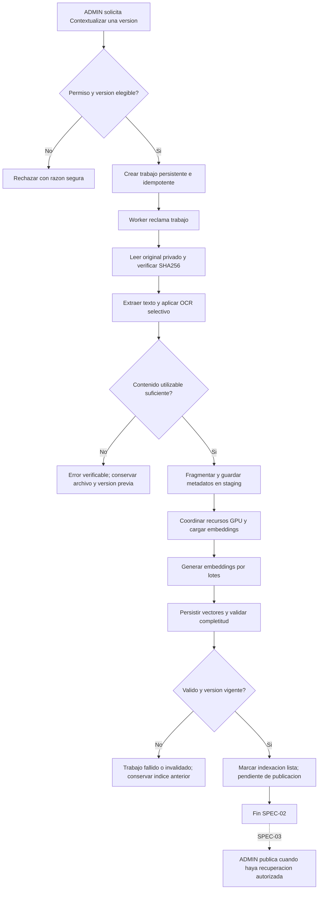

# RAG-SPEC-02 — EXTRACCIÓN, OCR, FRAGMENTACIÓN, CONTEXTUALIZACIÓN Y EMBEDDINGS LOCALES

**Proyecto:** BELLAARTE BOUTIQUE — ERP BAB_VDOS + agente inteligente LENY  
**Subsistema:** LENY RAG V1  
**Documento:** Especificación técnica y funcional de la segunda entrega RAG  
**Versión:** 1.0 — Propuesta para diagnóstico, planificación y aprobación  
**Estado:** `REVIEW` — **NO IMPLEMENTAR SIN APROBACIÓN DEL PLAN**  
**Fecha de referencia:** 19/10/2026  
**Entorno de referencia:** Windows nativo, FastAPI, React/Ant Design, PostgreSQL 17.9, Ollama local  
**Ubicación sugerida:** raíz del proyecto o `specs/RAG/LENY_RAG_SPEC_02_CONTEXTUALIZACION_EMBEDDINGS.md`

**Seguimiento de ejecución 19/10/2026 — IMPLEMENTED, con escenarios reales comprobados:** el propietario aprobó el plan y autorizó el despliegue conservando versiones. Migración0020 aplicada con respaldo anterior al DDL, pgvector0.8.7, OCR local y qwen3-embedding:0.6b ya instalado ejecutado en CPU. Worker manual; contextualización comprobada en el ERP habitual con cuatro fragmentos/cuatro embeddings y versión pendiente de publicación. La carga mediante selector fue aceptada por el propietario. Publicación y recuperación en chat siguen reservadas a SPEC-03; evaluación integral a SPEC-04. Diagnóstico, archivos, pruebas y límites: [reporte](../../documentacion/REPORTE_IMPLEMENTACION_LENY.md), [módulo](../../documentacion/MODULO_LENY.md) y [evidencia](../../documentacion/evidencias/leny_rag02_business_deployment.json). El estado REVIEW del encabezado describe la propuesta original; esta nota registra su ejecución autorizada, sin prometer calidad o seguridad absolutas.

> **Regla principal para Codex:** este archivo es una especificación, **no autorización para implementar ni desplegar**. Primero inspecciona el repositorio, la SPEC-01, la documentación y el reporte reales; elabora un plan técnico por archivos con migraciones, dependencias, decisiones de infraestructura, riesgos y pruebas; **detente y espera aprobación explícita**. No instales extensiones en PostgreSQL empresarial, no apliques migraciones en `bellaarte_db:5432`, no descargues modelos ni cambies servicios globales sin la autorización concreta correspondiente. No deshagas cambios previos del workspace.

---

## 1. CONTEXTO VERIFICADO Y RESTRICCIONES DE CONTINUIDAD

LENY ya dispone de núcleo conversacional con Qwen3.5:4B mediante Ollama, API FastAPI, chat React/NDJSON, historial privado PostgreSQL en esquema `leny`, JWT/Casbin, auditoría y control de concurrencia. La etapa 01.1 añadió controles de especialización, tasa de solicitudes y seguridad conversacional.

**RAG-SPEC-01** implementó gestión de carpetas y documentos, ACL por documento, almacenamiento privado, carga controlada de PDF/DOCX/JPG/PNG, versionado inmutable, previsualización, papelera de diez días, respaldos de BD + archivos y prohibición de publicación sin contextualización.

Según el reporte presentado en este chat, la migración documental **`20261019_0019_leny_documents.py`** ya se habilitó con autorización previa en la base habitual, y la biblioteca ADMIN está disponible. Al redactar la propuesta estaba pendiente la carga desde el selector real del navegador. **Actualización:** el propietario confirmó expresamente que esa prueba ya se realizó y funciona correctamente. Se registra como aceptación del usuario; las pruebas multipart y automatizadas corresponden a verificaciones independientes ejecutadas por el agente.

### 1.1. Archivos de referencia que el agente debe verificar, no presuponer inmutables

- `AGENTS.md`.
- `documentacion/MODULO_LENY.md` y `documentacion/REPORTE_IMPLEMENTACION_LENY.md`.
- `LENY_RAG_SPEC_01_GESTION_DOCUMENTAL.md` o su ubicación real.
- `backend/app/models/leny_documents.py`, `backend/app/models/leny.py`.
- `backend/app/services/leny_document_service.py`, `leny_document_storage.py`, `leny_document_validation.py`, `leny_document_maintenance.py`, `leny_document_backup.py`.
- `backend/app/api/routers/leny_documents.py`, contratos Pydantic, configuración, autorización y auditoría.
- `backend/alembic/versions/20261019_0019_leny_documents.py`, `alembic/env.py` y **head efectivo**.
- `backend/app/services/leny_ollama.py`, `leny_coordination.py`, `leny_service.py` y sus leases/bloqueos actuales.
- `frontend/src/pages/leny/documents/`, `frontend/src/api/lenyDocuments.js`, layout y tema.
- Pruebas de PostgreSQL aislado, seguridad, documentos, backups y regresión del chat.

Las rutas son evidencia del reporte, no instrucciones para duplicar archivos. Inspeccionar diferencias actuales y cambios sin commit antes de planificar.

### 1.2. Secuencia de las cuatro SPECS

| SPEC | Propósito | Resultado esperado |
|---|---|---|
| **RAG-SPEC-01** | Gestión documental y seguridad | Archivos originales, carpetas, ACL, versiones y papelera |
| **RAG-SPEC-02 (esta)** | Procesamiento documental y almacenamiento vectorial | **Extracción + OCR + chunks/metadatos + embeddings + pgvector + trabajos + progreso + validación técnica** |
| RAG-SPEC-03 | Recuperación documental y chat | Generar embedding de la consulta; buscar vectores autorizados; responder desde Qwen con citas; publicación operativa |
| RAG-SPEC-04 | Evaluación integral | Exactitud, Recall@K, fidelidad/citas, ataques documentales, rendimiento, seguridad y regresiones |

**Límite esencial:** al cerrar SPEC-02, los archivos podrán estar **contextualizados y listos para revisión/publicación**, pero Qwen **todavía no debe utilizar esos textos para responder**. La recuperación semántica dirigida al usuario, selección de fuentes para el chat y citas corresponden a SPEC-03. No introducir una búsqueda en el chat “de prueba” como si ya estuviera autorizada.

---

## 2. OBJETIVO DE RAG-SPEC-02

Diseñar y, solo tras aprobar el plan, implementar dentro del módulo LENY del ERP un motor local de **contextualización documental** que extraiga texto de PDF, DOCX e imágenes JPG/PNG mediante OCR cuando corresponda, lo divida en fragmentos trazables, genere embeddings con el modelo **`qwen3-embedding:0.6b`** ejecutado mediante Ollama y los almacene en PostgreSQL con `pgvector`, con procesamiento confiable, progreso visible, gestión conservadora de recursos y reintentos/recontextualizaciones que preserven las versiones e índices previamente válidos.

### 2.1. Resultados obligatorios

1. Modelo exacto `qwen3-embedding:0.6b` instalado/configurado localmente **tras autorización de la ejecución**; sin comparativas de modelos alternativos.
2. Verificación técnica de `pgvector` en PostgreSQL 17.9 **sobre instancia o BD de prueba aislada** antes de migraciones reales.
3. Pipeline de extracción y OCR para formatos ya aceptados por SPEC-01.
4. Fragmentos (*chunks*) con texto, orden y metadatos verificables de procedencia.
5. Representaciones vectoriales correctas en base de datos; coherencia de dimensiones y modelo.
6. Trabajos durables, cancelación segura, recuperación al reiniciar, reintentos e idempotencia.
7. Control de RAM, VRAM, CPU, tiempo y concurrencia compatible con el chat actual.
8. Progreso real y estados claros en el panel documental ADMIN.
9. Mecanismo **Contextualizar** y **Contextualizar de nuevo**; conservar original y versión válida frente a fallos.
10. Índices *staging* y verificación previa al cambio de indexación; preparación para publicación posterior.
11. Seguridad, respaldo y restauración de metadatos, chunks y vectores.
12. Pruebas automatizadas, ensayos reales con Ollama y documentación técnica.

### 2.2. Fuera de alcance estricto

- No elegir, comparar ni descargar otro modelo de embeddings; **el elegido es `qwen3-embedding:0.6b`**.
- No introducir LangGraph, otra API pública FastAPI ni otro ERP.
- No crear una base vectorial separada ni MongoDB para reemplazar el almacenamiento aprobado sin una decisión expresa ante bloqueo comprobado.
- No habilitar búsqueda RAG de usuarios, generación con fuentes ni respuestas documentales del chat: **SPEC-03**.
- No habilitar publicación real mientras no existan recuperación autorizada y verificación de elegibilidad de SPEC-03. Puede quedar **`PENDIENTE_PUBLICACION`**, sin crear una publicación ficticia.
- No crear un servicio externo de embeddings, ni enviar documentos a APIs externas/cloud.
- No implementar comprensión visual general: fotografías sin texto, escenas, bocetos, estilos y diagramas complejos quedan fuera.
- No implementar SQL generado por el LLM, BI, Monte Carlo, ML ni AutoML.
- No instalar Redis por anticipación ni crear colas distribuidas sin justificación/aprobación.
- No ejecutar tareas de ingesta como generación paralela de Qwen en GPU sin coordinación.
- No modificar los roles del ERP, ni alterar arbitrariamente los controles de seguridad de 01.1.

---

## 3. DECISIONES APROBADAS Y TECNOLOGÍAS

### 3.1. Decisión irrevocable de esta entrega: modelo de embeddings

- **Identificador exacto:** `qwen3-embedding:0.6b`.
- **Ejecución:** Ollama local; backend mediante HTTPX existente y endpoint `POST /api/embed`.
- **Sin fine-tuning:** no se entrena el LLM; se calculan representaciones vectoriales.
- **Sin descarga automática al consultar:** instalación del modelo como paso operacional explícito, comprobación de artefacto y prueba de inferencia antes de habilitar contextualización.
- **Sin fallback silencioso** a otro embedding: si el modelo falta, devolver estado controlado y dejar los trabajos pendientes.
- **Coherencia obligatoria:** la misma identidad exacta de modelo, dimensión, política de entradas e instrucciones/versiones de pipeline deberán estar disponibles para indexar documentos **y**, en SPEC-03, las preguntas.

**Dimensión propuesta:** salida completa de **1024 componentes**, que es la dimensión máxima declarada para Qwen3-Embedding-0.6B. El pipeline debe **verificarla mediante una llamada real local** al endpoint Ollama antes de crear o aceptar índices definitivos; registrar dimensión/configuración efectiva. No escoger otra dimensión arbitrariamente ni combinar índices con tamaños distintos. Si el modelo servido no coincide con 1024, parar y documentar la incompatibilidad. No permitir truncamiento silencioso (`truncate=false`, siempre que la versión local de Ollama lo soporte).

**Precaución:** `keep_alive` no representa progreso de carga. No se inventará un porcentaje de “descarga” o “carga GPU”. Las pantallas mostrarán actividad o etapa, y usarán porcentajes únicamente cuando haya unidades de trabajo conocidas.

### 3.2. Almacenamiento vectorial — se implementa AQUÍ

**Tecnología objetivo:** **PostgreSQL 17.9 + extensión `pgvector`**, reutilizando la instancia empresarial y el esquema `leny` existente.

En SPEC-02 deberán materializarse las tablas de: (a) trabajos, (b) corridas de indexación, (c) fragmentos y sus metadatos y (d) embeddings. No basta con dejar un campo `vector` vacío para SPEC-03.

**Puerta de viabilidad bloqueante:**

1. Confirmar binarios, distribución y permisos del PostgreSQL real (Windows/Laragon).
2. Verificar si la extensión `vector` está **disponible** y si puede instalarse con seguridad para esa versión; `pg_available_extensions`, `pg_extension`, `CREATE EXTENSION` **solo en una BD de pruebas autorizada**.
3. Si requiere instalación de binarios nativos, documentar impacto en la instalación PostgreSQL, DLL, compatibilidad Windows y proceso de reversión; **no reemplazar DLL ni alterar producción sin permiso expreso**.
4. Verificar inserción, lectura, dimensiones, comparación de distancia y backup/restore en entorno aislado.
5. Solo después de comprobar compatibilidad, diseñar la migración aditiva siguiente al head real; comprobar permisos y ubicación de extensión/esquema.
6. **Si pgvector no es viable:** **detener y presentar alternativas con consecuencias**. No elegir silenciosamente un motor distinto ni simular que vectores se almacenan correctamente.

**Índices de búsqueda:** para el primer corpus pequeño usar búsqueda **exacta** y claves relacionales normales. No crear HNSW/IVFFlat ni infraestructura aproximada hasta observar volumen y consulta futura real. SPEC-03 evaluará la estrategia de consulta y SPEC-04 medirá calidad/rendimiento.

### 3.3. Stack documental y OCR

- **PDF textual:** reutilizar `pypdf` ya instalado; preservar límites y validaciones de SPEC-01.
- **DOCX:** reutilizar parser validado y seguro de SPEC-01 si es suficiente para obtener párrafos y tablas; evaluar `python-docx` **solo** si existe una carencia específica demostrada, sin habilitar relaciones externas, macros ni contenido activo.
- **JPG, JPEG, PNG:** reutilizar `pyvips`/infraestructura nativa existente para decodificación y preprocesamiento bajo los límites de seguridad.
- **OCR local:** **Tesseract OCR**, con datos de idioma `spa` y `eng` cuando corresponda, en proceso restringido con timeout. Verificar binario, licencia, paquetes de idioma y ejecución real en Windows antes de diseñar rutas definitivas.
- **PDF escaneado:** renderizar solo páginas seleccionadas mediante un componente seguro y limitado; proponer un motor de rasterización compatible con Python 3.10.6/Windows (p. ej., `pypdfium2`), justificándolo y probándolo antes de agregar la dependencia. `pypdf` no hace OCR ni rasteriza páginas.
- **Fragmentación:** implementación modular en Python, preferentemente propia y simple; evitar marcos adicionales de orquestación.
- **Ollama:** reutilizar configuración/conexión segura existente, sin exponer el puerto a la LAN o navegador.

### 3.4. Requisitos de entorno

Hardware de referencia: **Ryzen 5 8645HS; RAM 16 GB DDR5 5600; RTX 4050 6 GB VRAM; SSD M.2 1 TB**. Sistema operativo **Windows nativo** (sin WSL como requisito), Python existente **3.10.6** según el reporte, PostgreSQL **17.9** y Ollama local.

No actualizar Python, PostgreSQL, React o bibliotecas del ERP para acomodar una dependencia marginal sin evaluación y consentimiento. Preferir distribuciones compatibles verificadas y fijadas por versión.

---

## 4. ARQUITECTURA FUNCIONAL

Separar responsabilidades en servicios integrados en el monolito modular:

| Responsabilidad | Contrato esperado |
|---|---|
| Administración de contextualización | Validar rol ADMIN, elegibilidad, operaciones y estados |
| Acceso a originales | Abrir de forma segura **la versión exacta** por contrato de almacenamiento de SPEC-01 |
| Extracción documental | Recuperar texto estructurado por página, sección, párrafo, tabla o imagen |
| OCR | Extraer texto de imagen/PDF escaneado con límites de CPU/RAM/tiempo |
| Fragmentación | Dividir contenido y preservar orden, ubicación, versiones y hashes |
| Adaptador de embeddings | Comunicarse con Ollama `/api/embed`, verificar dimensionado/salida y configurar lotes |
| Repositorio de indexación | Guardar trabajos, fragmentos, vectores y metadatos en PostgreSQL + pgvector |
| Worker de contextualización | Procesar trabajos persistentes y reanudar después de reinicios |
| Coordinador IA | Gestionar uso de Ollama y GPU sin competir con chat Qwen |
| Observabilidad | Registrar estados, errores seguros, métricas y progreso real |

No crear clases vacías o servicios especulativos. Reutilizar interfaces y pruebas implementadas en SPEC-01.

### 4.1. Flujo de la acción **Contextualizar**

El hecho de contextualizar no concede visibilidad a un documento. Solo ADMIN puede gestionar archivos; la consulta documental de los otros roles espera SPEC-03.

### 4.2. Flujo de fallos

- Falló la extracción -> conservar el original/versión y registrar `ERROR_CONTEXTUALIZACION`, motivo seguro y opción de reintento.
- Falló OCR parcialmente -> registrar cobertura/páginas; si falta evidencia esencial o se exceden límites, no certificar contexto completo. Definir criterio de aceptación explícito.
- Falló Ollama -> conservar trabajo y fragmentos de *staging* según política de reanudación; no activar índice incompleto.
- Falló BD -> rollback de lote o indexación, reconciliación segura con archivos/versiones; no ocultar pérdidas.
- Documento movido a papelera o purgado -> cancelar/inutilizar trabajos, impedir nuevas activaciones y limpieza de dependencias consistente con SPEC-01.
- Nueva versión subida -> no confundir bytes ni fragmentos; todo trabajo está vinculado a UUID versión + SHA-256.
- Cancelación ADMIN -> concluir en estado terminal/cancelado y liberar lease; conservar version anterior válida.
- Reinicio del backend o worker -> reconciliar trabajos abandonados usando lease, vencimiento e idempotencia, sin sobrescrituras arbitrarias.

---

## 5. MODELO DE DATOS VECTORIAL Y METADATOS

**Esta sección es requisito de diseño para la migración de SPEC-02.** Los nombres propuestos son conceptuales: se ajustarán a las convenciones reales verificadas.

| Entidad propuesta | Campos/referencias mínimos | Responsabilidad |
|---|---|---|
| `leny.rag_trabajos` | UUID, documento_id, version_id, SHA-256, tipo, solicitud_id, estado, etapa, totales/progreso, intentos, worker_id, lease_until, errores seguros, fechas | Cola durable de contextualización |
| `leny.rag_indexaciones` | UUID, version_id, modelo exacto, digest/manifest, dimensión, configuración/tokenización, `pipeline_version`, `chunking_version`, `ocr_version`, estados, cobertura, chunk_count, fechas | Corrida específica e inmutable de indexación |
| `leny.rag_fragmentos` | UUID, indexacion_id, ordinal, texto, SHA-256 texto, origen, localizador, segmento/carácter de origen, longitud, idioma/confianza OCR cuando exista, fechas | Chunks trazables y ordenados |
| `leny.rag_embeddings` | UUID o PK/FK fragmento, indexacion_id, `vector(1024)` si se confirmó dimensión, modelo/config, fechas | Vector de cada fragmento |

No duplicar tablas de carpetas, documentos, versiones, permisos, conversación ni auditoría si ya existen en SPEC-01. Preferir FK y restricciones de integridad hacia `documento_versiones` y la entidad documento existente.

### 5.1. Metadatos mínimos del fragmento

Cada chunk deberá identificar al menos:

- `documento_id`, `version_id` y `indexacion_id` por relación FK verificable.
- SHA-256 de la versión original y hash del fragmento textual.
- Orden determinista del chunk dentro de la versión.
- Tipo de origen: `PDF_TEXT`, `PDF_OCR`, `DOCX_PARAGRAPH`, `DOCX_TABLE`, `IMAGE_OCR` o equivalentes.
- Localizador: número de página PDF, número de página renderizada OCR, sección/título o identificador de párrafo/tabla cuando corresponda; **no inventar páginas de DOCX**.
- Rangos de párrafo, offsets o referencias técnicas cuando se puedan obtener con fiabilidad.
- Idioma OCR si aplica, parámetros de extracción y texto normalizado, sin alterar códigos, cifras o unidades empresariales.
- Estado y validez de la indexación a la que pertenece.

**Criterio de metadatos:** la SPEC-03 deberá poder mostrar de qué documento/versión/página/sección procede una afirmación y comprobar el permiso del documento antes de entregar la fuente.

### 5.2. Invariantes de persistencia

1. Una indexación pertenece a **una sola versión** de documento. No indexar una entidad lógica mutable sin fijar su versión y hash.
2. El SHA-256 del original al procesar debe coincidir con el registrado en SPEC-01.
3. Indexación y embeddings registran el **modelo exacto** y las dimensiones confirmadas.
4. No mezclar vectores de modelos, dimensiones o configuraciones incompatibles como si fueran equivalentes.
5. `fragmento.ordinal` único por indexación; cada fragmento listo tiene exactamente un vector válido.
6. Vectores con valores no finitos, dimensiones incorrectas, embeddings nulos/incompletos o cardinalidades inconsistentes -> **invalidan** la corrida.
7. Ninguna corrida `STAGING`, `ERROR` o `CANCELADA` es elegible para publicación ni futura recuperación.
8. Una nueva recontextualización no borra ni invalida anticipadamente la indexación anterior válida.
9. La nueva corrida pasa a **VALIDADA/LISTA** solo con verificación completa y estado de versión vigente. Activación/publicación final se coordinará con SPEC-03.
10. Cambios de ACL, papelera y eliminación se verifican antes de iniciar y antes de activar resultados. Un índice de documento revocado jamás concede permiso por sí solo.
11. Mantenimiento y purga deben incluir relaciones de fragmentos/vectores y contemplar trabajos activos; no permitir índices huérfanos recuperables.
12. Reglas de unicidad e idempotencia impiden dos trabajos activos equivalentes de una misma versión y corrida.

### 5.3. Progreso persistente

Persistir por trabajo: `etapa_actual`, `total_paginas_detectadas`, `paginas_procesadas`, `total_fragmentos`, `fragmentos_vectorizados`, `reintentos`, inicio/actualización/finalización, resultado y `last_error_code` seguro.

No guardar textos completos ni embeddings en logs o auditoría. El contenido estará en tablas protegidas de fragmentos/vectores, no en respuestas del endpoint de estado.

### 5.4. Backups

Extender el backup conjunto existente de **PostgreSQL + archivos** a nuevas tablas e índice. Probar recuperación en una BD aislada con extensión compatible, verificando versionado, FK, hashes y conteos de vectores, además de restaurar originales y previsualizaciones. Restaurar un esquema con `vector` requiere que la extensión esté disponible en el destino.

Registrar versión de pgvector y del modelo en el manifiesto de respaldo. Un rollback de DDL no debe destruir datos RAG ni documentos sin plan de respaldo explícito.

---

## 6. EXTRACCIÓN Y NORMALIZACIÓN DOCUMENTAL

### 6.1. PDF textual

- Aplicar validación estructural de SPEC-01 antes de extraer.
- Extraer **por página** cuando sea posible, con número de página y origen.
- Mantener títulos, párrafos, líneas y tablas tanto como permita el extractor; no prometer reconstrucción perfecta de columnas o tablas PDF.
- PDFs escaneados/mixtos: aplicar OCR **únicamente a páginas que realmente lo requieran**, con límites de OCR.
- No abrir enlaces remotos, ejecutar JavaScript ni evaluar acciones incorporadas.
- Si PDF cifrado, dañado, excedido o ilegible: error controlado; el original persiste.

### 6.2. DOCX

- Mantener orden de encabezados, párrafos y tablas relevantes.
- Respetar delimitación de secciones/estilos cuando sea recuperable.
- No interpretar macros, DDE, relaciones externas, imágenes remotas ni elementos activos.
- El documento no tiene una paginación estable independiente del procesador de Word: utilizar secciones/párrafos/tablas, no afirmar número de página inexistente.
- Si contiene imágenes con texto, evaluar **OCR selectivo de imágenes incrustadas** únicamente si puede hacerse sin ampliar superficie de ataque excesiva; documentar alcance y cobertura. El OCR completo y masivo de objetos arbitrarios no es requisito.

### 6.3. JPG/PNG con texto

- Decodificar y normalizar con bibliotecas/controles ya validados en SPEC-01.
- Corregir orientación cuando los metadatos son fiables; opcionalmente contraste/escala sin cambios engañosos.
- Aplicar Tesseract local (`spa` como idioma principal, `eng` como secundario cuando esté disponible).
- Registrar motor/versionado y advertencias de confianza/cobertura si el API permite medirlo.
- Fotografías sin texto utilizable no se contextualizan artificialmente; informar que el análisis visual avanzado está fuera del alcance.

### 6.4. PDF escaneado

- Renderizar páginas de forma acotada a raster temporal seguro, luego OCR.
- Máximo **50 páginas PDF** admitidas por biblioteca SPEC-01, de las cuales inicialmente **20 páginas que requieran OCR** por documento.
- Resolución DPI, memoria/píxeles temporales y procesos simultáneos configurables con defaults conservadores definidos en el plan tras benchmark.
- En documentos mixtos, no imponer OCR a todas las páginas si su texto ya es útil.
- No extender el número máximo de páginas para sortear restricciones sin aprobación.

### 6.5. Normalización segura

- Normalizar Unicode y espacios innecesarios, preservando información de contenido, unidades, códigos de productos, precios y fechas.
- Evitar eliminar signos que distinguen valores: `Bs`, decimales, guiones de código, identificadores, referencias y porcentajes.
- Preservar saltos/separadores lógicos en tablas para no unir columnas equivocadas.
- Documentar transformaciones y mantener hashes del original/fragmentos para trazabilidad.
- Rechazar texto completamente vacío o sin información recuperable suficiente; nunca generar embeddings vacíos como éxito.

---

## 7. FRAGMENTACIÓN (CHUNKING)

Objetivo: generar fragmentos útiles sin romper información empresarial importante.

### 7.1. Estrategia inicial

- Separar por unidad estructural primero: página/sección, encabezado, párrafo y tabla.
- En segundo término aplicar límite de longitud; fragmentos excesivos se subdividen sin perder procedencia.
- Priorizar mantener filas de tablas y sus encabezados juntos cuando quepan.
- Utilizar solapamiento controlado entre chunks para conservar contexto cercano, evitando duplicaciones grandes.
- Configurar una meta orientativa de **350–500 tokens equivalentes** por chunk y **50–80 de solapamiento**, sujeta a mediciones con el tokenizador/modelo efectivo. No tratar un conteo por palabras/caracteres como número exacto de tokens.
- En ausencia de tokenización oficial disponible en el stack, aplicar límites conservadores de bytes/caracteres **sin truncamiento silencioso en Ollama** y registrar la aproximación.
- No sobrepasar el contexto real soportado ni generar lotes grandes únicamente por la ventana teórica de 32K.
- Establecer un máximo configurable de fragmentos/documento y de texto extraído antes de admitir el trabajo.

### 7.2. Calidad mínima de chunks

- Orden determinista y reproducible para el mismo archivo y `chunking_version`.
- Conservar título de sección/encabezado como metadata contextual cuando sea fiable.
- No incluir instrucciones maliciosas como instrucciones del sistema; contenido extraído sigue siendo **datos no confiables**.
- No fragmentos vacíos, con solo caracteres no útiles, o duplicados inadvertidos en un mismo índice; deduplicar cuidadosamente sin destruir referencias.
- No cambiar semántica de tablas de costos, cantidades o medidas al reestructurar.

---

## 8. GENERACIÓN DE EMBEDDINGS CON OLLAMA

### 8.1. API

Usar `POST /api/embed` local con:

- `model="qwen3-embedding:0.6b"`.
- `input`: uno o varios chunks preparados por lote de tamaño conservador.
- `truncate=false`, para detectar textos demasiado extensos, si la versión de Ollama lo soporta.
- `keep_alive` controlado por coordinador; evitar retenciones simultáneas innecesarias.
- Opcionalmente `dimensions=1024` **solo tras validar** la respuesta y compatibilidad real de esta opción en el Ollama instalado.

Validar shape, número de vectores = número de entradas, dimensión = 1024, valores finitos, ausencia de errores por lote y respuesta de modelo esperada. No almacenar errores internos del proveedor en mensajes visibles.

### 8.2. Consistencia documentos vs. consultas futuras

Qwen3 Embedding admite instrucciones para el lado de consulta. En SPEC-02 deberán **definirse y versionarse** la política para entradas documentales y la futura política de preguntas, con pruebas que aseguren coherencia de espacio vectorial. **No generar embeddings de preguntas de usuario en el chat todavía**; esa función será SPEC-03.

No modificar el modelo ni su identidad sin proceso explícito de migración/recontextualización. Documentar qué ocurre si Ollama actualiza pesos/digest con el mismo tag y cómo detectar discrepancias.

### 8.3. Lotes y reintentos

- Inicio recomendado: **lotes pequeños**, por ejemplo 1–4 chunks, ajustables tras medición.
- Batch que falla -> reintentar de manera limitada cuando sea transitorio, con backoff y límite total; no convertir errores permanentes en bucles.
- Comprobar dimensionado antes del primer lote y antes de declarar lista una indexación.
- Persistir lotes de forma transaccional y reanudable, según estrategia idempotente.
- Descartar staging incompleto al reconstruirlo o continuarlo solo cuando exista checkpoint confiable y hashes idénticos.
- Límite global de un procesador de embeddings mientras se pruebe este hardware.

---

## 9. COORDINACIÓN GPU, RAM Y CPU CON EL CHAT EXISTENTE

### 9.1. Principio obligatorio

El modelo conversacional Qwen3.5:4B y el modelo de embeddings no deben competir sin control por la RTX 4050 de **6 GB VRAM**. El módulo de documentos debe **reutilizar o ampliar** el coordinador de LENY sin romper el contrato de streaming, leases, cancelación ni rate limit del chat.

### 9.2. Estrategias a ensayar (mismo modelo de embeddings)

1. **Embeddings en CPU:** si se puede forzar o aislar realmente su ejecución y el consumo de RAM es seguro, Qwen podrá mantenerse en GPU con menor alternancia; medir impacto CPU/latencia.
2. **Alternancia de modelos:** esperar fin de generación, descargar Qwen cuando corresponda, cargar embeddings, procesar lotes, liberar embeddings, devolver disponibilidad conversacional. Usar `keep_alive` o mecanismos documentados y **confirmar estado de carga**, sin asumir que un parámetro garantiza liberar toda la VRAM.

**No comparar otros modelos:** solo se ensaya cómo ejecutar **el mismo `qwen3-embedding:0.6b`** de manera segura. Si ninguna estrategia funciona, registrar bloqueo y presentar una propuesta antes de cambiar hardware, motor o infraestructura.

### 9.3. Política inicial de disponibilidad

- **Chat y procesamiento no generarán simultáneamente en GPU** si la medición indica riesgo de memoria.
- El ERP completo permanece disponible; únicamente operaciones IA incompatibles mostrarán `IA ocupada` o `Contextualización en curso`, con status seguro y reintento apropiado.
- No desplazar trabajos iniciados por otro proceso Ollama ajeno a LENY sin comprobar propiedad/autorización; la coordinación interna solo garantiza exclusión para servicios LENY. Documentar el riesgo residual.
- Definir prioridad/preempción **no destructiva**: trabajos nuevos esperan a terminar la generación activa; un ADMIN puede cancelar una contextualización sin corromper índices. No abortar silenciosamente una respuesta en curso.
- Una generación nueva mientras se contextualiza puede recibir estado de ocupado y espera orientativa; no crear una cola de chat ficticia.
- Liberar lease y recursos ante timeout, error, cancelación, muerte del worker y reinicio. Nunca mantener transacción SQL larga mientras Ollama genera vectores.
- No cambiar parámetros globales de Ollama que afecten otros proyectos sin aprobación independiente.

### 9.4. Medición obligatoria

Registrar (sin contenido documental): tiempos extracción/OCR/embeddings, duración carga del modelo, RAM/VRAM observada, batch size, número de fragmentos, tiempo total, fallos y comportamiento posterior del chat. Distinguir ensayos en CPU de GPU y mediciones frías/calientes.

Los umbrales de consumo/rendimiento se establecerán **antes de ejecutar la suite de aceptación**, después de una línea base acotada en el equipo real. No afirmar que un modelo cabe totalmente en VRAM solo por su tamaño de descarga.

---

## 10. TRABAJOS ASÍNCRONOS DURABLES (SIN REDIS OBLIGATORIO)

Un POST HTTP **no debe mantener abierta** la conexión hasta concluir OCR e indexación. La API creará un trabajo persistente y responderá con su ID; un worker lo procesará en segundo plano.

### 10.1. Diseño recomendado

- PostgreSQL como registro de trabajos y estados, no colas exclusivamente en memoria.
- Worker local controlado, con inicio/parada documentados en Windows; **no debe depender de una tarea en memoria de Uvicorn como único mecanismo fiable**.
- Reclamo atómico de trabajo con transacción corta y control de concurrencia (por ejemplo `SELECT ... FOR UPDATE SKIP LOCKED` o mecanismo equivalente justificado).
- Lease con expiración/heartbeat y reconciliación al reiniciar.
- Recuperación tras interrupción sin doble ejecución activa de una misma versión/pipeline.
- Reintentos explícitos y limitados; `request_id` idempotente para evitar duplicación por doble clic/reenvío.
- Trabajos vinculados a `documento_id + version_id + sha256 + pipeline_version + model_manifest`.
- Si worker no se está ejecutando, mostrar `En espera de procesador` y diagnóstico ADMIN, nunca progreso artificial ni éxito.
- Reservar exactamente **una contextualización intensiva a la vez** al inicio; concurrencia de cargas de archivos es otra cosa.
- Diseñar estado y contratos para posible broker Redis futuro, **sin instalar Redis ahora**.

### 10.2. Estados propuestos del trabajo

`PENDIENTE` → `ESPERANDO_RECURSOS` → `EXTRAYENDO` → `OCR` (si aplica) → `FRAGMENTANDO` → `CARGANDO_MODELO` → `GENERANDO_EMBEDDINGS` → `VERIFICANDO` → `FINALIZADO`.

Estados terminales alternativos: `FALLIDO`, `CANCELADO`, `INVALIDADO`.

El estado de **la versión documental** se coordina con los estados existentes de SPEC-01 (`PENDIENTE_CONTEXTUALIZACION`, `CONTEXTUALIZANDO`, `ERROR_CONTEXTUALIZACION`, `PENDIENTE_PUBLICACION`, otros definidos realmente). No agregar combinaciones contradictorias de estado a varias tablas.

### 10.3. Recontextualización y reemplazo atómico

- Crear **nueva indexación `STAGING`** para la misma versión, sin destruir la anterior.
- Extraer, fragmentar y vectorizar de forma separada.
- Validar que el documento no cambió, no se purgó ni perdió elegibilidad para la operación.
- Verificar completitud de chunks y vectores, coherencia de metadatos y versión del modelo.
- En una transacción corta, activar/referenciar la corrida nueva verificada y desactivar la anterior **solo si la política de publicación lo permite**. Si hay una versión publicada con un índice en servicio, su visibilidad continúa asociada al índice anterior hasta que SPEC-03 pueda garantizar conmutación segura.
- Si falla, mantener el índice anterior íntegro y la nueva corrida marcada fallida (o limpiar staging con trazabilidad).
- Cancelar trabajo activo no implica retirar original ni versiones ya validadas.
- Con una versión todavía no publicada, `PENDIENTE_PUBLICACION` solo significa que **la contextualización técnica finalizó**. La aprobación ADMIN seguirá bloqueada hasta estar implementada la recuperación en SPEC-03.

---

## 11. FRONTEND REACT — EXPERIENCIA «CONTEXTUALIZAR»

Reutilizar `/app/leny/documents`, estilos del ERP (React + Ant Design, paleta verificada) y componentes reales de SPEC-01. No crear otra aplicación.

### 11.1. Interacciones ADMIN

- Mostrar botón **Contextualizar** en documentos/versiones válidos pendientes o con error.
- Mostrar **Contextualizar de nuevo** en versiones que ya fueron procesadas, previa confirmación y explicación de que la indexación anterior se conservará hasta una nueva validación.
- Mostrar estado por documento y por versión; evitar mostrar una versión provisional como publicada.
- Permitir **Cancelar contextualización** cuando el trabajo lo permita; cancelación idempotente.
- Permitir refrescar/recuperar estados al navegar, recargar o cerrar y volver a abrir el ERP.
- Mostrar información técnica ADMIN: modelo exacto, cantidad de fragmentos, fecha, páginas/elementos procesados, etapa y advertencias.
- Mostrar **pendiente de publicación** cuando corresponda, sin habilitar lectura RAG en el chat todavía.
- Ningún usuario de los otros cuatro roles accede a controles/documentos administrativos.

### 11.2. Progreso real

Diseñar pantalla o modal con etapas y métricas:

1. `Preparando documento` (indeterminado hasta verificar cantidad).
2. `Extrayendo texto` (páginas/elementos procesados de un total conocido).
3. `Reconociendo texto (OCR)` (páginas/imágenes procesadas, si aplica).
4. `Preparando fragmentos` (contador de chunks).
5. `Cargando modelo de embeddings` (spinner/estado indeterminado; **no inventar porcentaje GPU**).
6. `Contextualizando fragmentos` (chunks o lotes completados / total fijo).
7. `Verificando contextualización` (recuento e integridad).
8. `Contextualización terminada` / `Error` / `Cancelada` / `En espera`.

No sumar subporcentajes ficticios para aparentar un progreso global preciso. Usar barra por etapa con total fiable; para otras etapas mostrar actividad y tiempos reales medidos si existen.

### 11.3. Transporte

Proponer endpoints autenticados **bajo la convención real** del router documental existente:

| Operación conceptual | Ruta orientativa | Acceso |
|---|---|---|
| Solicitar contextualización | `POST /api/v1/leny/documents/{id}/versions/{version_id}/contextualizations` | ADMIN |
| Estado de trabajo/progreso | `GET /api/v1/leny/contextualizations/{job_id}` | ADMIN |
| Consultar últimas indexaciones de versión | `GET /api/v1/leny/documents/{id}/versions/{version_id}/contextualizations` | ADMIN |
| Cancelar trabajo | `POST /api/v1/leny/contextualizations/{job_id}/cancel` | ADMIN |
| Comprobar preparación del modelo/worker | `GET /api/v1/leny/admin/rag/status` | ADMIN |

Preferir polling limitado y configurado inicialmente (por ejemplo cada 1–2 s mientras esté abierto un progreso); evitar WebSocket/SSE adicionales sin justificación. Reutilizar cliente Axios, refresh JWT, errores seguros y pruebas actuales. No bloquear botones del ERP ajenos a LENY.

---

## 12. SEGURIDAD, PERMISOS Y AISLAMIENTO

### 12.1. Roles

Conservar exactamente los **cinco roles oficiales**:

- `ADMIN`.
- `CAJA`.
- `INV_BOUTIQUE`.
- `INV_TALLER`.
- `MODISTA`.

El reporte consigna un código `DOC` **preexistente en datos históricos**, excluido de políticas LENY; **no crearlo, promoverlo, borrarlo ni renombrarlo** como parte de SPEC-02. No modificar los roles oficiales ni las políticas del ERP ajenas al módulo.

**Acciones de contextualizar, reintentar, cancelar, ver diagnóstico y ver índice provisional: exclusivamente ADMIN**, mediante JWT/Casbin comprobados en backend. Mantener `leny:admin` o las reglas específicas que mejor encajen con el código real; no conceder a los otros roles más permisos por adelantar SPEC-03.

### 12.2. Archivos y OCR

- Abrir originales únicamente mediante el servicio privado y contratos de SPEC-01; nunca paths del navegador.
- Los archivos son entradas **no confiables** incluso si los subió ADMIN.
- Aplicar límites de tamaño comprimido y descomprimido, cantidad de páginas, píxeles, tiempo, CPU/RAM y texto máximo.
- Ejecutar OCR/renderizado en proceso restringido con timeout, rutas temporales seguras, sin descargar recursos externos y sin ejecutar macros/scripts.
- Reutilizar Job Objects / protecciones OS de SPEC-01 si funcionan; si no ofrecen aislamiento suficiente, declarar riesgo residual. No fingir antivirus ni CDR.
- Limpiar temporales y resultados parciales en cancelación/reintento, conservando registros de error.
- No registrar contenido completo de documentos ni vectores en logs de observabilidad.

### 12.3. Prompt Injection documental

Textos encontrados en archivos nunca se promueven a mensajes `system` ni instrucciones de herramientas. SPEC-02 **no envía esos textos al LLM generativo**. Guardar contenido como datos, no ejecutar instrucciones embebidas. Las defensas de salida y recuperación final son parte de SPEC-03/04.

### 12.4. Consulta de vectores

Aunque se materialice el almacenamiento vectorial, **no abrir un endpoint público de búsqueda sobre todos los chunks**. El recuperador posterior deberá aplicar desde el backend ACL, estado `ACTIVO`, versión publicada, ausencia de papelera/revocaciones, y asociación entre índice y modelo.

Cualquier endpoint diagnóstico debe requerir ADMIN, estar acotado y no devolver texto de otros ámbitos por error. No convertir índices *staging* en datos disponibles para el chat.

---

## 13. LÍMITES DE PROCESAMIENTO INICIALES

Reutilizar sin ampliar los límites aprobados en SPEC-01:

| Tipo | Máximo de original | Reglas complementarias |
|---|---:|---|
| PDF | 10 MiB y 50 páginas | OCR para un máximo inicial de **20 páginas que necesiten OCR** |
| DOCX | 10 MiB | Limitar ZIP descomprimido, tablas/objetos, texto extraído y tiempo |
| JPG/JPEG/PNG | 5 MiB | Hasta 12 megapíxeles decodificados |

**Límites adicionales a definir en el plan y registrar en Settings:** páginas OCR/DPI, píxeles de render, tiempo OCR por página, texto máximo extraído, fragmentos máximos por documento, tokens equivalentes por chunk, batch de embeddings, reintentos, tiempo total por trabajo, concurrencia, CPU/RAM, límite de disco para staging e índice.

Los valores deben justificarse con medición y configuración; no inventar límites que se anuncien como capacidad física del modelo. Un PDF de 1 MB puede exigir más recursos que un DOCX de 10 MB.

---

## 14. REQUISITOS FUNCIONALES — RF

| ID | Requisito verificable | Prioridad |
|---|---|---|
| `RAG2-RF-01` | ADMIN solicita contextualización de una versión elegible y recibe un trabajo identificado | Alta |
| `RAG2-RF-02` | Se verifica original, versión y SHA-256 antes del procesamiento | Alta |
| `RAG2-RF-03` | Se extrae texto PDF manteniendo localizadores de página | Alta |
| `RAG2-RF-04` | Se extrae texto DOCX conservando párrafos, títulos y tablas pertinentes | Alta |
| `RAG2-RF-05` | Se aplica OCR local a JPG/PNG con texto | Alta |
| `RAG2-RF-06` | Se aplica OCR selectivo a PDFs escaneados dentro del límite autorizado | Alta |
| `RAG2-RF-07` | Se rechazan contenidos vacíos/ilegibles y se conservan archivos originales | Alta |
| `RAG2-RF-08` | Se generan chunks reproducibles, ordenados y trazables al documento | Alta |
| `RAG2-RF-09` | Ollama genera embeddings solo con `qwen3-embedding:0.6b` | Alta |
| `RAG2-RF-10` | Los embeddings se validan y guardan en PostgreSQL + pgvector | Alta |
| `RAG2-RF-11` | Se registra identidad/digest/dimensiones y versión de pipeline por índice | Alta |
| `RAG2-RF-12` | Trabajos persistentes se reanudan o recuperan ante fallos/reinicio | Alta |
| `RAG2-RF-13` | Progreso y estados reales se muestran en la biblioteca ADMIN | Alta |
| `RAG2-RF-14` | ADMIN cancela o reintenta un trabajo de manera segura | Alta |
| `RAG2-RF-15` | ADMIN recontextualiza sin destruir índices anteriores válidos | Alta |
| `RAG2-RF-16` | Trabajos de un documento eliminado/revocado se invalidan y no activan | Alta |
| `RAG2-RF-17` | Se limita la competencia de recursos entre embeddings y chat Qwen | Alta |
| `RAG2-RF-18` | Índices completos quedan pendientes de publicación, sin acceso al chat | Alta |
| `RAG2-RF-19` | Auditoría registra acciones/estados sin contenido sensible | Alta |
| `RAG2-RF-20` | Backups incluyen esquema vectorial y permiten restauración verificable | Alta |
| `RAG2-RF-21` | Chat, historial, streaming, roles y biblioteca SPEC-01 mantienen funcionalidad | Alta |
| `RAG2-RF-22` | Se documentan instalación local, operación del worker, mantenimiento y límites | Alta |

---

## 15. REQUISITOS NO FUNCIONALES — RNF

| ID | Área | Condición |
|---|---|---|
| `RAG2-RNF-01` | Privacidad | Inferencia de embeddings/OCR sin servicios externos ni Internet en operación |
| `RAG2-RNF-02` | Seguridad | Ninguna operación de contextualización accesible a roles no ADMIN; sin fuga de texto/índices |
| `RAG2-RNF-03` | Consistencia | No pérdida de originales, versiones o índices activos tras fallos |
| `RAG2-RNF-04` | Trazabilidad | Todo chunk tiene procedencia/versionado y todas las corridas modelo/config |
| `RAG2-RNF-05` | Calidad técnica | Dimensionado, cardinalidad, hashes, valores finitos y completitud antes de validación |
| `RAG2-RNF-06` | Recursos | RAM/VRAM/CPU/lotes/tiempos acotados y medidos en el equipo de referencia |
| `RAG2-RNF-07` | Disponibilidad | Caída del worker/Ollama no inutiliza el ERP ni corrompe biblioteca |
| `RAG2-RNF-08` | Recuperación | Trabajos abandonados recuperables y cancelación/reintento idempotente |
| `RAG2-RNF-09` | Compatibilidad | Python 3.10.6/Windows nativo/stack vigente; migraciones aditivas posteriores al head real |
| `RAG2-RNF-10` | Usabilidad | Estados/progreso legibles y no ficticios; interfaz visual consistente |
| `RAG2-RNF-11` | Backup | BD + índices vectoriales + originales recuperables y verificados juntos |
| `RAG2-RNF-12` | Evolución | SPEC-03 consumirá solo índices validados/publicables con consultas autorizadas |

---

## 16. CASOS DE USO

| Código | Caso | Actor | Resultado |
|---|---|---|---|
| `RAG2-CU-01` | Solicitar contextualización | ADMIN | Trabajo persistente validado |
| `RAG2-CU-02` | Consultar progreso | ADMIN | Estado/contadores reales |
| `RAG2-CU-03` | Contextualizar PDF textual | ADMIN | Chunks y vectores con páginas |
| `RAG2-CU-04` | Contextualizar DOCX | ADMIN | Chunks y vectores con secciones/tablas |
| `RAG2-CU-05` | Contextualizar imagen | ADMIN | Texto OCR contextualizado |
| `RAG2-CU-06` | Contextualizar PDF escaneado | ADMIN | Texto OCR selectivo y metadatos |
| `RAG2-CU-07` | Cancelar o reintentar | ADMIN | Estado consistente sin pérdida |
| `RAG2-CU-08` | Recontextualizar versión | ADMIN | Nuevo índice validado, anterior protegido |
| `RAG2-CU-09` | Inspeccionar estado técnico | ADMIN | Diagnóstico sin datos protegidos |
| `RAG2-CU-10` | Solicitar sin permiso | Otro rol/externo | 401/403/404 sin información sensible |
| `RAG2-CU-11` | Restaurar tras fallo | Operación controlada | Reconciliación de trabajos y archivos |

---

## 17. PRUEBAS OBLIGATORIAS

### 17.1. Verificaciones previas / infraestructura

- Verificar estado real de SPEC-01, incluido el pendiente del selector de archivos.
- Modelo exacto instalado y `ollama list`; `/api/embed` real sobre texto sintético sin datos comerciales.
- Dimensión **1024**, vector finito y respuesta con un embedding por entrada; fallo si el modelo retorna algo incompatible.
- Ollama en loopback, sin nubes, proxies ni descargas involuntarias.
- `pgvector` comprobado en BD **aislada**, extensión, compatibilidad PostgreSQL 17.9/Windows, operador de similitud y tipo vectorial.
- Ensayo de backup y restauración de tablas vectoriales y originales en BD nueva.

### 17.2. Extracción y OCR

- PDF textual válido por página; PDF sin texto; PDF mixto; PDF escaneado dentro de límites y sobre límite de 20 páginas OCR.
- DOCX con títulos, párrafos, tablas, tablas extensas, encabezados duplicados y caracteres especiales bolivianos.
- Imagen con texto claro en español, imagen rotada, imagen sin texto, JPG/PNG dañados y archivos con megapíxeles al límite.
- OCR con `spa`/`eng` ausente, ejecutable ausente, timeout, fallos parciales y extracción vacía.
- PDFs/ZIP maliciosos, relaciones externas, recursos excesivos, fuzzing prudente con corpus sintético aislado.
- Revisión de texto extraído con ejemplos conocidos; no declarar OCR exacto sin evidencia.

### 17.3. Fragmentos y vectores

- Chunks reproducibles para mismo original/version de pipeline.
- Orden, offsets/páginas/secciones y hashes preservados; números/moneda/medidas no alterados.
- No truncamiento silencioso, batches controlados, cardinalidad uno-a-uno.
- Vectores de dimensión errónea, NaN/Inf, incompletos, mal ordenados o modelo distinto rechazados.
- Indexación lista solo con **todos** los fragmentos y embeddings y validación de modelo.
- Evaluación técnica de recuperación exacta **solo sobre datos sintéticos de prueba**, sin abrir API de RAG al usuario (SPEC-03 medirá y aplicará ACL de recuperación).

### 17.4. Trabajos, concurrencia, integridad

- Dos clics iguales -> un trabajo lógico (idempotencia durable).
- Dos workers intentan mismo trabajo -> solo uno lo reclama; no doble indexación.
- Reinicio worker en extracción/OCR/mitad de vectorización -> estado reconciliado; indexación incompleta no activa.
- Error de disco/BD/Ollama -> original preservado; recuperación y cleanup.
- Documento a papelera o purgado durante OCR -> resultado no elegible y tareas canceladas/invalidas.
- Subir nueva versión durante trabajo -> resultado ligado a versión correcta y no se activa como versión nueva.
- Recontextualización de índice válido fallida -> índice anterior intacto.
- Cancelación durante batch -> liberar recursos y estado terminal sin perder índice anterior.
- Trabajo sin worker activo -> `esperando` visible, no “procesando 99 %”.
- La corrida exitosa permanece no publicada hasta SPEC-03.

### 17.5. Seguridad y frontend

- JWT/Casbin: solo ADMIN puede contextualizar/ver progreso/cancelar/reintentar.
- `DOC` preexistente y cuatro roles operativos sin permiso de administración.
- IDs forjados, versiones ajenas, carpetas eliminadas, rutas físicas no expuestas.
- Mensajes extraídos maliciosos no se interpretan como instrucciones de sistema.
- React: botón, confirmación, estados, polling, refresh JWT, desconexión, cancelación, errores y vista móvil.
- Regresión: chat NDJSON, tasa de solicitudes, seguridad LENY 01.1, biblioteca SPEC-01, papelera, versiones, ACL y backups.

### 17.6. Rendimiento real

En el equipo de referencia, medir:

- CPU/RAM/VRAM antes/durante/después de OCR, embeddings y conversación.
- Cold start de embeddings y duración lote.
- PDF textual representativo, DOCX con tablas, imagen OCR y PDF escaneado permitido.
- Tiempo por documento y tiempo por chunk.
- Comportamiento del chat durante/tras un trabajo, liberación de lease y uso posterior de Ollama.
- Riesgos por retener modelos y límites de memoria, con evidencias en vez de cifras inventadas.

---

## 18. CRITERIOS DE ACEPTACIÓN

| Código | Criterio | Evidencia mínima |
|---|---|---|
| `AC-01` | Verificación de SPEC-01 y dependencias | Reporte de arquitectura, brechas y pendiente E2E de carga |
| `AC-02` | Embedding exacto configurado | Prueba real Qwen3-Embedding-0.6B y dimensión confirmada |
| `AC-03` | PostgreSQL + pgvector operativo | DDL/inserción/lectura aisladas, backup/restore |
| `AC-04` | Extraer PDF/DOCX con origen | Corpus conocido con localizadores correctos |
| `AC-05` | OCR local de imágenes y PDFs escaneados | Archivos de prueba, cobertura/errores documentados |
| `AC-06` | Fragmentar de forma trazable | Hash, orden, tabla/ubicación y validación de límites |
| `AC-07` | Vectorizar todas las unidades válidas | Recuento exacto chunks/vectores, dimensiones y modelo |
| `AC-08` | Trabajos persistentes y recuperables | Reinicio, idempotencia, interrupciones y sin índices incompletos |
| `AC-09` | Progreso y recontextualización | UI real, etapas genuinas, reintento, conservación de índice |
| `AC-10` | Protección de recursos | Mediciones RAM/VRAM y chat disponible sin corrupción |
| `AC-11` | Seguridad e integridad | JWT/Casbin, ACL de original, papelera, no publicación RAG prematura |
| `AC-12` | No regresiones y documentación | Backend/DB/React/build/lint y operaciones Windows documentadas |

**Cierre formal:** declarar `IMPLEMENTED` solo con código realmente integrado y `VALIDATED` únicamente cuando todos los criterios aplicables dispongan de evidencia verificable. La publicación desde ADMIN y la recuperación de respuestas con fuentes siguen reservadas para SPEC-03. No presentar como aprobada una prueba que no se pudo ejecutar.

---

## 19. SECUENCIA DE TRABAJO OBLIGATORIA PARA CODEX

### A. Diagnóstico técnico sin cambios

1. Revisar repositorio y estado Git; verificar SPEC-01, implementación real, reportes y endpoints.
2. Inspeccionar rutas de biblioteca, versiones, estado, ACL, backups, parsers, workers y leases.
3. Verificar Python/Windows, Ollama, PostgreSQL y posibilidad de pgvector **sin alterar BD habitual**.
4. Enumerar bloqueantes y decisiones técnicas por resolver; confirmar pendientes E2E de SPEC-01.

### B. Plan técnico por archivos y pedir autorización

Entregar:

- Mapa de archivos a crear/modificar y contratos de integración reales.
- Dependencias nuevas y compatibilidad con Python/Windows sin actualizaciones destructivas.
- Diseño relacional final, extensión pgvector, dimensión, índices/constraints, head Alembic previsto y rollback.
- Diseño de extracción PDF/DOCX/OCR, chunking, metadatos y límites.
- Adaptador del modelo exacto y gestión de CPU/GPU.
- Worker durable, estados, idempotencia, recuperación, cancelación y control de concurrencia.
- Endpoints, modelos Pydantic, permisos y componentes React/progreso.
- Política de staging, recontextualización, backup/restore, purga y papelera.
- Matriz de pruebas, medición de rendimiento y criterios de aceptación.
- Plan de despliegue y comprobación de BD **aislada** vs. **empresarial**.
- Lista de exclusiones para no implementar SPEC-03/04 prematuramente.

**DETENERSE. Esperar aprobación explícita del usuario antes de escribir código o instalar modelos, extensión o dependencias.** Si pgvector exige manipulación del servidor compartido, solicitar autorización **específica** para esa operación y nunca reutilizar permisos antiguos de despliegue como autorización nueva.

### C. Implementación aprobada

- Avanzar incrementalmente por extracción → OCR → chunks → embeddings → DB → trabajos/progreso → UI, pero permitir ajustar el orden técnico si hay dependencias reales documentadas.
- Migraciones **aditivas** sobre head real, sin reescribir `0019` ni alterar tablas comerciales.
- Preservar cambios ajenos y roles reales, sin seeds empresariales ni purgas de producción.
- Documentar cualquier diferencia frente a la SPEC antes de tomar una decisión material.

### D. Pruebas y aceptación

- Pruebas deterministas y aislamientos de subprocess/worker; pruebas reales de Ollama/pgvector/OCR en entorno aislado.
- Ejecutar la regresión completa relacionada con LENY y módulos sensibles.
- Validación manual del panel ADMIN, estados y carga real del navegador si el responsable dispone de acceso.
- Reportar cualquier test pendiente o no ejecutado, sin declarar validación integral engañosa.

### E. Entrega final

Entregar inventario completo, migraciones y ubicación, configuración, pruebas (número real), duración, evidencias, screenshots sin secretos, métricas de memoria/tiempo, riesgos, rollback, instrucciones Windows y criterios de aceptación. Actualizar `documentacion/MODULO_LENY.md`, reporte, evidencias y anotación de estado de SPEC-02; no marcar `VALIDATED` sin aceptación.

---

## 20. INTEGRACIÓN FUTURA DE LAS SIGUIENTES SPECS

**SPEC-03 — Recuperación semántica y chat:** el motor RAG deberá poder obtener únicamente índices validados de versiones **publicadas** y documentos **ACTIVOS**, aplicar ACL efectiva antes de retornar fragmentos, vectorizar consultas con **el mismo** Qwen3-Embedding-0.6B y parámetros compatibles, construir respuestas con Qwen generativo, mostrar fuentes/citas autorizadas y habilitar aprobación/publicación ADMIN tras comprobar la elegibilidad completa. Si un documento pasa a papelera o cambia permiso, la visibilidad para nuevas consultas se actualiza inmediatamente; ningún cambio de índice vulnera la seguridad del ERP.

**SPEC-04 — Evaluación integral:** medir Recall@K, exactitud, fidelidad, respaldo real de citas, seguridad documental/prompt injection, errores OCR, latencia, uso de VRAM/CPU, backup/restore, condiciones adversariales, regresión y criterios objetivos de calidad. SPEC-02 realiza sus propias pruebas técnicas pero no presume calidad semántica global ya aprobada.

### 20.1. No confundir tres conceptos

- **Subido:** original seguro y versión registrados en SPEC-01.
- **Contextualizado:** texto, fragmentos y embeddings **validados** en SPEC-02.
- **Publicado y consultable por LENY:** aprobación ADMIN + búsqueda y autorización operativas en SPEC-03.

Los estados deberán reflejar esta diferencia de forma inequívoca.

---

## 21. PREGUNTAS DE VIABILIDAD QUE CODEX DEBE RESOLVER EN EL PLAN

1. ¿Está `pgvector` instalado o es viable habilitarlo sobre PostgreSQL 17.9 en Windows sin alterar la instancia empresarial antes de autorización?
2. ¿Cuál es la ubicación exacta de la extensión en el servidor y las implicaciones del respaldo/restauración?
3. ¿Cómo se controlará CPU/GPU sin desconectar impropiamente otras aplicaciones que utilicen Ollama?
4. ¿Cómo se ejecutará y recuperará el worker en Windows nativo, después de reinicio y fuera del ciclo de Uvicorn?
5. ¿Los parsers ya implementados permiten extraer estructura DOCX suficiente y qué herramienta rasterizará PDF OCR con seguridad?
6. ¿Cómo se mapeará el estado de procesamiento con los estados físicos existentes de `leny.documento_versiones`?
7. ¿Cómo se invalidarán trabajos durante papelera, eliminación, cambio de versiones, restauración y cambios ACL?
8. ¿Cómo se garantizará que una corrida nueva no haga perder la indexación anterior válida?
9. ¿Qué evidencia faltante de SPEC-01 se debe completar antes de certificar la nueva experiencia?
10. ¿Qué umbrales medidos serán razonables para 16 GB RAM, 6 GB VRAM y 1 procesador IA concurrente?

**Si aparece un bloqueante relevante, presentar alternativas y esperar la decisión; no improvisar librerías, estados ni despliegues.**

---

## 22. REFERENCIAS TÉCNICAS VERIFICABLES

- Ollama, modelo seleccionado: https://ollama.com/library/qwen3-embedding:0.6b
- Ollama, API de embeddings: https://docs.ollama.com/api/embed
- Ollama, FAQ y administración de modelos: https://docs.ollama.com/faq
- Qwen, ficha del modelo/dimensión: https://huggingface.co/Qwen/Qwen3-Embedding-0.6B
- pgvector, instalación y consultas vectoriales: https://github.com/pgvector/pgvector
- PostgreSQL, bloqueos para trabajos: https://www.postgresql.org/docs/17/sql-select.html
- Tesseract OCR, uso e idiomas: https://tesseract-ocr.github.io/tessdoc/Command-Line-Usage.html
- Tesseract OCR, instalación Windows: https://tesseract-ocr.github.io/tessdoc/Installation.html

Estas fuentes sustentan el diseño, **no sustituyen la verificación del estado real en la laptop y el ERP**. Las tecnologías están seleccionadas dentro del alcance; su disponibilidad técnica concreta sigue siendo una condición de la planificación.

---

**FIN — RAG-SPEC-02 / LENY RAG V1**
